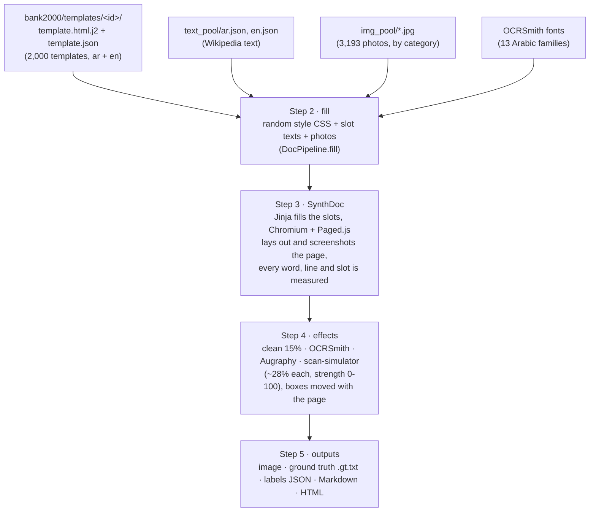

# OCRREADME: how a training page is made, step by step

This document follows one page from an empty template to a finished OCR training sample. For every step
it says what goes in, what comes out, which file does it, and the exact arguments given to each library
(SynthDoc, OCRSmith, Augraphy, scan-simulator). The examples are real: they were produced by this code
from template `g_0003` with seed 42 (Arabic, OCRSmith effects), unless a section says otherwise.

[README.md](README.md) is the overview. This file is the detailed explanation.

**Contents**

0. [The final version in short](#0-the-final-version-in-short) (read this first: what changed, and where)
1. [The whole path in one picture](#1-the-whole-path-in-one-picture)
2. [Which program runs where (environments)](#2-which-program-runs-where-environments)
3. [Step 1: templates, and how they are stored](#3-step-1-templates-and-how-they-are-stored)
4. [Step 2: text, style and pictures go in](#4-step-2-text-style-and-pictures-go-in)
5. [The text: where Wikipedia text comes from and its format](#5-the-text-where-wikipedia-text-comes-from-and-its-format)
6. [Step 3: SynthDoc renders the page and measures it](#6-step-3-synthdoc-renders-the-page-and-measures-it)
7. [What happens inside the browser before the page is laid out](#7-what-happens-inside-the-browser-before-the-page-is-laid-out)
8. [Step 4: effects (OCRSmith, Augraphy, scan-simulator)](#8-step-4-effects-ocrsmith-augraphy-scan-simulator)
9. [Step 5: the outputs (image, labels, Markdown, HTML)](#9-step-5-the-outputs-image-labels-markdown-html)
10. [How to use it: commands and Python examples](#10-how-to-use-it-commands-and-python-examples)
11. [Seeds and reproducibility](#11-seeds-and-reproducibility)
12. [Rules that keep the labels honest](#12-rules-that-keep-the-labels-honest)
13. [Known limits](#13-known-limits)
14. [File map](#14-file-map)

---

## 0. The final version in short

Sections 1–14 explain each step in depth. Several steps were extended for the final version; this section
says what each one does now. Where it disagrees with a later section, this one is current.

### 0.1 The template bank: `bank2000/`

```
bank2000/
  templates/b_0001/template.html.j2    the page, {{ slot_N }} and {{ pic_N }} placeholders
  templates/b_0001/template.json       slots, pictures (id + hint), lang, source, source_template, features
  index.jsonl                          one line per template: id, source, lang, slots, pictures, structure_hash
  report.json                          how the bank was built: candidates, screened, passed, kept, rejections
```

Built by [src/bank2000.py](src/bank2000.py) (`python -m src.bank2000 --workers 6`):

| Step | What happens |
|---|---|
| candidates | grammar: 3,000 new rich-grammar templates; WebSight v0.1 and DocLayNet: 4,000 each from the full bank; WebSight v0.2: 3,298 converted Tailwind pages ([src/from_websight2.py](src/from_websight2.py)) |
| adapt | language alternates ar/en (grammar and DocLayNet use logical CSS, so only `<html lang dir>` changes; WebSight v0.1 CSS is flipped back to left-to-right by rtlcss for English; WebSight v0.2 pages got their language when converted). Every grey picture box becomes `<div class="pic-frame"></div>`, with a hint (`"team photo"`, `"food"`) taken from the original page. A page with a web address in it (a background photo loaded from the internet) is left out |
| diversity | farthest-first on layout features (page skeleton and layout CSS for flowing pages, box positions for DocLayNet, slot roles, picture count): each next template is the one least like everything taken; anything sharing 75% or more of its features with a taken one (Jaccard) is never taken; equal structure hashes are dropped |
| screening | each candidate is rendered once by the real generator (random style, theme, text, pictures) and kept only if the page passes every check of [pipeline/qa.py](pipeline/qa.py) |
| quotas | the first passing ones per source: grammar 500, WebSight v0.1 450, WebSight v0.2 450, DocLayNet 600 |
| top-up | if fewer than 2,000 passed: more candidates of each source (unlike every template already taken), then LLM templates (saved ones, then new ones from Groq), screened the same way (`--top-up` runs only this) |
| validation | every template: `lang` and `<html lang dir>` agree; slot and picture ids are `slot_0…`, `pic_0…`; the Jinja variables are exactly the slots, pictures and `style`; no `http` or `<script>`; it renders |

The build (`bank2000/report.json`, 24 minutes with 6 workers):

| Source | Candidates | Screened (most diverse) | Passed | Kept | Arabic / English |
|---|---|---|---|---|---|
| grammar | 3,000 | 850 | 798 | 500 | 259 / 241 |
| WebSight v0.1 | 4,000 | 765 | 609 | 450 | 200 / 250 |
| WebSight v0.2 | 3,298 (2,360 usable) | 765 | 664 | 450 | 217 / 233 |
| DocLayNet | 4,000 | 1,020 | 952 | 600 | 280 / 320 |
| **total** | | | | **2,000** | **956 / 1,044** |

No template is invalid, no two share a structure hash, and the most alike pair of all 2,000 shares 41% of
its layout features (the limit was 75%). 1,191 templates have `` picture slots. The top-up was not
needed. Most rejections were words hidden by the template's CSS, covered by a picture, or (DocLayNet,
before the ink-overflow fix of 0.5) letters clipped by tight boxes.

`DocPipeline` uses `bank2000/` by default. `DocPipeline(..., bank="old")` uses the 113,077-template bank in
`templates/`; `bank=<folder>` any folder with `index.jsonl` and `templates/`.

### 0.2 Picking a template

`DocPipeline.template(rng, name, lang)` keeps the templates of the wanted language (50% Arabic, 50% English
by default), picks a source (all four equally often, or as `sources=` says), then a template of it. With
`templates="llm"` (the generator page's **Template maker: LLM**) Groq writes a new page; it is converted like
a WebSight page and then adapted like a bank template (language, `` picture slots).

### 0.3 Filling: text and pictures

- **Text** comes from one Wikipedia article per page (document mode of `TextPool`): the article's title goes
  in the first title slot, then its sentences in order; a slot that wants a short text gets a whole short
  sentence or the start of one; when an article runs out the next one starts with its title. Cells and form
  fields still get numbers, dates, phone numbers and amounts some of the time.
- **Pictures:** each `{{ pic_N }}` gets a `file:///` address of a photo from `img_pool/` whose category
  matches the slot's hint (`ImagePool.pick(rng, hint)`; a hint like "chef", "pizza" → food, "team",
  "doctor" → people, "office", "building" → architecture; no match → any photo). Solid-colour boxes the
  converters could not name as pictures (a blue `.logo` square) get a photo in the browser.

### 0.4 Styling

The typography of section 4.2 plus a **theme** ([pipeline/themes.py](pipeline/themes.py)), recorded in the
label's `theme`:

| Choice | Values |
|---|---|
| accent colour | 13 dark, readable colours |
| headings | plain, accent colour, underline, side bar, tinted band, rule above |
| tables | grid, striped rows, tinted header, rules only, boxed |
| boxes (side boxes, callouts, cards) | tint, side bar, outline, plain |
| page | white, off-white, light tint of the accent |
| lists | disc, square or circle bullets |
| spacing | paragraph and heading gaps |

DocLayNet layouts get colours only (their boxes have fixed sizes). WebSight pages keep their own design; in
the browser every colour is turned around the colour wheel by a random angle and saturation, so one page
comes in many colour schemes. Any text that ends up with contrast below 4.5:1 against its background is
set to near-black or white, whichever reads. "Its background" is what is actually painted under each line of
the text (`document.elementsFromPoint` at the line's centre, from the text down to the first opaque colour or
picture), so a dark band of another element that the text runs over counts, and a dark band the text has
overflowed out of does not.

### 0.5 Rendering, and what is checked

SynthDoc renders at **2x** (Chromium `device_scale_factor=2`), so small text is sharp; all measurements are
scaled to image pixels. Inside the browser, before layout (`PagedConfig.before`): fonts and photos are
loaded (the exported page already turns off `text-transform` and `letter-spacing` everywhere, so the text
is drawn exactly as the labels spell it); boxes whose text overflows are fitted (line height 1.2, font down to 80%, then
whole words dropped from the end); a clipping box whose text fits lets the ink of its letters show (hamza,
accents and descenders reach past the line box, and DocLayNet boxes are tight: they were the main reason
DocLayNet pages failed); rows too wide for the page wrap; slots past the bottom margin are emptied.

After layout, [pipeline/qa.py](pipeline/qa.py) `render_issues` checks every word, using the letters' real
extent (canvas glyph metrics around the baseline), not the line box:

| Check | A word is rejected when |
|---|---|
| hidden | it is in the slot's DOM text but was not measured (`display:none`, `visibility`, zero size…) |
| cut | a box edge cuts its letters left/right, or more than 3% of their height |
| mismeasured | its box is far wider than its letters could be |
| off page | its letters are outside the page |
| overlap | its letters overlap letters of another slot by more than 20% |
| picture | a picture covers more than 15% of it |
| generated | the page shows text the template didn't write (CSS `content:`, numbered markers other than bullets) |
| contrast | its contrast against what is painted under it (on any of its lines) is under 3:1 |
| empty | the page has no text at all |

A page with any issue is made again: another style, and every second attempt another template (up to 8).
The label records `attempts` and what was `rejected`.

### 0.6 Degradation and its strength

[pipeline/degrade.py](pipeline/degrade.py) `degrade(image, words, seed, effect, strength)`; one tool per page:
clean 15%, OCRSmith, Augraphy, scan-simulator about 28% each. `strength` is 0–1 (the page's sliders: 0–100);
0.5 is each tool's own settings:

| Tool | What strength changes |
|---|---|
| OCRSmith | noise, blur, JPEG quality, rotation, contrast and ink-erosion amounts are scaled around their neutral values (`toward(value, neutral, 2·strength)`: 0 → no change from neutral, 0.5 → as set, 1 → twice as far); the paper texture is always applied |
| Augraphy | every augmentation's numeric ranges are scaled the same way, and its probability multiplied by 0.5 + strength |
| scan-simulator | blur, noise, shadows, perspective, JPEG and lighting of its config scaled the same way (with Augraphy before it for `augraphy+scan-simulator`). The page first gets a border of its own edge colour (4% of its longer side at strength 0.5, 6% at 1), so rotation and perspective turn the page inside the picture instead of pushing words out of the frame |

Augraphy's DirtyDrum intensity is capped at 0.6: above that it draws solid black bands across lines of text.

After the effect, `legibility(clean, out, words, boxes)` measures every word: lost (no box), edge (its box
touches the image border: cut by the frame), faint (ink contrast gone, or under 40 grey levels between letters and background: washed out by lighting), sharpness (Laplacian energy compared
with the clean page), drowned (noise as dark as the ink, by Otsu) and blotted (`covered()`: how much more of
the word's box is dark than before; a streak or blot over a word scores 0.33 or more, blur and ink bleed
much less; the limit is 0.30). If the page fails (`readable()`: no lost, edge or blotted word, at most 1%
faint or drowned, sharpness ≥ 0.10), the effect is tried again with another seed, then at 60% and 30% of the
strength; if nothing passes, the clean page is used and the label says so.

### 0.7 Ground truth

[pipeline/groundtruth.py](pipeline/groundtruth.py): one region per slot, its words in DOM order (absolute
DocLayNet layouts: top to bottom, then right to left for Arabic or left to right for English). Each word's
box hugs its letters (glyph top and bottom plus 12% padding, never more than the line box), and moves with
the page through every effect; the region's box is the union of its words' boxes. Written as
`<name>.gt.txt`:

```
<text>نشأتها: <bbox>1457, 27, 1531, 68</bbox></text>
<text>KINGDOM OF SAUDI ARABIA <bbox>50, 20, 450, 65</bbox></text>
```

`x1, y1` top-left and `x2, y2` bottom-right, in pixels of the final image; only `<` and `>` in the text are
escaped (`&lt;`, `&gt;`). The same regions are in the label JSON as `slots` (`text`, `box` `[x, y, w, h]`,
`bbox` `[x1, y1, x2, y2]`, `role`), and the saved `.html` holds exactly these texts.

### 0.8 Checking finished samples

`python -m pipeline.audit <folder>` re-checks samples without trusting the generator's own checks: the
ground truth parses and equals the label's slots; boxes lie on the image and have a size; every labelled
word lies in a region; each region's text is the page's text for that slot; every region has ink in the
clean render and still stands out after the effect; no two regions' words overlap. It draws the boxes on
every page (`audit/<name>_gt.jpg`) and makes contact sheets (`audit/sheet_NN.jpg`).

### 0.9 One environment note

Windows Smart App Control blocks numba 0.68.1's `_devicearray.pyd`; without it Augraphy silently does
nothing. `requirements-pipeline.txt` pins `numba==0.68.0`, whose files are allowed.

---

## 1. The whole path in one picture



One sample is one call: `DocPipeline.sample(seed)` in [pipeline/doc_pipeline.py](pipeline/doc_pipeline.py).
Everything random in it is drawn from that one seed, so the same seed always gives the same page.

What one call does, in order:

| # | Step | Code | Takes about |
|---|---|---|---|
| 1 | pick a template | `DocPipeline.template` | 0.01 s |
| 2 | pick a style, fill the slots with text, put photos in picture boxes | `DocPipeline.fill`, `fill_pictures` | 0.05 s |
| 3 | render with SynthDoc and measure every word | `DocPipeline.render` | 2–4 s |
| 4 | apply effects, move the boxes | `DocPipeline.degrade` | 0.1–1 s |
| 5 | write image, labels, Markdown, HTML | `DocPipeline.sample` | 0.01 s |

---

## 2. Which program runs where (environments)

The project uses four Python environments, because the libraries come from different places:

| Environment | Has | Used for |
|---|---|---|
| `.venv` | lxml, BeautifulSoup, jsonschema, datasets, Pillow | building the template bank (`src/`), the static gallery |
| `.venv-pipeline` | **everything below together**, plus SynthDoc, its Arabic extension, OCRSmith and scan-simulator through `ocr_sources.pth` | the generator: `pipeline/` (DocPipeline, dataset command, server) |
| `.venv-attacks` | Augraphy, OpenCV, scipy | the old batch attack script `synthdoc_adapter/attack.py` |
| `../ocrsmith/.venv` | OCRSmith | the old OCRSmith renders (`demo/render_demo.py`, `attack_ocrsmith.py` batch) |

For training data you only need `.venv-pipeline`. It has no copies of SynthDoc, OCRSmith or
scan-simulator: the file `.venv-pipeline\Lib\site-packages\ocr_sources.pth` adds their source folders to
Python's path, so they are used as they are, without changes:

```
D:\code\OCR\synthdoc-arabic-test\synthdoc\src      -> import synthdoc
D:\code\OCR\synthdoc-arabic-test\arabic_ext        -> import synthdoc_arabic
D:\code\OCR\ocrsmith\src                           -> import ocrsmith
D:\code\OCR\scan-simulator                         -> import scan_simulator
```

---

## 3. Step 1: templates, and how they are stored

### 3.1 What a template is

A template is **one page layout with no text in it**. Every place where text goes is a numbered
placeholder, `{{ slot_0 }}`, `{{ slot_1 }}`, … (Jinja syntax). The page is Arabic by default: right to
left (`<html lang="ar" dir="rtl">`), with logical CSS (`margin-inline-start`, not `margin-left`), so the
same template can be turned to left-to-right for English.

### 3.2 How templates are stored on disk

One folder per template, named by its id, under `templates/`:

```
templates/
  g_0003/                       a Grammar template
    template.html.j2            the page, with {{ slot_N }} placeholders and a {{ style }} hook
    template.json               what the page contains (slots, roles, word ranges, features, source)
  d_0000/                       a DocLayNet template of the first build
    template.html.j2
    template.json
    img_0.png                   a picture kept from the original page (only some DocLayNet templates)
  w_15_08126/ ...               a WebSight template
bank_index.jsonl                one line per template: id, source, features, structure hash
schema/template.schema.json     the JSON Schema every template.json must pass
config/roles.json               default word range of each slot role
config/pictures_with_text.json  DocLayNet pictures that show text (turned into grey boxes)
reports/                        statistics of the bank, of duplicate removal and of the full build
```

Template ids tell where a template came from:

| Id | Source | Example |
|---|---|---|
| `g_NNNN` | our grammar generator ([src/grammar.py](src/grammar.py)), 300 templates | `g_0003` |
| `w_NNNNN` | WebSight, first build (row number) | `w_00011` |
| `w_SS_RRRRR` | WebSight, full build: shard SS, row RRRRR | `w_15_08126` |
| `d_NNNN` | DocLayNet, first build | `d_0041` |
| `d_X_SS_RRRR` | DocLayNet, full build: split X (t = train, v = val, s = test), shard, row | `d_t_07_0630` |
| `llm_…` | written by an LLM at generation time (not stored in the bank) | `llm_s01` |

### 3.3 `template.html.j2`: the page

The head of every template has two style blocks: the template's own CSS, then the `{{ style }}` hook,
where step 2 puts the random typography. The template's CSS reads its sizes from CSS variables, so the
style hook can change them all at once:

```html
<!DOCTYPE html>
<html lang="ar" dir="rtl">
<head>
<meta charset="utf-8">
<style>@page { size: A4 portrait; margin: 0; }
:root { --font-body: "Noto Naskh Arabic", "Amiri", serif; --font-heading: "Noto Naskh Arabic", "Amiri", serif;
        --base-size: 10pt; --line-height: 1.8; --align: justify; --page-width: 210mm; --page-height: 297mm;
        --page-margin: 25mm; }
html { font-family: var(--font-body); font-size: var(--base-size); line-height: var(--line-height); }
.page { box-sizing: border-box; inline-size: var(--page-width); min-block-size: var(--page-height);
        padding: var(--page-margin); text-align: var(--align); }
.ph { background: #d0d0d0; }
</style>
<style>{{ style }}</style>
</head>
<body><div class="page">
<h1 style="font-size: calc(var(--base-size) * 2.6); text-align: start; margin-block: 0.3em 0.5em">{{ slot_0 }}</h1>
<main><p style="margin-block: 0 0.4em; ...">{{ slot_1 }}</p>
<aside style="border: 2px dashed #444; ..."><p style="margin-block: 0.2em">{{ slot_2 }}</p></aside>
...
```

(`g_0003`, shortened.) The body is a `.page` div the size of one sheet.

| CSS variable | Meaning | Changed by step 2 to |
|---|---|---|
| `--font-body`, `--font-heading` | font families | one of 13 Arabic families, or a Latin font |
| `--base-size` | body font size | 9–14 pt |
| `--line-height` | line spacing | 1.35–2.0 |
| `--align` | text alignment | start or justify |
| `--page-margin` | page margins | 10–28 mm |
| `--page-width`, `--page-height` | sheet size | not changed (A4, Letter, Legal…) |

A grey picture box is any element with the class `ph`:
`<div class="ph" style="block-size: 56mm; inline-size: 50%"></div>`.

There are two kinds of layout:

- **flow** (Grammar, WebSight, LLM): ordinary HTML that flows down the page (paragraphs, columns,
  tables, lists, forms, side boxes);
- **absolute** (DocLayNet): every block is a box placed at the exact position it had on the real page,
  in millimetres, with its own font size and `overflow: hidden`:

```html
<div class="page">
<header class="box" style="inset-inline-start: 128.6mm; inset-block-start: 6.2mm; inline-size: 70.3mm;
                            block-size: 7.4mm; font-size: 10.4pt">{{ slot_0 }}</header>
<p class="box" style="inset-inline-start: 17.0mm; inset-block-start: 32.9mm; inline-size: 51.7mm;
                       block-size: 3.4mm; font-size: 9.6pt">{{ slot_2 }}</p>
<ul class="box" style="..."><li>{{ slot_3 }}</li></ul>
```

(`d_t_07_0630`.)

### 3.4 `template.json`: what the page contains

```json
{
  "id": "g_0003",
  "source": "grammar",
  "source_ref": "seed=3",
  "license": "own-generated",
  "attribution": "arabic-template-bank grammar generator (src/grammar.py)",
  "positioning": "flow",
  "page": {"size": "A4", "orientation": "portrait"},
  "slots": [
    {"id": "slot_0", "role": "title",     "words": [3, 10],   "dir": "rtl"},
    {"id": "slot_1", "role": "paragraph", "words": [60, 120], "dir": "rtl"},
    {"id": "slot_2", "role": "sidebar",   "words": [10, 50],  "dir": "rtl"},
    ...
  ],
  "features": {"columns": 1, "tables": 0, "lists": 0, "list_depth": 0, "forms": 1, "asides": 1,
               "has_header": false, "has_footer": false, "slot_count": 19},
  "structure_hash": "56f50197f000fc59a92ba919fca086b5b557695f8c92b504ac3c0d8d9fcefbd7"
}
```

| Field | Meaning |
|---|---|
| `id` | the folder name |
| `source` | `grammar`, `websight` or `doclaynet` |
| `source_ref` | where exactly it came from: a seed, a WebSight row, a DocLayNet page (`docling-project/DocLayNet-v1.1:train:shard7:row630`) |
| `license`, `attribution` | the source's licence and credit line |
| `positioning` | `flow` or `absolute` (see above) |
| `page` | sheet size and orientation |
| `slots` | one entry per placeholder, in order `slot_0`, `slot_1`, … |
| `slots[].role` | what kind of text goes there (table below) |
| `slots[].words` | how many words it should get, `[min, max]`; measured from the original page's text (WebSight, DocLayNet) or from `config/roles.json` (Grammar) |
| `features` | what the page has: number of columns, tables, lists and their depth, forms, side boxes, header, footer, slot count |
| `structure_hash` | a fingerprint of the layout, for finding exact duplicates |
| `images` | (only if the template has picture files) the `img_*.png` names |

The slot roles and their default word ranges (`config/roles.json`):

| Role | Words | Role | Words |
|---|---|---|---|
| `title` | 3–10 | `cell` | 1–4 |
| `subtitle` | 4–12 | `caption` | 5–15 |
| `heading` | 2–8 | `label` | 1–3 |
| `paragraph` | 25–120 | `field_value` | 1–6 |
| `list_item` | 3–20 | `quote` | 10–40 |
| `table_header` | 1–3 | `footnote` | 8–30 |
| `header`, `footer` | 2–8 | `sidebar` | 10–50 |
| `page_number` | 1 | | |

Every template passes [src/validate.py](src/validate.py): the JSON Schema; slot ids exactly
`slot_0 … slot_k-1`; the Jinja variables in the page are exactly the slots plus `style`; the root is
`<html lang="ar" dir="rtl">`; no `http` and no `<script>`; `` only for listed local files; no
physical left/right in Grammar and DocLayNet CSS; the page renders.

### 3.5 Where the templates came from

| Source | How the page becomes a template | File |
|---|---|---|
| Grammar (300) | built from random blocks (heading, paragraph, list, table, form, side box, quote, figure) with random columns, borders and spacing | [src/grammar.py](src/grammar.py) |
| WebSight v0.1 (35,618) | a real web page: scripts and links removed; every text node becomes a slot, its role taken from its tag (`h1` title, `p` paragraph, `li` list item, `td` cell, …); pictures become grey boxes; the CSS is flipped to right-to-left with rtlcss; kept only if document-like (15+ slots and a table, list or columns) | [src/from_websight.py](src/from_websight.py), [src/full_sources.py](src/full_sources.py) |
| DocLayNet v1.1 (77,159) | a real document page's labelled boxes (title, section header, text, list item, table, caption, footer, picture…), scaled to A4/Letter/Legal and mirrored left↔right; each text box becomes a slot sized to fit its box; the original text is never used; pictures become grey boxes | [src/from_doclaynet.py](src/from_doclaynet.py), [src/full_sources.py](src/full_sources.py) |
| LLM (optional) | Groq (or a local Ollama) writes an English document page; it then goes through the WebSight steps | [pipeline/llm_templates.py](pipeline/llm_templates.py) |

Duplicates are removed twice: exact copies by `structure_hash` ([src/dedup.py](src/dedup.py)), then
near-duplicates, templates of the same source sharing 90% or more of their layout features
([src/near_dedup.py](src/near_dedup.py)).

### 3.6 How the generator picks a template

`bank_index.jsonl` lists every template, one JSON object per line:

```json
{"id": "g_0000", "source": "grammar", "features": {"columns": 3, "tables": 0, ...}, "structure_hash": "0777d5..."}
```

`DocPipeline.template` picks a **source** first (Grammar, WebSight and DocLayNet equally often, by
default), then a random template id of that source from the index, and reads only that template's
`template.json`. (Reading all 113,077 `template.json` files would slow every worker's start.) If the
rendered page ends up with no readable text (a template that is all pictures), another template is
picked, up to 3 times.

---

## 4. Step 2: text, style and pictures go in

`DocPipeline.fill(meta, text, folder, rng, lang)` returns three things:

1. **the page** as SynthDoc will render it (the template plus some changes, below);
2. **the values**: a dictionary `{"slot_0": "...", "slot_1": "...", ..., "style": "<css>"}`;
3. **the style record**: which font, size, spacing… were picked (saved in the labels).

The text is *not* put into the page here. The page keeps its `{{ slot_N }}` placeholders, and SynthDoc
fills them with the values (section 6). That is how SynthDoc is designed to work: a template plus data.

### 4.1 Language

`lang` is the template's language (bank2000: half the templates `"ar"`, half `"en"`; samples 50/50 by default). For English, `synthdoc_html` turns the page around:
`<html lang="ar" dir="rtl">` becomes `<html lang="en" dir="ltr">`, and the Paged.js fix CSS (4.5) says
`direction: ltr`. Because the templates use logical CSS (start/end, not left/right), the layout mirrors
correctly. (WebSight CSS was flipped by rtlcss into physical right/left, so a few WebSight layouts stay
mirrored in English; the text still runs left to right.)

### 4.2 The style: random typography

[demo/fill_style.py](demo/fill_style.py): `style(rng, families, transparent=False)` for Arabic,
`style_latin(rng, transparent=False)` for English. They draw, in this order:

| Choice | Arabic | English |
|---|---|---|
| body font | one of 13 families from OCRSmith's font folder: Amiri, Fustat, IBM Plex Sans Arabic, Kufam, Mada, Mirza, Noto Kufi Arabic, Noto Naskh Arabic, Noto Sans Arabic (normal, Condensed, ExtraCondensed, SemiCondensed), Vazirmatn | one of Georgia, Times New Roman, Cambria, Constantia, Book Antiqua, Palatino Linotype, Arial, Calibri, Segoe UI, Verdana, Tahoma, Candara, Corbel, Trebuchet MS (installed in Windows) |
| heading font | the body font (70%) or another family | same rule |
| weights | body 300–500, headings 600–900, nearest the font has | 400 and 700 |
| size | 9–14 pt | same |
| line height | 1.35–2.0 | same |
| alignment | start (⅓) or justify (⅔) | same |
| margins | 10–28 mm | same |
| ink colour | black, near-black, dark navy, dark blue, dark brown, dark red | same |
| digits | Western (⅔) or Arabic-Indic ٠١٢٣ (⅓) | Western |

The style record of the traced sample:

```json
{"font": "Noto Sans Arabic ExtraCondensed", "heading_font": "Noto Sans Arabic ExtraCondensed",
 "body_weight": 400, "heading_weight": 600, "size_pt": 10.1, "line_height": 1.73, "align": "start",
 "margin_mm": 15, "ink": "rgb(10, 25, 60)", "digits": "arabic-indic"}
```

It becomes the CSS put into the `{{ style }}` hook: an `@font-face` rule for every file of the chosen
families (the fonts are loaded from OCRSmith's folder by `file:///` address), then the variables:

```css
@font-face { font-family: "Noto Sans Arabic ExtraCondensed";
             src: url("file:///D:/code/OCR/ocrsmith/assets/fonts/NotoSansArabic_ExtraCondensed-Black.ttf");
             font-weight: 900; font-style: normal; }
...
:root { --font-body: "Noto Sans Arabic ExtraCondensed", serif; --font-heading: "...", serif;
        --base-size: 10.1pt; --line-height: 1.73; --align: start; --page-margin: 15mm; }
.page { color: rgb(10, 25, 60); font-weight: 400; }
h1, h2, h3, h4, th { font-weight: 600; }
```

`transparent=False`: the page keeps a white background (SynthDoc renders on white; paper comes later, in
step 4). English pages also get `ol { list-style-type: decimal }` (the templates number lists with
Arabic letters).

### 4.3 The slot texts

[demo/fill_style.py](demo/fill_style.py) `fill(slot, rng, digits, lang, source)` makes the text for one
slot. It first picks a length `n` at random in the slot's word range, then:

| Slot role | Text |
|---|---|
| `page_number` | a number 1–120 |
| `cell` | 55%: a number (`427`, `12.05`, `38%`, `24,583`); else words |
| `field_value` | 60%: a date (`14/03/2019`), phone (`052 460 5824`), amount (`1,250.75`) or id; else words |
| `title`, `subtitle`, `heading`, `table_header`, `header`, `footer` | a Wikipedia title or section heading of about `n` words |
| `label` | a short heading (about 1–3 words), plus `:` |
| `list_item` | a Wikipedia list line |
| `paragraph`, `quote`, `caption`, `footnote`, `sidebar` | `n` words of Wikipedia running text, whole sentences where possible |
| anything else | `n` consecutive words from a Wikipedia paragraph |

With `digits = "arabic-indic"` every digit 0–9 becomes ٠–٩. The text is HTML-escaped and passed as
`Markup` (marked safe), because SynthDoc's Jinja would otherwise escape it twice.

Some values of the traced sample (the template's `slot_2` is a side box, `slot_3` a paragraph):

```json
{"slot_2": "من المحتمل أن تكون البنية السرية المشتركة عرضة للخطر في عدد من المجالات.",
 "slot_3": "١٩٩٦ سي أل (ويعرف أيضًا باسم (٧٧٩٨) ١٩٩٦ سي أل وفق تسمية الكوكب الصغير) ؛ هو كويكب ضمن حزام الكويكبات. ..."}
```

Section 5 explains where these words come from. With `text="demo"` the words come instead from 18
built-in sentences per language (the early demo; small vocabulary, not for training).

### 4.4 The pictures

Every grey picture box (an element with class `ph`) gets a random photo from `img_pool/`, as a CSS
background that covers the box, so the box keeps its size and nothing moves:

```html
<div class="ph" style="background: url(file:///D:/code/OCR/arabic-template-bank/img_pool/picsum_2.jpg)
     center / cover no-repeat !important; block-size: 56mm; ..." data-img="img_pool/picsum_2.jpg">
```

`!important` beats the WebSight templates' `.ph { background: #d0d0d0 !important }`. `img_pool/` has
500 photos from [Lorem Picsum](https://picsum.photos) (Unsplash licence; each author in
`img_pool/sources.json`). They are photos on purpose: a picture with text in it would put words on the
page that the labels don't know about. Web pages also have grey areas the converter could not name as
pictures (a grey `.logo` square); those are filled in the browser (section 7).

### 4.5 The page as SynthDoc gets it

`synthdoc_html(meta, text, lang, folder)` in [synthdoc_adapter/export.py](synthdoc_adapter/export.py)
makes four changes to the template, then `fill` adds two more:

1. **picture paths**: `src="img_0.png"` becomes an absolute `file:///…/templates/d_0000/img_0.png`,
   because SynthDoc renders the page from a temporary file somewhere else;
2. **the Paged.js fix CSS**, put at the end of `<head>`:

   ```css
   html, body, [class*="djs_page"], [class*="djs_sheet"], [class*="djs_area"] { direction: ltr; }
   body > *, [class*="djs_page_content"] > div { direction: rtl; }
   .page { max-block-size: var(--page-height); overflow: hidden; }
   *, *::before, *::after { letter-spacing: normal !important; text-transform: none !important; }
   * { text-overflow: clip !important; }
   ```

   Paged.js (SynthDoc's page-layout engine) only looks for overflow to the right: with a right-to-left
   root, overflowing content is laid out off the page instead of on a new page. So Paged.js's own boxes
   stay left-to-right, and only the content is right-to-left. `.page` is capped at one sheet, because
   Paged.js splits CSS multi-column layouts into thin scattered columns over many pages. Letter spacing,
   upper-casing and "…" truncation are turned off: they would make the words on the image differ from
   the words in the labels;
3. **the page size in millimetres**: `@page { size: A4 portrait; }` becomes
   `@page { size: 210mm 297mm; }` (Paged.js knows "A4" but falls back to Letter for "Legal" and
   "Letter" written by name);
4. **every placeholder wrapped in a span with a `property`**:

   ```html
   <span property="schema:text" data-slot="slot_1" data-role="paragraph">{{ slot_1 }}</span>
   ```

   SynthDoc only measures elements that have an RDFa `property` attribute: that is how it knows what to
   put a box around. `data-slot` and `data-role` tell us later which slot a measured word belongs to.
   The property of each role (`ROLE_PROPERTY`):

   | Role | `property` | Role | `property` |
   |---|---|---|---|
   | title | `doco:title` | caption | `doco:caption` |
   | subtitle, heading | `doco:sectionTitle` | list_item | `schema:itemListElement` |
   | table_header | `doco:columnHeader` | quote | `schema:quotation` |
   | cell | `doco:tableCell` | footnote | `schema:comment` |
   | label | `doco-fd:fieldLabel` | header | `schema:headline` |
   | field_value | `doco-fd:fieldValue` | footer | `schema:creditText` |
   | page_number | `schema:position` | sidebar | `schema:abstract` |
   | (paragraph, others) | `schema:text` | | |

Then `fill` adds:

5. the photos (4.4);
6. **two `<head>` additions**: a `<meta name="synthdoc-ar-variant" content="{…style record…}">`, which
   the Arabic extension copies into every word's labels, and the page script (section 7).

---

## 5. The text: where Wikipedia text comes from and its format

### 5.1 Why Wikipedia

The text has to be real language with a large vocabulary, in both Arabic and English, from a source
that is edited and checked, and with a licence that allows a training set. Wikipedia fits: CC BY-SA 4.0,
millions of articles on every topic, in both languages. The pool built from it has about **130,000
different Arabic words** (4,122 articles) and **198,000 English words** (4,533 articles).

### 5.2 Where it is downloaded from

The dataset `wikimedia/wikipedia` on Hugging Face, dump of 2023-11-01, configs `20231101.ar` and
`20231101.en`. Nothing is downloaded in bulk: [pipeline/text_pool.py](pipeline/text_pool.py) asks
Hugging Face's dataset server for 100 articles at a time, at 50 random positions per language:

```
GET https://datasets-server.huggingface.co/rows?dataset=wikimedia/wikipedia&config=20231101.ar
    &split=train&offset=<random>&length=100
```

### 5.3 The format of one article, as it arrives

Each row has four fields:

```json
{"id": "343469",
 "url": "https://ar.wikipedia.org/wiki/...",
 "title": "كلية الهندسة الميكانيكية بجامعة حلب",
 "text": "كلية الهندسة الميكانيكية - جامعة حلب\nيعود إحداث كلية الهندسة الميكانيكية بهذا الاسم بحسب الموقع الرسمي لجامعة حلب إلى سنة 1983 م حيث فصلت عن ...:\n\n إعداد وتأهيل المهندسين في مجال الميكانيكا ...\n تأمين حاجة مؤسسات ...\n\nأقسام الكلية \nتضم كلية الهندسة ..."}
```

`text` is the article as **plain text, one line per block**: no markup, no links. A short line with no
full stop is a section heading (`أقسام الكلية`); a line starting with a space is a list item; a long line
is a paragraph.

### 5.4 How an article is cut up

`split_article(text, lang)` reads it line by line:

| A line that… | becomes a… |
|---|---|
| starts with a space and has 2–25 words | list item |
| has 15 or more words | paragraph |
| has 1–8 words and doesn't end in `. ! ? ؟ : ، ,` | heading |
| is a references section title (`المراجع`, `وصلات خارجية`, `References`, `See also`, …) | the end: the rest is skipped |
| has more than 5% (Arabic) or 2% (English) letters of the other script, or `{ } [ ] \| = < >` | dropped |

The script check keeps every page in one language: an Arabic line full of Latin words would make mixed
pages. The article title itself is kept as a title if it has 10 words or fewer.

The article above gives: headings `كلية الهندسة الميكانيكية - جامعة حلب`, `أقسام الكلية`,
`النظام الدراسي`; list items like `إعداد وتأهيل المهندسين في مجال الميكانيكا …`; 6 paragraphs.

### 5.5 How it is stored: `text_pool/ar.json` and `text_pool/en.json`

```json
{
  "source": "wikimedia/wikipedia 20231101.ar",
  "license": "CC BY-SA 4.0 (Wikipedia)",
  "articles":   [{"title": "العلاقات الأسترالية الروسية", "url": "https://ar.wikipedia.org/wiki/..."}, ...],
  "titles":     [["العلاقات الأسترالية الروسية", 0], ...],
  "headings":   [["أعلام", 0], ...],
  "items":      [["أليكس بوبوف (مهندس معماري أسترالي، 3 فبراير 1942 – )", 0], ...],
  "paragraphs": [["تعود العلاقات بين أستراليا وروسيا إلى عام 1807، عندما وصلت السفينة الحربية الروسية ...", 0], ...]
}
```

Every piece of text is a pair `[text, article number]`, so each sample can list the articles it used
(CC BY-SA asks for attribution). Sizes: Arabic 13,692 paragraphs, 8,080 headings, 7,639 list items;
English 33,918 paragraphs.

### 5.6 How a slot gets its words: `TextPool`

```python
from pipeline.text_pool import TextPool
import random

t = TextPool("ar")
rng = random.Random(3)
t.text("title", 5, rng)        # 'أولاد سيدي قاسم (المركز)'         a title/heading of 4–6 words
t.text("heading", 3, rng)      # 'للشاعر / لطفي الياسيني'
t.text("label", 2, rng)        # 'إدوارد بيدفورد:'                  a short heading + ':'
t.text("list_item", 6, rng)    # 'تقييم كتاب جغرافية الباز الآشهب.'   a list line of about that length
t.text("paragraph", 25, rng)   # 'ينتمي الدوّار لمشيخة الواد التي تضم 18 دوار. يقدر عدد سكانه ...'
t.text("cell", 2, rng)         # '13.4% من'                          2 words from a paragraph
t.sources()                    # [{'title': ..., 'url': ...}, ...]  the articles used so far
```

| Method | What it returns |
|---|---|
| `short(rng, n)` | a heading or title with n−1 to n+1 words; if there is none, `words(rng, n)` |
| `words(rng, n)` | n consecutive words from a random paragraph, without the closing punctuation |
| `prose(rng, n)` | n words of running text: consecutive sentences from a random paragraph, continued from other paragraphs if it runs out; stops at a sentence end when one falls within 80–100% of n, else cuts at n words and adds a full stop |
| `item(rng, n)` | a list line no longer than n+3 words (from 40 random ones), else `prose` |
| `text(role, n, rng)` | the right one of the above for a slot role (table in 4.3) |

Sentences are found by `. ! ؟` (Arabic) or `. ! ?` before a capital or digit (English). Text from
different articles can follow each other in one paragraph: the words are real, the topic may jump.

To build the pool again, or bigger:

```bash
.venv-pipeline\Scripts\python -m pipeline.text_pool --articles 5000
.venv-pipeline\Scripts\python -m pipeline.text_pool --articles 20000 --lang ar
```

---

## 6. Step 3: SynthDoc renders the page and measures it

### 6.1 What SynthDoc is

[SynthDoc](../synthdoc-arabic-test/synthdoc) makes labelled document pages: it takes a Jinja HTML
template and data, fills the template, lays it out as printed pages with **Paged.js** in **Chromium**
(through Playwright), takes a screenshot of every page, and reads back the position of every element
that has an RDFa `property`. The **Arabic extension** ([synthdoc_arabic](../synthdoc-arabic-test/arabic_ext/synthdoc_arabic))
adds a box for every word and line. Neither is changed: the extension and this project hook in at run
time.

### 6.2 The exact calls and their arguments

In `DocPipeline.__init__`:

```python
synthdoc_arabic.install()
```

wraps three SynthDoc functions (once per process): `PagedJSRenderer.extract_page_data` also runs the word
measuring script in the page; `PagedJSRenderer.render_and_extract` saves those measurements as
`<temp>/synthdoc_ar_ocr_*/<name>.json`; `synthdoc.cli._assign_bates_and_rename` writes word labels in
batch runs (not used by the pipeline).

In `DocPipeline.render(page, values, name)`:

```python
from synthdoc.ner_data_generator import NERDataGenerator

gen = NERDataGenerator(
    output_dir=str(out_dir / "_synthdoc"),  # where SynthDoc writes its images and labels
    create_overlays=False,                  # no box drawings (we draw our own after the effects)
    output_formats=["json"],                # only JSON labels (not RDF .ttl/.jsonld)
)
result = gen.generate_dataset_sample(
    template_html=page,      # the page from section 4.5, still with {{ slot_N }} and {{ style }}
    template_data=values,    # {"slot_0": Markup(...), ..., "style": Markup(css)}
    output_id=name,          # file name for this sample, e.g. "trace"
)
```

| Argument | Value | Why |
|---|---|---|
| `output_dir` | `<out>/_synthdoc` | SynthDoc writes `images/<name>.jpg` and `labels/<name>.json` there; the pipeline reads and deletes them |
| `create_overlays` | `False` | SynthDoc's overlays would show boxes before the effects; ours are drawn after |
| `output_formats` | `["json"]` | the slot boxes are in the JSON; RDF output is not needed |
| other arguments | defaults | `dpi=96` (an A4 page is 794 × 1123 px), `min_bbox_size=5`, `filter_tiny_boxes=True`, `entity_types=None` (all) |
| `template_html` | the page | |
| `template_data` | the values | `Markup` so Jinja doesn't escape them again |
| `output_id` | the sample name | |

What `generate_dataset_sample` does inside:

1. `jinja2.Template(template_html).render(**template_data)`: **this is where the text goes into the
   page**; every `{{ slot_N }}` becomes its text and `{{ style }}` the CSS;
2. writes the result to a temporary `.html` file;
3. `PagedJSRenderer.render_and_extract(...)`: adds the Paged.js script at the end of `<head>`, opens the
   file in headless Chromium, waits for Paged.js to lay the pages out, then:
   - reads every element with a `property` (box, text, property, table/row/field ids): the **slot
     boxes**;
   - (Arabic extension) runs the **word measuring script**: the box of every word;
   - takes a screenshot of every page: the **image**;
4. returns `{"image_path", "label_path", "annotations", "total_pages", ...}`, or `{"pages": [...]}` when
   the content took more than one page.

The pipeline keeps **page 1** only.

### 6.3 What is measured

A **slot box** (SynthDoc annotation, in `labels/<name>.json`):

```json
{"label": "value_0_vsdu1tyrh", "entity_type": "TEXT", "text_content": "٠٥١ ٧٦٠ ٨٨٩٩",
 "x": 515.6, "y": 460.0, "width": 51.8, "height": 41.1, "rdfa_property": "doco-fd:fieldValue",
 "box_2d": [649, 409, 714, 446], "generic_type": "TEXT", "field_id": null, "table_id": null, ...}
```

A **word** (Arabic extension's measuring script; one per word on the page):

| Field | Meaning |
|---|---|
| `text` | the word as shown |
| `x`, `y`, `width`, `height` | its box in page pixels: the font's whole line slot for the word (taller than the letters), trimmed to what is visible |
| `clipped` | true if any edge of it is hidden by a box with `overflow: hidden` |
| `split_word` | true if the word breaks over two lines |
| `block` | the block element it is in |
| `direction` | `rtl` or `ltr` |
| `font_family`, `font_size_px`, `font_weight` | as the browser used them |
| `ink_overflow_px` | how far the letters reach outside the box `[top, right, bottom, left]` |
| `cut_x` | *(added by this project)* the word is cut on its left or right |
| `cut_y` | *(added)* the share of the letters' height hidden above or below, measured on the letters (canvas text metrics) against the clipping edge |
| `slot` | *(added)* the `data-slot` of the slot the word is in |

The added fields are added by changing the measuring script **in memory** when
`pipeline/doc_pipeline.py` is imported (one `str.replace` on `synthdoc_arabic.pipeline.WORDS_JS`);
nothing in the SynthDoc folder changes. Then `build_page_gt` (Arabic extension) groups words into
**lines**: consecutive words of the same block whose heights overlap by more than half.

`DocPipeline.render` returns `(image, ocr, slots, total_pages)`: the page image (PIL), the words and
lines, the slot boxes, and how many pages the content took. It deletes SynthDoc's own copies of the
files, so a big run doesn't keep every page twice.

### 6.4 Batch mode (the gallery's SynthDoc sets)

The gallery's "SynthDoc-…" views were made differently, with SynthDoc's own batch command, which
needs each template as a SynthDoc template class:

```bash
.venv\Scripts\python -m synthdoc_adapter.export --n 0          # all templates -> synthdoc_adapter/templates/bank_<id>_template/
..\synthdoc-arabic-test\.venv\Scripts\python synthdoc_adapter\generate.py --count 1 --workers 6
```

`export` writes, per template, `template.html` (the page of 4.5), `template.json`
(`{"name": "bank_g_0003", "category": "bank_grammar", "class": "BankTemplate"}`), `slots.json` and an
`__init__.py` whose class inherits `BankTemplateBase` ([synthdoc_adapter/bank_template.py](synthdoc_adapter/bank_template.py));
its `generate_sample_data()` returns the values of 4.2–4.3 (demo sentences, seed
`BANK_SYNTHDOC_SEED` + template + document number). `generate.py` then calls
`synthdoc.add_template_dir(...)`, `synthdoc_arabic.pipeline.install()` and
`synthdoc.cli.generate(templates=[...], count=1, out_dir="synthdoc_out", keep_pdfs=True, parallel_workers=6)`,
which writes `synthdoc_out/{images, labels, html, pdfs, ocr, overlays, ocr_overlays}/SDD000123.*` and a
`manifest.json`. The training pipeline does not use this path.

---

## 7. What happens inside the browser before the page is laid out

`fill` puts one more script at the end of `<head>` (`PAGE_JS` in [pipeline/doc_pipeline.py](pipeline/doc_pipeline.py)).
It defines `window.PagedConfig = {auto: true, before: async () => {...}}`: Paged.js reads that when it
loads, and runs `before()` and waits for it **before** it lays the page out. The script must come before
the Paged.js script, which SynthDoc puts at the end of `<head>` too, after ours. Inside `before()`:

1. `await document.fonts.ready`: measurements are only right once the fonts have loaded;
2. **text that doesn't fit its box**: a box with `overflow: hidden` whose content is bigger than the box
   (a DocLayNet box sized for the original PDF's text, now with a taller Arabic font) gets
   `line-height: 1.2`, then a smaller font, 5% at a time down to 80%, then loses words from the end of
   its last slot (a binary search for the most words that fit);
3. **rows wider than their column**: an element whose content is wider than itself (a form row: a label
   that never wraps plus a value at least 5em wide, in a narrow column) may wrap; its children lose
   `nowrap` and their minimum width. Without this, the row spills over the next column, text on text;
4. **the page itself**: `.page` is one sheet with `overflow: hidden`, so a slot running into the bottom
   margin (or off a side) loses words from its end; a slot left with no words hides its paragraph or
   list item;
5. **grey areas with no text**: an element with no text, at least 30 × 30 px, with a plain grey
   background (an image placeholder the converter couldn't name) gets one of 12 photos picked for this
   sample. Grey sections with text on them are design and stay.

Because SynthDoc measures the page *after* this, the boxes, the labels and the image always agree.

---

## 8. Step 4: effects (OCRSmith, Augraphy, scan-simulator)

### 8.1 Which effect

`DocPipeline.degrade(image, words, rng, effect)`. The effect is drawn with these weights (`EFFECTS`):

| Effect | Share | What it does |
|---|---|---|
| `clean` | 15% | nothing: the page exactly as SynthDoc rendered it (a born-digital document) |
| `ocrsmith` | 28.3% | OCRSmith paper, then one OCRSmith capture preset (scan, photo, fax, archive) |
| `augraphy` | 28.3% | Augraphy ink, paper and lighting effects (nothing moves) |
| `scan-simulator` | 28.3% | one scan-simulator preset (tilts, warps, folds, curls) |
| `augraphy+scan-simulator` | 0% by default | Augraphy, then scan-simulator; available with `--effect augraphy+scan-simulator` |

`words` are the readable words from step 3 (section 12 says which are dropped). Every effect returns new
boxes for them, in the new image's pixels; a word pushed off the image gets no box.

**Legibility guard:** after an effect, the page's contrast is measured: for each of the first 200 word
boxes, the 90th minus the 5th percentile of grey levels inside it (paper minus ink, 0–255), and the
median of those. Below **35** the text is too faint to be a fair label: the effect is tried again with a
new seed (up to 4 tries), and the most readable try is kept (marked `low_contrast` if still faint).

### 8.2 OCRSmith

[OCRSmith](../ocrsmith) is a synthetic Arabic document generator. Three of its parts are used: its fonts
(step 2), its backgrounds and its degradations. `attack_ocrsmith.degrade(image, words, seed)` in
[synthdoc_adapter/attack_ocrsmith.py](synthdoc_adapter/attack_ocrsmith.py):

**1. A paper.** `background(rng, width, height)` from [demo/render_demo.py](demo/render_demo.py):

| Paper | Weight | OCRSmith call |
|---|---|---|
| paper with grain | 5 | `paper_background(tint, strength, rng)` with `strength` 2–9 |
| plain colour | 2 | `solid_background(tint)` |
| gradient | 1.5 | `gradient_background(tint1, tint2, direction)`, direction horizontal, vertical or diagonal |
| photo texture | 0.8 | `image_background(<ocrsmith>/assets/backgrounds/white_paper.jpg)` |

`tint` is between cream `(226, 218, 198)` and white `(255, 255, 252)` (one factor for all channels, so
paper never turns pink or green). Each call returns a function; `bg(width, height)` gives the image. The
page is **multiplied** onto the paper (`page × paper / 255`): white becomes paper, ink stays ink.

**2. A capture preset.** One of (`PRESETS` in `attack_ocrsmith.py`):

| Preset | Weight | OCRSmith degradations in it (each with its own probability) |
|---|---|---|
| `scan` | 4 | Rotation (≤1.5°), PaperGrain, Bleedthrough, InkSpread, Blur, GaussianNoise, Brightness, JpegArtifacts |
| `photo` | 3 | PerspectiveWarp, Rotation (≤4°), PageCurl, Wrinkles, IlluminationField, Shadow, Glare, Vignette, MotionBlur, Blur, Downscale, GaussianNoise, JpegArtifacts |
| `fax` | 0.7 | Rotation (≤2°), Downscale, Contrast, InkErosion, GaussianNoise, JpegArtifacts |
| `archive` | 1.5 | Rotation (≤2.5°), PaperGrain, Stains, Folds, Wrinkles, Bleedthrough, InkErosion, Contrast, Brightness, GaussianNoise, JpegArtifacts |

(`clean` exists in OCRSmith too, but here clean pages are a separate effect.)

```python
from ocrsmith.core.degradations import build_preset
image, page, records = build_preset("photo").apply(image, page, rng)
```

| Argument | Type | Meaning |
|---|---|---|
| `image` | PIL image | the page on paper |
| `page` | `ocrsmith.domain.annotations.Page` | the boxes to move along with the image |
| `rng` | `random.Random` | all random choices of the preset |
| returns `image` | PIL image | the degraded page (its size can change: rotation and perspective make it bigger) |
| returns `page` | `Page` | the same boxes, moved: every degradation that moves pixels passes the boxes through the same transform |
| returns `records` | list | what was applied, e.g. `Rotation {angle: 0.8}`; their names go into the labels' `attacks` |

**3. Boxes in and out.** OCRSmith has its own annotation classes, `Page → Region → Line → Word`, each word
a `BBox(x0, y0, x1, y1)`. `to_page(words, width, height)` puts our words in: one region per line, and
**each word's text replaced by its index** (`"0"`, `"1"`, …). After the preset, `from_page(page, n)`
reads the moved boxes back by those indexes. (A word's box after a rotation is the upright box around
its rotated corners.)

### 8.3 Augraphy

[Augraphy](https://github.com/sparkfish/augraphy) (8.2.6) imitates printing, paper and photocopying. The
pipeline uses only effects that **don't move pixels**, so the boxes stay as they are
(`augraphy_pipeline(seed)` in [synthdoc_adapter/attack.py](synthdoc_adapter/attack.py)):

```python
AugraphyPipeline(
    ink_phase=[OneOf([InkBleed(), LowInkRandomLines(), LowInkPeriodicLines(), InkMottling()], p=0.6),
               Letterpress(p=0.25)],
    paper_phase=[OneOf([NoiseTexturize(), BrightnessTexturize()], p=0.6), ColorPaper(p=0.3)],
    post_phase=[OneOf([DirtyDrum(), DirtyScreen(), SubtleNoise()], p=0.6),
                OneOf([LightingGradient(), ShadowCast(), Brightness()], p=0.5),
                Jpeg(p=0.5), BadPhotoCopy(p=0.15)],
    random_seed=seed)
```

`pipeline.augment(image_bgr)["output"]` gives the degraded image (OpenCV BGR array). Watermarks and
hand-written marks are never used: they add text the labels don't know about. Augraphy's noise code
sometimes fails for one random draw; `run_augraphy` then tries the next seed (3 tries). Its first use in
a process compiles code for about 15 s; the generator does that once at start (`warm_up()`).

### 8.4 scan-simulator

[scan-simulator](https://github.com/s1mb1o/scan-simulator) imitates scanners and phone cameras, and
**moves pixels**: rotation, perspective, folds, curl. One preset per page (`PRESETS` in `attack.py`):
`scan-clean` 2, `scan-heavy` 2, `photo-indoor` 2, `photo-outdoor` 2, `photocopy` 1.5, `archive` 1.5.

```python
from scan_simulator import ScanSimulator
out_image, out_mask = ScanSimulator.from_preset("photo-indoor", seed=seed)(image_bgr, mask)
```

scan-simulator moves an image and a **mask** together, and warps the mask with nearest-neighbour
sampling (no blending of values). So the boxes travel inside the mask:

1. `word_mask(shape, words)`: a 16-bit image, 0 everywhere, each word's box painted with its number
   plus one;
2. the mask goes through the same preset as the image;
3. `mask_boxes(mask, n)`: each word's new box is the smallest box around the pixels with its number
   (`scipy.ndimage.find_objects`). A word whose number is gone (off the page, or under a hole) gets no
   box.

### 8.5 After the effect

`build_label(...)` in [synthdoc_adapter/labels.py](synthdoc_adapter/labels.py) makes the labels:
the word boxes as returned; each **line** box is the box around its words, and its text is its labelled
words; each **slot** box is the box around the words whose centre was inside the slot's original box,
and its text is those words.

---

## 9. Step 5: the outputs (image, labels, Markdown, HTML)

### 9.1 Files

From `DocPipeline.sample` (in its `out_dir`) or from `python -m pipeline.dataset` (in folders):

| Generator page / `DocPipeline` | Dataset command | What |
|---|---|---|
| `<name>.jpg` | `images/<id>.jpg` | the final page |
| `<name>.json` | `labels/<id>.json` | the labels |
| `<name>.md` | `markdown/<id>.md` | the page as Markdown, with the boxes on top |
| `<name>.html` | `html/<id>.html` | the filled page (only the words that are on the image) |
| `<name>_clean.jpg`, `_words.jpg`, `_slots.jpg` | — | SynthDoc's page before effects, and the boxes drawn (only with `extras=True`, the generator page) |
| — | `manifest.jsonl`, `dataset.json` | the index of the set, and how it was made |

### 9.2 The labels: `<name>.json`

```json
{
 "page": "trace", "width": 800, "height": 1127, "seed": 1128466620,
 "attacks": ["ocrsmith-paper:gradient", "ocrsmith:scan", "Rotation", "PaperGrain", "Bleedthrough",
             "InkSpread", "GaussianNoise", "JpegArtifacts"],
 "contrast": 173.1, "no_text": false, "low_contrast": false,
 "words": [
  {"id": 0, "text": "عبد",  "line_id": 0, "box": [700, 63, 43, 75]},
  {"id": 1, "text": "الله", "line_id": 0, "box": [648, 63, 44, 75]},
  ...
 ],
 "lines": [
  {"id": 0, "text": "عبد الله بن متعب بن عبد الله آل سعود", "box": [260, 61, 483, 77]},
  ...
 ],
 "slots": [
  {"entity_type": "TEXT", "property": "doco-fd:fieldValue", "text": "في الطرف الشرقي", "box": [...]},
  ...
 ],
 "lost_words": 0, "cut_words_dropped": 0,
 "template": "g_0003", "source": "grammar", "lang": "ar", "effect": "ocrsmith",
 "style": {"font": "...", "size_pt": 10.1, ..., "pictures": ["picsum_2.jpg"], "text": "wikipedia",
           "text_sources": [{"title": "بيكالوتاميد", "url": "https://ar.wikipedia.org/wiki/..."}, ...]},
 "pages_rendered": 1
}
```

| Field | Meaning |
|---|---|
| `width`, `height` | the final image in pixels (an effect can make it bigger than the page) |
| `words[].box`, `lines[].box`, `slots[].box` | `[x, y, width, height]` in final image pixels, after the effects; a word box is the font's line slot for the word, so it is taller than the letters |
| `words[].text` | in reading (logical) order, as stored, not as drawn: right-to-left words read the same as in a text file |
| `words[].line_id` | the line it belongs to |
| `slots[].property` | the slot's kind (table in 4.5); `schema:text` is a paragraph or another role without its own property |
| `attacks` | the effects applied, in order |
| `seed` | the seed of the effect try that was kept |
| `contrast`, `low_contrast` | the legibility measure (8.1) |
| `no_text` | the page has no labelled word |
| `lost_words` | words pushed off the image or under a hole by the effect |
| `cut_words_dropped` | words left out because they were cut or mismeasured (section 12) |
| `style` | everything step 2 picked, the photos used, and the Wikipedia articles of the text |
| `pages_rendered` | how many pages the content took in SynthDoc (only page 1 is used) |

### 9.3 The Markdown: `<name>.md`

The page in reading order as Markdown, with a YAML header at the very top that has every text block and
every line with its box:

```markdown
---
image: trace.jpg
width: 800
height: 1127
language: ar
template: g_0003
effects: ["ocrsmith-paper:gradient", "ocrsmith:scan", "Rotation", "PaperGrain", ...]
text: Wikipedia, CC BY-SA 4.0 (articles listed in trace.json)
boxes: [x, y, width, height] in image pixels, after the effects
regions:  # 17 text blocks (template slots)
  - {"type": "title", "box": [260, 61, 483, 77], "text": "عبد الله بن متعب بن عبد الله آل سعود"}
  - {"type": "text", "box": [80, 142, 663, 82], "text": "يتميز الطبخ بأسلوب «سو-ڤي» بالحرارة المنخفضة، ..."}
  - {"type": "sidebar", "box": [379, 241, 349, 30], "text": "من المحتمل أن تكون البنية السرية المشتركة ..."}
  - {"type": "heading", "box": [60, 356, 105, 38], "text": "الدهون: ٠.٦ غرام"}
  ...
lines:  # 24 lines; word boxes are in trace.json
  - {"box": [260, 61, 483, 77], "text": "عبد الله بن متعب بن عبد الله آل سعود"}
  ...
---

# عبد الله بن متعب بن عبد الله آل سعود

يتميز الطبخ بأسلوب «سو-ڤي» بالحرارة المنخفضة، ...

## الدهون: ٠.٦ غرام

> ينتمي الدوّار لمشيخة تورار التي تضم ٨ دواوير. ...


```

- **Regions** are sorted in reading order: top to bottom, then right to left for Arabic (left to right
  for English). `type` is the slot role from its property (`text` for a paragraph).
- **The body** is made by [src/markdown.py](src/markdown.py) from the filled page, in document order:
  headings `#`, lists `-` / `1.`, tables as pipe tables, quotes `>`, pictures
  ``, everything else a paragraph.
- The filled page is rebuilt from the **labelled** words before this, so the Markdown, the labels and the
  image have the same words (only Markdown syntax is extra).

### 9.4 A manifest line (dataset command)

```json
{"id": "0000001", "split": "train", "images": "images/0000001.jpg", "labels": "labels/0000001.json",
 "markdown": "markdown/0000001.md", "html": "html/0000001.html", "seed": 11000001,
 "template": "w_15_08126", "source": "websight", "lang": "ar", "effect": "clean", "attacks": ["clean"],
 "font": "Fustat", "size_pt": 13.7, "contrast": 239.5, "low_contrast": false, "words": 125,
 "lost_words": 0, "pages_rendered": 1, "note": "", "pictures": 4, "text": "wikipedia",
 "text_sources": 21, "seconds": {"template": 0.73, "fill": 0.14, "render": 2.96, "effects": 0.03,
 "markdown": 0.01, "total": 3.87}}
```

`split` is `val` for about 5% of samples, picked by a hash of the id, so a sample is always in the same
split.

---

## 10. How to use it: commands and Python examples

All commands run from `D:\code\OCR\arabic-template-bank`.

### 10.1 Make a training set

```bash
.venv-pipeline\Scripts\python -m pipeline.dataset --n 10000 --out datasets\ocr_v1 --workers 6
```

| Option | Default | Meaning |
|---|---|---|
| `--n` | (required) | number of samples |
| `--out` | (required) | output folder |
| `--workers` | 4 | parallel processes; each needs about 1.5 GB of memory |
| `--seed` | 0 | sample `i` gets seed `seed × 1,000,000 + i`; the same seed makes the same set |
| `--val` | 0.05 | share of samples in the `val` split |
| `--language` | mix (50/50) | `ar` or `en` only |
| `--source` | all four | `grammar`, `websight`, `websight2` or `doclaynet` only |
| `--strength-ocrsmith`, `--strength-augraphy`, `--strength-scan-simulator` | 0.5 | effect strength, 0 (lightest) to 1 (strongest) |
| `--effect` | mix | `clean`, `ocrsmith`, `augraphy`, `scan-simulator` or `augraphy+scan-simulator` only |
| `--text` | `wikipedia` | `demo` for the built-in sentences |

Stopped halfway? Run the same command again: samples already in `manifest.jsonl` are kept.

Examples:

```bash
:: 2,000 clean English pages
.venv-pipeline\Scripts\python -m pipeline.dataset --n 2000 --out datasets\en_clean --language en --effect clean
:: an Arabic set of phone-photo-like pages, seed 5
.venv-pipeline\Scripts\python -m pipeline.dataset --n 5000 --out datasets\ar_scan --language ar --effect scan-simulator --seed 5
```

### 10.2 Look at samples one by one

```bash
.venv-pipeline\Scripts\python pipeline\server.py            :: then open http://localhost:8765
.venv-pipeline\Scripts\python pipeline\server.py --port 8766
```

**Generate 16 samples**, with menus for language, effects, template source, template maker (bank or
LLM) and text, and a preview of each sample (page, word boxes, slot boxes, clean render, HTML, Markdown,
labels, details). Restart the server after changing the code: its worker processes keep the code they
started with.

### 10.3 Python: one sample, many samples

```python
from pipeline.doc_pipeline import DocPipeline

pipe = DocPipeline("pipeline_out/mine")
summary = pipe.sample(seed=42)                  # one sample: files in pipeline_out/mine/s42.*
summary = pipe.sample(7, name="page7", language="en", effect="clean")
pipe.run(n=16, seed=1)                          # 16 samples, s01 ... s16

# Other weights (any {choice: weight}):
pipe = DocPipeline("pipeline_out/mine",
                   languages={"ar": 1},                                   # Arabic only
                   effects={"ocrsmith": 2, "augraphy": 1, "clean": 1},
                   sources={"doclaynet": 1},                              # DocLayNet templates only
                   text="wikipedia",                                      # or "demo"
                   extras=False)                                          # no _clean/_words/_slots images
```

`sample` returns the summary shown in 9.4 (without the file names).

### 10.4 Python: each step on its own

```python
import json, random
from pipeline.doc_pipeline import DocPipeline, TEMPLATES

pipe = DocPipeline("pipeline_out/steps")
rng = random.Random(42)

# Step 1: a template
meta = json.loads((TEMPLATES / "g_0003" / "template.json").read_text(encoding="utf-8"))

# Step 2: style + values + the page SynthDoc will get
page, values, style = pipe.fill(meta, None, None, rng, "ar")
print(style["font"], style["size_pt"])
print(values["slot_0"])                     # the title text

# Step 3: render and measure
image, ocr, slots, pages = pipe.render(page, values, "steps_demo")
print(len(ocr["words"]), "words,", len(ocr["lines"]), "lines,", len(slots), "slots")

# Step 4: effects
from synthdoc_adapter.labels import split_words, build_label
words, cut = split_words(ocr)
out, boxes, attacks, contrast, seed = pipe.degrade(image, words, rng, "scan-simulator")
label = build_label("steps_demo", out.size, seed, attacks, contrast, ocr, slots, words, boxes, cut)
out.save("pipeline_out/steps/steps_demo.jpg")
```

### 10.5 Python: OCRSmith, Augraphy and scan-simulator on any image with boxes

The effect code works on any page image and word boxes, not only SynthDoc's:

```python
import random
import cv2, numpy as np
from PIL import Image
import pipeline.doc_pipeline            # first: puts synthdoc_adapter/ and demo/ on the path
import attack, attack_ocrsmith          # synthdoc_adapter/attack.py, attack_ocrsmith.py

image = Image.open("page.jpg").convert("RGB")
words = [{"x": 100, "y": 80, "width": 60, "height": 24, "line_id": 0},     # your word boxes
         {"x": 170, "y": 80, "width": 45, "height": 24, "line_id": 0}]

# OCRSmith: paper + a random capture preset; boxes come back moved
out, boxes, applied = attack_ocrsmith.degrade(image, words, seed=7)

# Augraphy: ink/paper/lighting; boxes don't move
bgr = cv2.cvtColor(np.asarray(image), cv2.COLOR_RGB2BGR)
out_bgr, used_seed = attack.run_augraphy(bgr, 7)

# scan-simulator (with Augraphy first if use_augraphy=True); boxes travel in a mask
mask = attack.word_mask(bgr.shape[:2], words)
out_bgr, out_mask, applied = attack.degrade(bgr, mask, 7, use_augraphy=False)
boxes = attack.mask_boxes(out_mask, len(words))        # [[x, y, w, h] or None, ...]
```

### 10.6 Python: the text and picture pools

```python
import random
from pipeline.text_pool import TextPool
from pipeline.img_pool import ImagePool

ar = TextPool("ar")
ar.prose(random.Random(1), 40)        # 40 words of Arabic running text
ar.sources()                          # the articles used

photos = ImagePool()
photos.pick(random.Random(1))         # Path to a random photo in img_pool/
```

```bash
.venv-pipeline\Scripts\python -m pipeline.text_pool --articles 5000     :: rebuild text_pool/
.venv-pipeline\Scripts\python -m pipeline.img_pool --n 500              :: re-download img_pool/
```

### 10.7 Templates written by an LLM

Put a Groq key in `.env` (`GROQ_API_KEY=...`, optional `GROQ_MODEL=openai/gpt-oss-20b`), then pick
**Template maker: LLM** on the generator page, or:

```bash
.venv-pipeline\Scripts\python -m pipeline --n 16 --templates llm
.venv-pipeline\Scripts\python -m pipeline.llm_templates --n 30          :: build up saved LLM templates
```

The model writes an English document page (invoice, report, letter, form…), which goes through the
WebSight conversion. Groq's free limit (8,000 tokens a minute) allows about 3 new templates a minute;
when it is used up the pipeline waits, then reuses a saved one from `pipeline_out/llm_templates/`.

### 10.8 Rebuild the template bank

```bash
.venv\Scripts\python -m src.build                          :: the first build (523 templates)
.venv\Scripts\python -m src.full_sources --workers 3      :: all of WebSight and DocLayNet (~1 h; ~2 GB per worker)
.venv\Scripts\python -m src.dedup                          :: exact duplicates, bank_index.jsonl
.venv\Scripts\python -m src.near_dedup                     :: near-duplicates (--dry-run to only count)
.venv\Scripts\python -m src.validate                       :: checks + reports/bank_stats.json
.venv\Scripts\python -m src.gallery                        :: the static gallery (a sample of templates)
```

---

## 11. Seeds and reproducibility

- `DocPipeline.sample(seed)` makes one `random.Random(seed)` and draws everything from it, in a fixed
  order: language, effect, template, style, slot texts, photos, effect seeds. Same seed, same code, same
  bank and pools → same page.
- The dataset command gives sample `i` the seed `--seed × 1,000,000 + i`.
- What can still differ between machines: installed Latin fonts (English pages), the Chromium version
  that Playwright uses, and Augraphy's few unseeded random calls (the contrast value can differ by a
  point).

---

## 12. Rules that keep the labels honest

A word is **left out of the labels** (and so out of the line and slot texts, the Markdown and the HTML)
if:

| Rule | Why |
|---|---|
| more than 10% of its letters' height is hidden by a box edge (`cut_y`) | the image shows only part of it |
| it is cut on its left or right (`cut_x`) | same |
| it is clipped and touches the page edge | its box was trimmed to the visible part, so it is cut |
| it is clipped and its visible height is under 80% of the font size | older measure, kept for the batch sets |
| its box is wider than its character count × its font size | mismeasured: punctuation at both ends of a word in right-to-left text puts it in several direction runs, and its box spans the line |
| the effect pushed it off the image or under a hole | `lost_words` |

And:

- no effect adds text (no watermarks, stamps or hand-writing);
- photos have no text (DocLayNet pictures that show text were turned into grey boxes, listed in
  `config/pictures_with_text.json`);
- faint pages are retried, and still-faint ones are marked `low_contrast`;
- pages with no labelled word are marked `no_text` (the pipeline tries another template first).

---

## 13. Known limits

- **Resolution:** SynthDoc renders at 96 dpi (A4 = 794 × 1123 px); small text is small in pixels.
- **Word boxes** are the font's line slot, taller than the letters; on closely set lines, a word's box
  overlaps the box of the word on the next line (the letters don't). The Arabic extension also measures
  ink boxes (`ink_box`), which are not in the final labels.
- **Page 1 only:** content that runs to a second page in SynthDoc is not used.
- **Text that still doesn't fit:** in tiny boxes (smaller than one line) about 1% of words stay visibly
  cut; they are not labelled.
- **Mixed topics:** a paragraph can join sentences from different Wikipedia articles.
- **Some WebSight layouts stay mirrored** in English (their CSS was flipped into physical right/left).
- **Slot type names:** paragraphs, and roles without their own property, are all `text` in the
  Markdown regions (`schema:text`).
- **Licence:** a set you share must keep CC BY-SA 4.0 for the Wikipedia text, with the attribution in
  each label.

---

## 14. File map

| File | What it does |
|---|---|
| [pipeline/doc_pipeline.py](pipeline/doc_pipeline.py) | `DocPipeline`: the five steps; the page script (section 7); the word measuring additions |
| [pipeline/dataset.py](pipeline/dataset.py) | the training-set command |
| [pipeline/server.py](pipeline/server.py), [pipeline/static/index.html](pipeline/static/index.html) | the generator page |
| [pipeline/themes.py](pipeline/themes.py) | themes: accent colour, heading/table/box/page styles, WebSight hue turn |
| [pipeline/degrade.py](pipeline/degrade.py) | the three tools at a strength; the after-effect readability checks |
| [pipeline/qa.py](pipeline/qa.py) | the render checks (`render_issues`); `python -m pipeline.qa` makes and reports samples |
| [pipeline/groundtruth.py](pipeline/groundtruth.py) | slot regions in reading order; the `.gt.txt` format |
| [pipeline/audit.py](pipeline/audit.py) | independent check of finished samples, boxes drawn, contact sheets |
| [src/bank2000.py](src/bank2000.py), [src/from_websight2.py](src/from_websight2.py) | the 2,000-template bank; WebSight v0.2 conversion |
| [pipeline/text_pool.py](pipeline/text_pool.py) | Wikipedia download, `TextPool` |
| [pipeline/img_pool.py](pipeline/img_pool.py) | photo download, `ImagePool` |
| [pipeline/llm_templates.py](pipeline/llm_templates.py) | LLM-written templates (Groq or Ollama) |
| [demo/fill_style.py](demo/fill_style.py) | random typography, slot text by role, demo sentences |
| [demo/render_demo.py](demo/render_demo.py) | OCRSmith papers (`background`); the early demo renderer |
| [synthdoc_adapter/export.py](synthdoc_adapter/export.py) | `synthdoc_html`: template → SynthDoc page (4.5); batch export |
| [synthdoc_adapter/attack_ocrsmith.py](synthdoc_adapter/attack_ocrsmith.py) | OCRSmith paper + preset with moving boxes |
| [synthdoc_adapter/attack.py](synthdoc_adapter/attack.py) | Augraphy pipeline, scan-simulator with the word mask |
| [synthdoc_adapter/labels.py](synthdoc_adapter/labels.py) | which words are kept; contrast; building the labels |
| [synthdoc_adapter/bank_template.py](synthdoc_adapter/bank_template.py), [generate.py](synthdoc_adapter/generate.py) | SynthDoc batch mode (gallery sets) |
| [src/grammar.py](src/grammar.py), [from_websight.py](src/from_websight.py), [from_doclaynet.py](src/from_doclaynet.py), [full_sources.py](src/full_sources.py) | building templates from each source |
| [src/dedup.py](src/dedup.py), [near_dedup.py](src/near_dedup.py), [validate.py](src/validate.py) | duplicates, the index, checks |
| [src/markdown.py](src/markdown.py) | filled page → Markdown body |
| [src/bank.py](src/bank.py) | shared template helpers (page sizes, CSS defaults, slot regex) |
