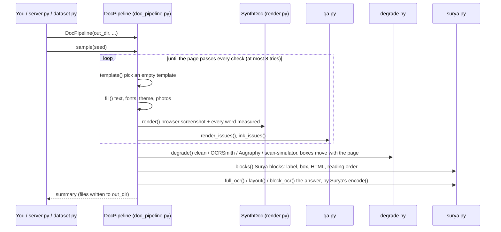

# OCRSynthGen: synthetic Arabic and English pages for training Surya OCR 2.5

This project makes **training pages for Surya OCR 2.5** (`datalab-to/surya-ocr-2.5`). Each page is a real-looking
document (Arabic or English) with a label written **exactly the way Surya answers**, so fine-tuning makes Surya
read better without changing the shape of its answers.

```
empty template  ->  fill with text  ->  render in a browser  ->  scan/photo effect  ->  Surya label
 (bank2000/)        (Wikipedia, fonts)     (SynthDoc, 2x)          (OCRSmith, ...)       (Surya's own encoder)
```

**Contents**

1. [Where everything is](#1-where-everything-is)
2. [Setup (once)](#2-setup-once)
3. [Run it: three ways](#3-run-it-three-ways)
4. [What one sample is](#4-what-one-sample-is)
5. [How the pipeline runs, step by step](#5-how-the-pipeline-runs-step-by-step)
6. [Calling the steps yourself](#6-calling-the-steps-yourself)
7. [Surya's label format](#7-suryas-label-format)
8. [How our labels match Surya](#8-how-our-labels-match-surya)
9. [Boxes through the effects](#9-boxes-through-the-effects)
10. [Fine-tuning Surya](#10-fine-tuning-surya)
11. [Files](#11-files)
12. [Sources, licences, limits](#12-sources-licences-limits)

---

## 1. Where everything is

Everything is in **`D:\code\OCR\arabic-template-bank`**, branch `main`
(GitHub: `Yousef10p/OCRSynthGen`). The three tools it uses sit next to it, unchanged:

```
D:\code\OCR\
  arabic-template-bank\      this project
  synthdoc-arabic-test\      SynthDoc + its Arabic extension (renders the page)
  ocrsmith\                  OCRSmith (fonts, paper, scan/photo effects)
  scan-simulator\            scan-simulator (scan effects)
```

The whole generator is one class, **`DocPipeline`**, in [pipeline/doc_pipeline.py](pipeline/doc_pipeline.py).
Every other file in `pipeline/` is one step it calls (section 5).

---

## 2. Setup (once)

```bash
py -3.12 -m venv .venv-pipeline
```
```bash
.venv-pipeline\Scripts\pip install -r requirements-pipeline.txt
```
```bash
.venv-pipeline\Scripts\python -m playwright install chromium
```

Then tell Python where the three tools are: put these four lines in
`.venv-pipeline\Lib\site-packages\ocr_sources.pth` (on Linux `.venv-pipeline/lib/python3.12/site-packages/`):

```
D:\code\OCR\synthdoc-arabic-test\synthdoc\src
D:\code\OCR\synthdoc-arabic-test\arabic_ext
D:\code\OCR\ocrsmith\src
D:\code\OCR\scan-simulator
```

The text and photo pools are made once (not in git):

```bash
.venv-pipeline\Scripts\python -m pipeline.text_pool --articles 5000
```
```bash
.venv-pipeline\Scripts\python -m pipeline.img_pool
```

Optional: `npm install` (Node.js) and a `.env` with `GROQ_API_KEY`, only for templates written by an LLM.

All commands below run from `D:\code\OCR\arabic-template-bank`.

---

## 3. Run it: three ways

**a) The website** (look at samples one by one):

```bash
.venv-pipeline\Scripts\python pipeline\server.py
```

Open http://localhost:8765 and press **Generate 16 samples**. Menus choose the language, effect, Surya task,
template source and tashkeel; sliders set each effect's strength. Click a card to see the page, its Surya
answer, the boxes, the HTML and the labels. Every run is saved in `pipeline_out/run_<time>_<port>/`.

**b) A training set** (many samples in parallel):

```bash
.venv-pipeline\Scripts\python -m pipeline.dataset --n 1000 --out datasets\v1 --workers 4 --seed 1
```

| Option | Meaning |
|---|---|
| `--task full_ocr+block_ocr` | which Surya prompt (default: 40% `full_ocr`, 25% `layout`, 35% `block_ocr`); also `layout`, `table` |
| `--language ar` / `en` | one language only (default 50/50) |
| `--effect clean` / `ocrsmith` / `augraphy` / `scan-simulator` | one effect only (default: 15% clean, the rest even) |
| `--tashkeel none` / `partial` / `full` | Arabic diacritics (default 40/30/30) |
| `--strength-ocrsmith 0.5` (and `-augraphy`, `-scan-simulator`) | 0 lightest, 0.5 the tool's own settings, 1 strongest |
| `--seed 1` | the same seed makes the same pages; use a new seed for each batch |
| `--val 0.05` | share of pages in the validation split |

An interrupted run continues where it stopped. Speed: about 4 s per sample per worker; each worker needs
about 1.5 GB of memory.

**c) From Python:**

```python
from pipeline.doc_pipeline import DocPipeline

pipe = DocPipeline("pipeline_out/mine")       # files go here
summary = pipe.sample(seed=7)                 # one sample
print(summary["task"], summary["target_file"], summary["seconds"])

pipe.run(n=16)                                # sixteen samples
```

Choose what you get:

```python
pipe = DocPipeline("pipeline_out/arabic_scans",
                   languages={"ar": 1},                          # only Arabic
                   effects={"scan-simulator": 3, "ocrsmith": 1}, # weights
                   tasks={"full_ocr": 1},                        # only full-page OCR
                   tashkeel={"none": 1},
                   strengths={"scan-simulator": 0.8})
pipe.sample(seed=1, name="page1")
pipe.sample(seed=2, task="block_ocr", effect="clean")           # force one sample's choices
```

---

## 4. What one sample is

`pipe.sample(seed=7, name="s7")` writes these files (the dataset command puts each kind in its own folder:
`images/`, `prompts/`, `targets/`, `pages/`, `labels/`, `markdown/`, `html/`, plus `manifest.jsonl`):

| File | What it is |
|---|---|
| `s7.jpg` | what Surya is shown: the page, or (for `block_ocr`) one block cut out of it |
| `s7.prompt.txt` | Surya's prompt, word for word |
| `s7.target.txt` / `s7.target.json` | **the training answer**: what Surya should reply |
| `s7_page.jpg` | the whole page, when `s7.jpg` is a cut-out |
| `s7.json` | labels: every word, line and slot with its box, the Surya blocks, how the page was made |
| `s7.md` | one line per text block: `<text>... <bbox>x1, y1, x2, y2</bbox></text>` (pixels) |
| `s7.html` | the filled page |
| `s7_clean.jpg`, `_words.jpg`, `_slots.jpg`, `_blocks.jpg` | the page before effects, and the boxes drawn (only with `extras=True`, the default) |

Example pair, `s7.prompt.txt` and `s7.target.txt` (`full_ocr`, one long line, shortened here):

```text
OCR this image to HTML. Each block is a div with data-label and data-bbox (x0 y0 x1 y1, normalized 0-1000).
```
```text
<|Section-Header|><|877|><|162|><|981|><|190|><h2>تاريخها</h2><|Text|><|22|><|202|><|980|><|265|><p>تأسست الجامعة في ...</p><|Image|><|22|><|14|><|981|><|149|><p class="img-desc">A close-up photograph of a dish of food.</p>
```

---

## 5. How the pipeline runs, step by step

### 5.1 The order of calls



### 5.2 The same, as code

This is `DocPipeline.sample()` with only its calls kept (the real one is in
[pipeline/doc_pipeline.py](pipeline/doc_pipeline.py)):

```python
def sample(self, seed, name=None, language=None, effect=None, task=None):
    rng = random.Random(seed)                         # one seed decides everything
    lang = language or pick(rng, self.languages)      # "ar" / "en"
    effect = effect or pick(rng, self.effects)        # "clean" / "ocrsmith" / "augraphy" / "scan-simulator"
    task = task or pick(rng, self.tasks)              # "full_ocr" / "layout" / "block_ocr" / "table"

    for attempts in range(1, ATTEMPTS + 1):           # 1. template + 2. fill + 3. render, until clean
        if attempts % 2 == 1:                         #    a new template every second try
            meta, text, folder, note = self.template(rng, name, lang, need_table=task == "table")
        page, values, style = self.fill(meta, text, folder, rng, lang)
        clean, ocr, slots, pages, qa = self.render(page, values, name)
        issues = {**render_issues(ocr, qa), **ink_issues(clean, ocr["words"])}
        if not issues:
            break

    words, cut = split_words(ocr)                     # the measured words
    plan = SURYA.carry(qa["struct"])                  # tables, rows, columns, lists, pictures
    image, boxes, attacks, strength, check, moved = self.degrade(     # 4. effect
        clean, words, rng, effect, SURYA.corners(plan))
    regions = GT.regions(meta["slots"], words, boxes, lang, positioning, qa["slots"])  # one per slot

    width, height = image.size                        # 5. Surya labels
    rects = SURYA.rebuild(plan, moved, width, height)
    blks = SURYA.blocks(regions, roles, qa["struct"], rects, lang, positioning, self.categories, width, height)
    if task == "full_ocr":
        target = SURYA.full_ocr(blks, width, height)
    elif task == "layout":
        target = SURYA.layout(blks, width, height)
    elif task == "block_ocr":
        block, crop = rng.choice(cuts)                # a block whose cut-out takes in no neighbour
        target = SURYA.block_ocr(block)
    # 6. write <name>.jpg, .prompt.txt, .target.txt, .json, .md, .html
```

### 5.3 Each step, its file, and what it does

| Step | Call | File | What happens |
|---|---|---|---|
| 1 template | `DocPipeline.template()` | `doc_pipeline.py` | a random template from `bank2000/` (2,000, half Arabic, half English; 4 sources: grammar, WebSight v0.1, WebSight v0.2, DocLayNet), or one written by an LLM (`llm_templates.py`) |
| 2 fill | `DocPipeline.fill()` | `style.py`, `themes.py`, `text_pool.py`, `img_pool.py`, `tashkeel.py` | Wikipedia text (one article per page), random fonts, sizes and colour theme, photos for picture slots, Arabic diacritics |
| 3 render | `DocPipeline.render()` | `render.py` | SynthDoc lays the page out in Chromium at 2x (about 192 dpi), takes the screenshot and measures every word, table, list and picture |
| 3 checks | `render_issues()`, `ink_issues()` | `qa.py` | hidden, cut, overlapping, covered, off-page, low-contrast or invisible text: the page is made again |
| 4 effect | `DocPipeline.degrade()` -> `degrade.degrade()` | `degrade.py` | clean (15%), OCRSmith, Augraphy or scan-simulator; boxes move with the page; every word checked still readable, else retried lighter |
| 5 regions | `groundtruth.regions()` | `groundtruth.py` | the words of each slot joined: its text and its box |
| 5 blocks | `surya.blocks()` | `surya.py` | Surya's blocks: label, HTML, box, reading order (section 8) |
| 5 answer | `surya.full_ocr()`, `layout()`, `block_ocr()` | `surya.py`, `surya_compact.py` | the answer, written by Surya's own `encode()` |
| 6 labels | `build_label()` | `labels.py` | the labels JSON (words, lines, slots) |

---

## 6. Calling the steps yourself

Any step can be used on its own. Run these from the project folder with `.venv-pipeline\Scripts\python`.
On Windows, run `set PYTHONIOENCODING=utf-8` first, or printing Arabic text fails.

**Render a page and look at what was measured:**

```python
import random
from pipeline.doc_pipeline import DocPipeline

pipe = DocPipeline("pipeline_out/try")
rng = random.Random(3)
meta, text, folder, note = pipe.template(rng, "t1", "ar")
page, values, style = pipe.fill(meta, text, folder, rng, "ar")
clean, ocr, slots, pages, qa = pipe.render(page, values, "t1")

clean.save("pipeline_out/try/clean.png")
print(len(ocr["words"]), "words;", ocr["words"][0]["text"], ocr["words"][0]["x"], ocr["words"][0]["y"])
print(style["font"], style["size_pt"], style["theme"])
```

**Put an effect on the page** (continuing from above; the word boxes come back moved with the page):

```python
from pipeline import degrade as D

words = ocr["words"]                           # each has x, y, width, height, line_id, text
out, boxes, attacks = D.degrade(clean, words, seed=5, effect="ocrsmith", strength=0.5)
print(attacks)                                 # e.g. ['ocrsmith-paper:solid', 'ocrsmith:fax', 'Downscale', ...]
print(boxes[0])                                # the first word's box after the effect: [x, y, w, h]
print(D.readable(D.legibility(clean, out, words, boxes)))   # is every word still readable?
out.save("pipeline_out/try/scanned.jpg")
```

The effect can be `"clean"`, `"ocrsmith"`, `"augraphy"`, `"scan-simulator"` or `"augraphy+scan-simulator"`.

**Write a Surya answer from your own HTML, and read one back** (Surya's own encoder):

```python
from pipeline import surya_compact

html = ('<div data-bbox="71 33 143 45" data-label="Page-Header">Northwind</div>'
        '<div data-bbox="120 87 881 255" data-label="Text"><p>The agent is not trading.</p></div>')
answer = surya_compact.encode(html)
print(answer)        # <|Page-Header|><|71|><|33|><|143|><|45|>Northwind<|Text|><|120|><|87|><|881|><|255|><p>...</p>
print(surya_compact.decode(answer))            # back to the div HTML, one div per line
```

**Check that a target is in Surya's format:**

```python
from pipeline import surya
print(surya.problems("full_ocr", open("pipeline_out/mine/s01.target.txt", encoding="utf-8").read()))  # [] = fine
```

**Check a whole training set** (pairing, prompts, format, Surya's encoder, length):

```bash
.venv-pipeline\Scripts\python surya_probe\check_dataset.py datasets\v1
```

**Check finished samples independently and draw their boxes:**

```bash
.venv-pipeline\Scripts\python -m pipeline.qa --n 40
```
```bash
.venv-pipeline\Scripts\python -m pipeline.audit pipeline_out\qa
```

---

## 7. Surya's label format

Surya OCR 2.5 answers four fixed prompts. Its code calls them "the model's training-time contract", so we use
them word for word (`surya.PROMPTS`):

| Task | Share | Surya is shown | It answers |
|---|---|---|---|
| `full_ocr` | 40% | the page | every block: label, box, content |
| `layout` | 25% | the page | a JSON list: label, box, `count` for each block |
| `block_ocr` | 35% | one block cut out | that block's content only |
| `table` | only when asked | a table cut out | rows, then columns (Surya 2's format; 2.5 reads tables through `block_ocr`) |

**Boxes** are `x0 y0 x1 y1` (left, top, right, bottom) as whole numbers from 0 to 1000 of the image's width and
height. A box from pixel (687, 764) to (901, 794) on a 1590 x 2248 page is `432 340 567 353`.

**A page's label is HTML, one `div` per block**, in reading order. We use 9 of Surya's labels: `Text`,
`Section-Header`, `List-Group`, `Table`, `Image`, `Caption`, `Footnote`, `Page-Header`, `Page-Footer`.

```html
<div data-bbox="71 33 143 45" data-label="Page-Header">Northwind Logistics</div>
<div data-bbox="120 87 881 255" data-label="Text"><p>The agent is not trading.</p></div>
<div data-bbox="120 270 881 400" data-label="List-Group"><ul><li>• first point</li><li>• second point</li></ul></div>
```

**Surya's `encode()` shortens it** into what the model really writes
([pipeline/surya_compact.py](pipeline/surya_compact.py) is Surya's `compact.py`, copied unchanged, Apache-2.0):

| Rule | Before | After |
|---|---|---|
| a block's `div` becomes 5 tokens | `<div data-bbox="71 33 143 45" data-label="Page-Header">` | `<\|Page-Header\|><\|71\|><\|33\|><\|143\|><\|45\|>` |
| no `</div>`, nothing between blocks | `...</p></div>\n<div ...>` | `...</p><\|Text\|>...` |
| `</td>`, `</th>`, `</tr>` left out | `<tr><td>a</td><td>b</td></tr>` | `<tr><td>a<td>b` |
| one spelling per tag | `<br>`, `<TD data-kind='parent' data-cs=2>` | `<br/>`, `<td data-cs="2" data-kind="parent">` |

A merged table cell is one `data-kind="parent"` cell with `data-cs` / `data-rs`, then a `data-kind="ghost"` cell
for each other place it covers. A picture is `<p class="img-desc">...</p>`. The answer
ends with the end token `<|im_end|>` (token 2), which training adds.

The other answers:

```json
[{"label": "Section-Header", "bbox": "451 90 872 176", "count": 30}, {"label": "Text", "bbox": "744 237 887 286", "count": 50}]
```
```html
<p>الحروب العثمانية الصفوية</p>
```

The first is `layout` (`count` = the block's answer length in Surya's tokens, rounded up to tens); the second
is `block_ocr` (content only: never a label or a box).

---

## 8. How our labels match Surya

We sent 100 of our pages per prompt to a Surya 2.5 server and kept every answer (`surya_probe/batch100/`,
`clean100/`; each answer next to the image it was shown, our label and the prompt). Where Surya does one thing
most of the time, our labels now do the same (`pipeline/surya.py`):

| Rule | Example |
|---|---|
| a short plain label line alone is `Text` (74 of 83); a bold one is a `Section-Header`, `<h3>` | `<p>History:</p>`, `<h3>Career:</h3>` |
| "label: value" with only the label bold | `<p><b>Charts:</b> 650542</p>` |
| a list right under another list is one list (45 of 67) | one `List-Group` with both items |
| texts on one line that almost touch are one block (20 of 23) | `<p>Population: 12,000</p>` |
| short lines stacked with almost no gap are one block, split by `<br/>` (30 of 35) | `<p><b>Born:</b> 1950<br/><b>Died:</b> 2010</p>` |
| boxes start a little left (0.65% of the width) and higher (0.35% of the height) | `432 340` -> `425 337` |
| two-column English pages are read one column at a time | left column, then right column |
| the text is what the image shows, word for word | `historica lly` -> `historically` |

How close we are, on the same images: block labels 91% the same, box overlap 0.90 (median), answer format
100 of 100 correct, Surya's own encoder gives back our targets unchanged (100 of 100). The rest is where Surya
is not consistent itself: heading levels (`h2` or `h3` for the same kind of heading), bold inside headings,
joining paragraphs. There we keep one simple choice.

One page, ours and Surya's (page `full_ocr/0000004`):

```text
ours:   <|Text|><|425|><|337|><|567|><|353|><p>MAD, MAD/I, and:</p><|Text|><|65|><|709|><|229|><|730|><p>MAD (Michigan.</p>...
Surya:  <|Text|><|425|><|334|><|571|><|354|><p>MAD, MAD/I, and:</p><|Text|><|64|><|708|><|230|><|731|><p>MAD (Michigan.</p>...
```

Same blocks, order, labels and tags; boxes a few thousandths apart.

---

## 9. Boxes through the effects

Every effect that moves the page moves the boxes with it:

- **OCRSmith** moves each word's four corners through the same rotation, perspective, curl or wrinkles as
  the pixels.
- **scan-simulator** moves a word-id mask with the image; words that overlap go in separate mask layers.
- **Augraphy** only changes colours, so nothing moves.

Tables, rows, columns, lists and pictures ride along as corner points.

Checked by painting every word as a solid block in its own colour and running each moving step alone:
rotation (5°), perspective, page binding, wrinkles and curls all stay within 2-6 px of the words. (Two bugs
found this way are fixed: OCRSmith's page curl slid boxes up to 42 px off their words, and touching lines cut
each other's boxes in scan-simulator.)

---

## 10. Fine-tuning Surya

**The simple way: `notebooks/Surya_finetune_swift_Colab.ipynb`** (ms-swift). Upload it to Colab, choose a T4
GPU, *Run all*. It:

1. makes the pages in Colab itself: `PAGES` pages per epoch, a new seed per epoch (`full_ocr` + `block_ocr`);
2. trains Surya on them for `EPOCHS` epochs, saving to `MyDrive/surya/run_swift/` (it continues after a
   disconnect, and skips training when the model is already there);
3. checks a few KITAB-Bench images after every epoch, and at the end compares the original and the trained
   Surya on KITAB-Bench (CER / WER per dataset).

It needs a read-only GitHub token in Colab's *Secrets* as `GITHUB_TOKEN` (to clone this repository).

**Other notebooks:** `Generate_batches_Colab.ipynb` makes batch folders into Drive;
`Surya_finetune_Colab.ipynb` trains on those folders with plain transformers.

**Three traps both notebooks avoid** (each found by testing):

| Trap | What goes wrong | Fix |
|---|---|---|
| the tokenizer | transformers' default Qwen tokenizer breaks Arabic letters into bytes (`<p>مرحبا</p>`: 12 tokens instead of 7) | load Surya's own tokenizer (`TokenizersBackend`) |
| the end token | `.<` and `><` are tokens, so `</p><|im_end|>` tokenized as one text loses the end token; Surya would learn to *type* "im_end" | add the end token by its number (2) |
| image tokens | ms-swift has Qwen's image token ids (248056, 248057) | Surya's are 11 and 12 |

To make pages locally for training instead:

```bash
.venv-pipeline\Scripts\python -m pipeline.dataset --n 1000 --out batches\epoch_001 --task full_ocr+block_ocr --tashkeel none --seed 1
```

---

## 11. Files

```
pipeline/doc_pipeline.py      DocPipeline: template -> fill -> render -> effect -> labels
pipeline/render.py            SynthDoc in Chromium: 2x render, one browser per process, word measuring
pipeline/style.py             random typography (fonts, sizes, digits) and the text of each slot
pipeline/themes.py            theme colours, heading / table / box styles
pipeline/tashkeel.py          Arabic diacritics (none / partial / full)
pipeline/text_pool.py         builds text_pool/ (Wikipedia, ar + en) and cuts text to fit each slot
pipeline/img_pool.py          downloads img_pool/ and picks a photo for each picture slot
pipeline/degrade.py           OCRSmith, Augraphy, scan-simulator, with strength and readability checks
pipeline/qa.py, audit.py      checks of rendered pages and of finished samples
pipeline/groundtruth.py       slot regions and the .md
pipeline/labels.py            the labels JSON (words, lines, slots)
pipeline/surya.py             Surya labels: blocks, prompts, answers
pipeline/surya_compact.py     Surya's own compact.py (encode / decode), unchanged
pipeline/dataset.py           the dataset command
pipeline/server.py, static/   the website (Generate 16 samples + preview)
pipeline/llm_templates.py     optional: templates written by an LLM (Groq or local Ollama)
bank2000/                     the 2,000 templates (templates/<id>/template.html.j2 + template.json)
synthdoc_arabic_ext/          SynthDoc's Arabic extension (a copy, so Colab gets it from this repository)
surya_probe/                  Surya's own answers to our pages, and the scripts that asked and compared them
notebooks/                    Colab: fine-tune Surya (ms-swift), make batches, KITAB-Bench before/after
```

Not in git (made locally): `text_pool/`, `img_pool/`, `pipeline_out/`, `datasets/`, `batches/`,
`surya_probe/batch100/` and `clean100/` (Surya's answers), `surya_inference/` (the Surya API client and its key),
`runnigs/` (training runs from Colab).

**A template** is a page with `{{ slot_N }}` where text goes; `template.json` gives each slot a role (title,
paragraph, cell, list item...) and a word range, and each picture slot a hint (food, people...).

---

## 12. Sources, licences, limits

| Part | Source | Licence |
|---|---|---|
| templates `g_` | our own grammar generator | own |
| templates `w_` | WebSight v0.1 and v0.2 (Hugging Face) | CC BY 4.0 |
| templates `d_` | DocLayNet v1.1 layouts (IBM) | CDLA-Permissive-1.0 |
| text | Arabic and English Wikipedia (dump 2023-11-01); each label lists its articles | CC BY-SA 4.0: a shared set must keep it and the attribution |
| photos | Lorem Picsum (Unsplash licence) and Wikimedia Commons (each photo's licence in `img_pool/sources.json`) | per photo |
| Surya's encoder | `datalab-to/surya` `compact.py`, commit 9d5aadf | Apache-2.0 |

The scripts that built `bank2000/` are in the git history up to commit d88ba8665c.

**Limits:**
- WebSight pages look like websites (menus, cards), not printed documents.
- Text inside photos is not in the labels (photos with signs or posters in their titles are skipped).
- Augraphy's noise is random even for the same seed, so Augraphy pages can't be remade exactly.
- English pages use Windows Latin fonts; on Linux, install `ttf-mscorefonts-installer` or pages look more alike.
