# OCRSynthGen: Arabic Document Template Bank and Synthetic OCR Generator

This project builds a bank of **empty Arabic (right-to-left) document templates** and turns them into a
**labelled synthetic OCR dataset**: page images with word, line and block boxes, text and Markdown.

A template is a page layout with no text. Every place where text should go is a placeholder such as
`{{ slot_3 }}`, and each placeholder has a type (title, paragraph, table cell…) and a word range. A later
stage fills the placeholders with Arabic text and renders the pages to images. This project builds the
templates; a [demo](#demo-from-empty-template-to-varied-scan-like-pages) shows that later stage.

**Result:** 113,077 unique templates from 3 sources (77,159 DocLayNet, 35,618 WebSight, 300 Grammar), all
checked and valid, and a pipeline that fills, renders, labels and degrades them.

## Quick start: make a training set

For a detailed, step-by-step explanation of how a page is made (template storage, text injection,
the exact SynthDoc and OCRSmith arguments, the Wikipedia text format, the label formats), see
[OCRREADME.md](OCRREADME.md).

```bash
cd D:\code\OCR\arabic-template-bank
.venv-pipeline\Scripts\python -m pipeline.dataset --n 10000 --out datasets\ocr_v1 --workers 6
```

Each sample: a page from a random template, filled with Wikipedia text (80% Arabic, 20% English) in a random
font and size, pictures from `img_pool/`, rendered by SynthDoc, then left clean (15%) or degraded with
OCRSmith, Augraphy or scan-simulator (about 28% each); every box moves with the page.

| In `--out` | What |
|---|---|
| `images/<id>.jpg` | the page |
| `labels/<id>.json` | words, lines and slots (blocks), each with its box `[x, y, w, h]` in image pixels and its text; how the page was made; the Wikipedia articles used |
| `markdown/<id>.md` | the page as Markdown, with every block and line box in a header at the top |
| `html/<id>.html` | the filled page |
| `manifest.jsonl` | one line per sample: id, `split` (train/val, 5% val), files, language, template, effects… |
| `dataset.json` | counts and the options, sources and licences of the set |

Options: `--language ar|en`, `--effect clean|ocrsmith|augraphy|scan-simulator|augraphy+scan-simulator`,
`--val 0.05`, `--seed 0` (the same seed makes the same set). An interrupted run continues where it stopped
when run again. Speed: about 2–4 s per sample per worker; each worker needs about 1.5 GB of memory.

To look at samples one by one instead: `.venv-pipeline\Scripts\python pipeline\server.py`, then open
http://localhost:8765 (**Generate 16 samples**, with previews). Setup of `.venv-pipeline`, `text_pool/` and
`img_pool/`: see [the sample generator](#the-sample-generator-the-whole-pipeline-in-one-class).

**Licences of a generated set:** the text is Wikipedia (CC BY-SA 4.0), so a set you share must keep
CC BY-SA and the attribution (each label lists its articles); photos are Unsplash (Unsplash License);
templates come from WebSight (CC BY 4.0), DocLayNet (CDLA-Permissive-1.0) and our own grammar.

---

## The big picture: two stages

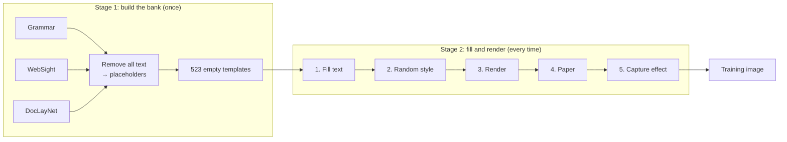

- **Stage 1** builds empty layouts and stores them once. They never change.
- **Stage 2** runs every time a template is used, with new random choices each time. So one template becomes
  an unlimited number of different pages: new text, new font and size, new paper, new scan or photo effect.
- **Pictures are decided in stage 1** (kept, or replaced by a grey box; see
  [pictures](#what-one-template-looks-like)). Stage 2 draws them unchanged.

---

## Stage 1: building the bank

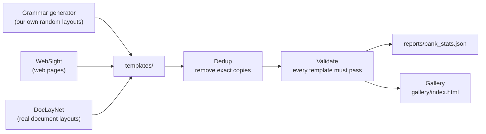

One command runs everything:

```bash
.venv/Scripts/python -m src.build --seed 0 --n-grammar 300 --n-websight 150 --n-doclaynet 100
```

Then double-click `gallery/index.html` to browse the templates in Chrome. The page opens empty: pick a source
and a version from the **Show** menu. The **Feature** menu narrows any set. To open the gallery with a set
already picked, add it to the link, e.g. `gallery/index.html#grammar:synthdoc`.

The menu has three versions for each source (Grammar, WebSight, DocLayNet):

| Version | Each card shows |
|---|---|
| **empty** | The empty template only, with placeholder tags (type · word range) |
| **OCRSmith render** | The template next to our render of it: sample Arabic text, OCRSmith's fonts, paper and a scan, photo, fax or archive effect ([demo pipeline](#demo-from-empty-template-to-varied-scan-like-pages)), with **HTML code ↗** and **Markdown ↗** |
| **SynthDoc-augraphy-scan-simulator** | The template next to SynthDoc's render after the Augraphy and scan-simulator attacks, with **HTML code ↗**, **Markdown ↗**, **Word boxes ↗** and **Slot boxes ↗** (boxes moved to match the attacked page), **Labels ↗** and the **Clean SynthDoc page ↗** ([SynthDoc](#synthdoc-rendering-bank-templates-with-labels)) |
| **SynthDoc-OCRSmith** | The same SynthDoc render attacked with OCRSmith's papers and capture effects instead, with the same buttons ([OCRSmith attacks](#attacks-ocrsmith-papers-and-effects)) |

The last entry, **OCRSmith pages → templates**, shows OCRSmith's own documents next to the templates
exported from them ([OCRSmith POC](../ocrsmith/poc_templates/README.md)).

The buttons open only when clicked. The code views have a **Copy** button. Markdown comes from
`src/markdown.py`: `#` headings, `-` and `1.` lists, pipe tables, `>` quotes, `` for grey boxes.

---

## What's in the bank

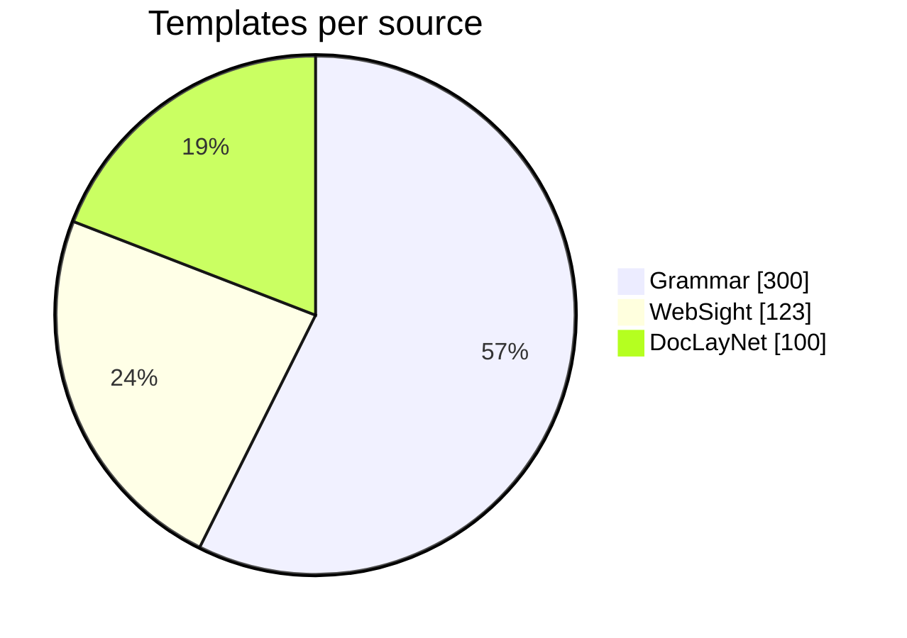

| | |
|---|---|
| Templates | 523 (2 duplicates removed) |
| Placeholders per template | min 1 · median 23 · max 306 |
| With tables | 38% |
| With lists | 68% |
| Multi-column | 44% |
| With forms | 35% |
| With header/footer | 79% |
| Page sizes | A4, A5, Letter, Legal (portrait and landscape) |

The full numbers are in `reports/bank_stats.json`.

---

## What one template looks like

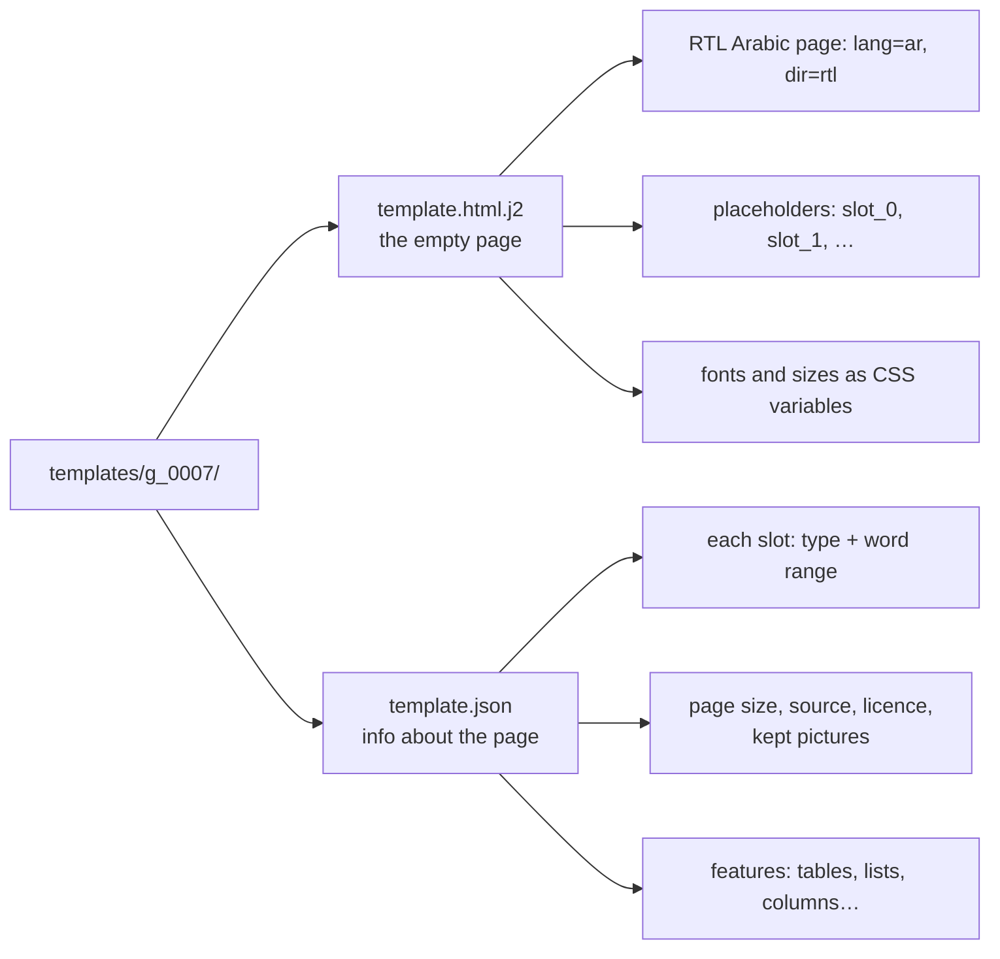

Each placeholder (slot) has one of 16 types: title, subtitle, heading, paragraph, list_item,
table_header, cell, caption, label, field_value, quote, footnote, header, footer, page_number,
sidebar. The default word ranges per type are in `config/roles.json`.

A template has no links and no scripts. How pictures are handled:

| Picture | What happens |
|---|---|
| Real picture with **no text inside** (photos, logos, drawings) | **Kept** as a PNG file next to the template (`img_0.png`, …) |
| Picture **with text inside** (charts with labels, diagrams) | Grey box: the text would end up in our OCR labels by mistake |
| Formula | Grey box: it is text |
| WebSight images | Grey box: WebSight v0.1 has no real image files, only names like `logo.png` that do not exist |
| Grammar figures | Grey box: generated layouts have no picture to show |

A DocLayNet picture counts as "with text" if any of DocLayNet's own PDF text cells lie inside it. This
catches text drawn into the PDF (chart labels, captions inside diagrams). It cannot see text that is part of
a photo's pixels.

---

## Before and after

Each pair shows the original page with its text (left) and the empty template made from it (right). In the
templates, each coloured tag marks a placeholder: its type and word range.

**WebSight: web page → RTL template.** Text becomes placeholders, the layout is mirrored, and the
broken image links become grey boxes.

| Original (dataset screenshot) | Our template |
|---|---|
| 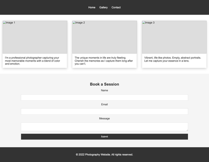 | 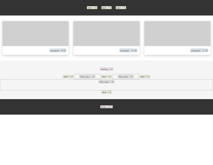 |
| 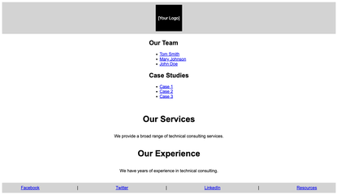 | 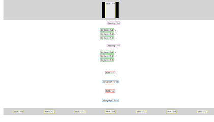 |

**DocLayNet: real document page → mirrored template.** The text is gone, the boxes are mirrored left ↔
right, the photo and the logo (no text inside) are kept, and the tables are rebuilt as empty tables.

| Original page | Our template |
|---|---|
| 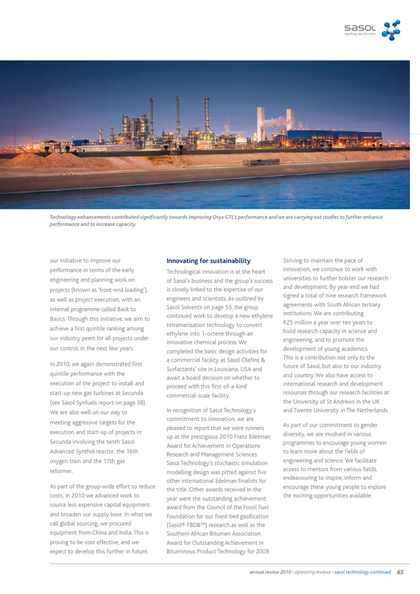 | 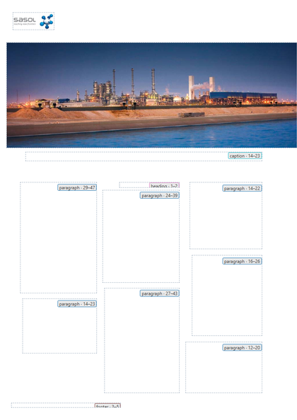 |
| 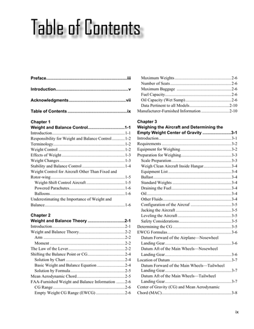 | 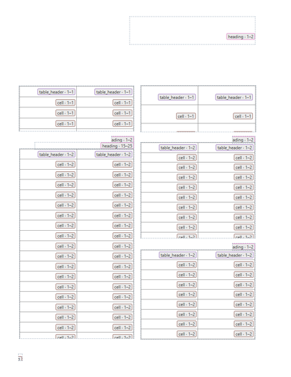 |

**Grammar: there is no original.** These layouts are generated from scratch. To show what a template becomes,
the right image fills the same template with sample Arabic words, the job of the later filling stage.

| Our template | Same template filled with sample Arabic text |
|---|---|
| 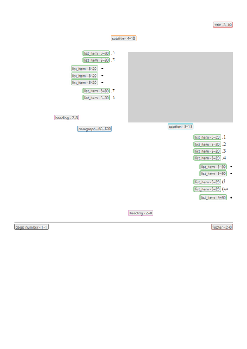 | 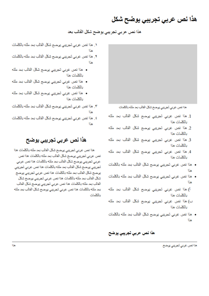 |

To remake these images after a build, run `python -m docs.make_examples` (Windows, uses Microsoft Edge).

> **Side note: why the WebSight templates have no pictures**
>
> WebSight v0.1 does not contain real images. Each row has only the page's HTML code and a screenshot of it.
> The images the code points to were never included in the dataset. In the 123 WebSight pages in the bank:
>
> - **108 pages have no image at all.** Their picture areas are coloured boxes such as
>   `<div class="image-placeholder">`.
> - **15 pages point to files that do not exist.** The names are made up, like `logo.png`,
>   `placeholder.jpg` and `product1.jpg`, or the link points to `placehold.it`, a dummy-image website that is no longer running.
> - **The dataset's own screenshots confirm it:** they show broken "Image 1 / Image 2" icons, not photos
>   (see the WebSight examples above).
>
> So there is nothing to keep, and these areas stay as grey boxes of the same size and position.
>
> **Possible solutions**
>
> | Option | How it works | Pros | Cons |
> |---|---|---|---|
> | **1. Picture pool (recommended)** | Keep the grey boxes in the templates. When the later filling stage fills a template, it also puts a real picture into each grey box, taken from a collection of text-free images. The DocLayNet picture crops can start that collection. | Nothing in the bank changes. No broken links. The same template gets different pictures each time it is used, which adds variety. | We need to gather the picture collection. |
> | **2. WebSight v0.2** | Use the newer WebSight version, whose pages link to real stock photos. Download each photo and store it next to its template. | Every page has its own real photos. | The photos are links to an online photo service; they must be downloaded and may no longer work. The format has not been checked yet. |
>
> Pictures from either option must contain no text. Otherwise that text would end up in the OCR labels
> without being labelled.

---

## Demo: from empty template to varied, scan-like pages

The bank on its own shows every template in one default font on white paper, because filling, rendering
and degradation are the next stage. To show what that stage adds, `demo/render_demo.py` renders bank
templates many different ways:

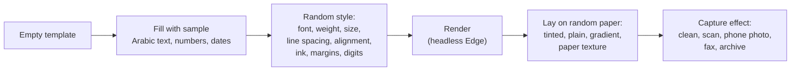

| What varies | Range in the demo |
|---|---|
| Text | See "What text goes where" below |
| Font family | 13 Arabic families: Amiri, Noto Naskh, Noto Kufi, Noto Sans (4 widths), IBM Plex, Vazirmatn, Mada, Mirza, Fustat, Kufam |
| Weights | Light to Medium for body text, SemiBold to Black for headings; headings sometimes use a second family |
| Size and spacing | 9–14pt body text, line spacing 1.35–2.0, start or justified, 10–28mm margins |
| Digits | Western (123) or Arabic-Indic (١٢٣), chosen per page |
| Ink | Black, near-black, dark blue, dark brown, dark red |
| Paper | Cream-to-white tinted paper with grain, plain, gradient, or a white-paper photo texture |
| Capture | Clean, flatbed scan (skew, grain, toner spread, noise, JPEG), phone photo (perspective, curl, shadow, glare, blur), fax (low resolution, high contrast), archive (stains, folds, bleed-through, fading) |

**What text goes where.** Each placeholder gets text that fits its type, with a random length inside
its word range. The words come from 18 neutral Arabic sentences we wrote ourselves, so repeats are
expected. A real Arabic corpus replaces them later.

| Placeholder type | Text it gets |
|---|---|
| paragraph, list item, caption, quote, footnote, sidebar | Full sentences, ending with a full stop |
| title, subtitle, heading, header, footer | A short phrase |
| table cell | About half numbers (`45.20`, `87%`, `12,500`), the rest a few words |
| form value | About half dates (`12/03/2024`), phone numbers, amounts or reference numbers, the rest words |
| label | A few words ending with a colon (`الاسم:`) |
| page number | A number |

**Pictures are not touched in this stage.** Grey boxes stay grey, and kept DocLayNet pictures (photos and
logos with no text) are drawn as they are.

The same template, rendered three ways:

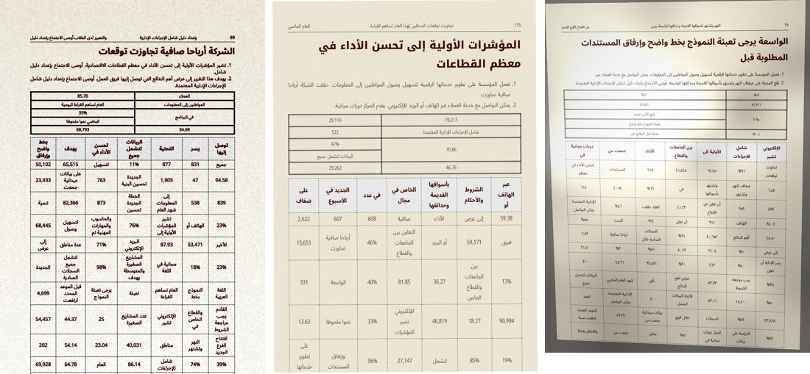
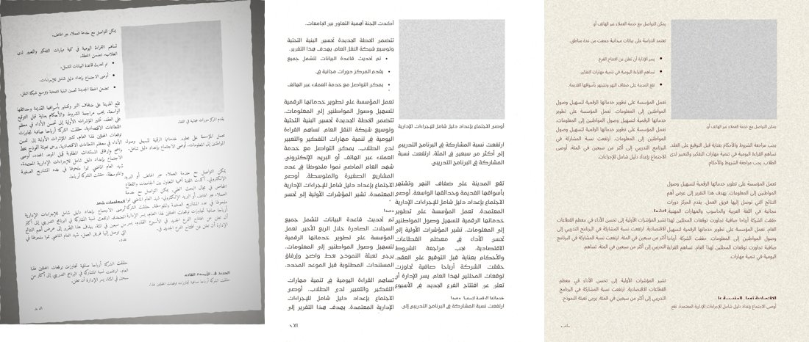
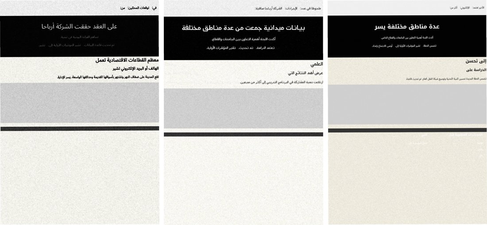

**In the main gallery:** every template in the bank gets one render: `renders/{id}.jpg` (the image) and
`renders/{id}.html` (the filled page, with the exact text and style used for that image). The gallery shows
each empty template next to its image, with a link to the HTML. To regenerate them after a build (about 25
minutes for 523 pages; it rebuilds `gallery/index.html` at the end):

```bash
cd D:\code\OCR\arabic-template-bank
..\ocrsmith\.venv\Scripts\python demo\render_demo.py --gallery --workers 6
```

Each template has its own fixed random seed, so the same template always gets the same text and style.
Adding `--html-only` rewrites only the HTML pages of existing renders, in seconds, and checks that their
font and size match the images.

**Demo set:** open `demo/index.html` to browse 72 demo images (24 templates × 3 variants), to see how much one
template can vary. Each caption lists the font, size, paper and capture effects used. To make a new set:

```bash
cd D:\code\OCR\arabic-template-bank
..\ocrsmith\.venv\Scripts\python demo\render_demo.py --per-source 8 --variants 3
```

The fonts, papers and capture effects come from OCRSmith (MIT licence), so the demo runs with OCRSmith's
environment. Limits of this demo:
- **No OCR labels yet.** Word and line boxes come with the real renderer.
- **Sample text only.** A real Arabic corpus replaces it later.
- **DocLayNet boxes keep their fixed sizes.** Text can overflow them when the random style needs more room.

---

## SynthDoc: rendering bank templates with labels

[SynthDoc](https://github.com/MatterWaveAI/synthdoc) renders HTML templates in a real browser (Chromium with
Paged.js) and measures a box for every marked element. `synthdoc_adapter/` lets it render **our** templates,
so the bank stays the single source of layouts and SynthDoc adds the labels our demo lacks.

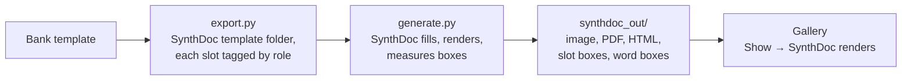

| Step | What it does |
|---|---|
| `export.py` | Copies a template into SynthDoc's format (template.html, template.json, a small Python class). Each placeholder is wrapped in a span whose `property` SynthDoc boxes: title → `doco:title`, heading → `doco:sectionTitle`, label/value → `doco-fd:fieldLabel`/`fieldValue`, cell → `doco:tableCell`… |
| `bank_template.py` | Fills each slot with our sample Arabic text and picks a random style, the same code as the demo (`demo/fill_style.py`), on a white page |
| `generate.py` | Runs SynthDoc with the Arabic extension from `../synthdoc-arabic-test`, which adds word and line boxes |

Three fixes in `export.py` make SynthDoc lay our pages out like our own renders. Without them, 238 of 523
pages lost text:

| Problem | Fix |
|---|---|
| Paged.js only looks for overflow to the right. With a right-to-left page, overflowing text went off the page to the left, where SynthDoc still labelled it (g_0001: 1 of 35 slots visible) | Paged.js's own page boxes stay left-to-right, and only the content inside a page is right-to-left (the same fix as in `synthdoc-arabic-test`) |
| Paged.js split CSS multi-column layouts into thin, scattered columns over many pages | Each bank page is capped at one sheet, like our own renders. Text past the bottom is cut off and gets no labels |
| Paged.js doesn't recognise the page-size names `Legal` and `Letter` written this way, so it fell back to Letter portrait | The page size is written in millimetres |

Output per document, in `synthdoc_out/`:

| Folder | Content |
|---|---|
| `images/`, `pdfs/` | Page images and PDF |
| `html/` | The filled page's HTML |
| `labels/`, `overlays/` | One box per slot, typed by its role (TITLE, SECTION_TITLE, FIELD_LABEL, TEXT…), drawn on the page |
| `ocr/`, `ocr_overlays/` | Every word and line with its box, drawn on the page |
| `manifest.json` | Document → page ids and template |

The gallery's SynthDoc cards show the template next to SynthDoc's page, with buttons for its HTML code,
Markdown (made from SynthDoc's HTML by `src/markdown.py`), slot boxes and word boxes.

### Attacks: Augraphy + scan-simulator

SynthDoc renders clean pages; it has no degradation step. `synthdoc_adapter/attack.py` adds it, with two
open-source libraries, and keeps every label aligned:

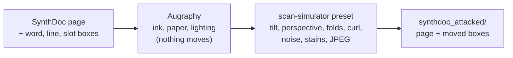

1. **[Augraphy](https://github.com/sparkfish/augraphy)**: ink bleed, low ink, letterpress, paper texture
   and colour, dirty drum or screen, lighting gradient, shadow, JPEG, photocopy. These effects don't move
   any pixel, so the boxes stay as they are.
2. **[scan-simulator](https://github.com/s1mb1o/scan-simulator)**: one preset per page (scan-clean,
   scan-heavy, photo-indoor, photo-outdoor, photocopy, archive). These rotate, warp, fold and curl the
   page. The boxes go through as a 16-bit mask with every word painted in its own number. scan-simulator
   warps masks without blending numbers, so afterwards each word's box is where its number ended up.
   Lines and slots are rebuilt from their words.

Output in `synthdoc_attacked/`: `images/`, `labels/` (words, lines and slots with their new boxes, the
attacks used), `overlays/` (word and slot boxes drawn on the attacked page), `summary.json`.
Three rules keep the labels honest:
- **No added text:** watermark and hand-annotation effects are never used, because they add text the labels
  don't know about.
- **No cut words:** a word whose letters are cut by a box edge or by the page edge is dropped from the labels.
  (SynthDoc trims a cut word's box to its visible part, so a clipped word ending at the page edge counts as
  cut; on the 571 SynthDoc pages this drops 1,967 words, 956 of them at the page edge.)
- **No unreadable pages:** if the attacked text ends up too faint (median paper-minus-ink contrast inside
  word boxes below 35 on a 0–255 scale), the page is attacked again with a new random seed (up to 4 tries),
  then with scan-simulator alone. If every try is too faint, the most readable one is kept and marked
  `low_contrast` in its labels and in `summary.json`. A page with no words at all (a template made only of
  pictures and lines) is marked `no_text` instead, since there is no text to measure.

Last run: 571 pages in under 4 minutes with 6 workers; 146 of 107,117 words lost (holes or pushed off the page), median contrast 82,
3 pages `low_contrast`, 3 pages `no_text`.

To make everything again:

```bash
cd D:\code\OCR\arabic-template-bank
.venv\Scripts\python -m synthdoc_adapter.export --n 0
..\synthdoc-arabic-test\.venv\Scripts\python synthdoc_adapter\generate.py --count 1 --workers 6
.venv-attacks\Scripts\python synthdoc_adapter\attack.py --workers 6
.venv\Scripts\python -m src.gallery
```

- `--n 0` exports all 523 templates; `--n 20` picks 20 spread over the three sources.
- `--count` makes several documents per template, each with new text and style.
- Render time: about 9 minutes for 523 pages with 6 workers; the attacks take about 4.
- The attacks environment: `python -m venv .venv-attacks`, then `pip install -r requirements-attacks.txt`.
  scan-simulator is used from `../scan-simulator`, a clone of its repository: its `pyproject.toml` can't be
  installed with current setuptools.

### Attacks: OCRSmith papers and effects

A second, separate attacked set: `synthdoc_adapter/attack_ocrsmith.py` gives the same clean SynthDoc pages
OCRSmith's look instead (the look of our own renders), with labels:

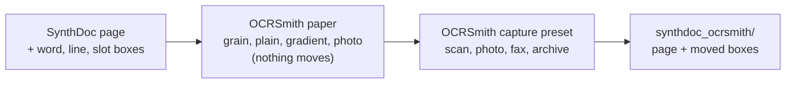

1. **Paper:** the page is multiplied onto one of OCRSmith's papers: white turns to paper, ink stays ink.
2. **Capture:** one of OCRSmith's presets. Scan is slight skew, grain, toner spread and JPEG. Photo is
   perspective, page curl, wrinkles, uneven light, shadow, glare and blur. Fax is low resolution and harsh
   contrast. Archive is stains, folds, bleed-through and fading.
3. **Boxes:** OCRSmith's effects already move boxes along with the image: every effect that moves pixels
   (rotation, perspective, curl, wrinkles) passes the page's annotation through the same transform. The
   script hands SynthDoc's words to OCRSmith in its own annotation format, each word named by its number,
   and reads the moved boxes back. Lines and slots are rebuilt from their words.

The same rules as above apply (no cut words, faint pages retried, `low_contrast` and `no_text` flags), and
the labels have the same format as in `synthdoc_attacked/`. It runs in OCRSmith's own environment:

```bash
..\ocrsmith\.venv\Scripts\python synthdoc_adapter\attack_ocrsmith.py --workers 6
```

Last run: 571 pages in under a minute with 6 workers; 53 of 107,117 words lost (pushed off the page);
presets scan 244, photo 207, archive 70, fax 50; median contrast 122; 6 pages `low_contrast`, 3 `no_text`.

---

## The sample generator: the whole pipeline in one class

`pipeline/doc_pipeline.py` holds `DocPipeline`, which makes one labelled, scan-like page from start to finish.
`pipeline/server.py` puts it behind a page with a **Generate 16 samples** button.

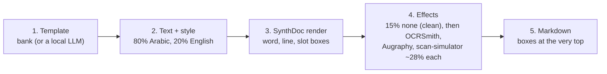

1. **Template:** a random bank template (Grammar, WebSight and DocLayNet equally often). If a page ends up
   with no readable text (a template that is all pictures), another template is picked.
2. **Text:** Arabic (80%) or English (20%), taken from Wikipedia (see below). English pages are switched to
   left-to-right and use installed Latin fonts (Georgia, Calibri, Cambria…); Arabic pages use OCRSmith's 13
   Arabic fonts.
3. **Render:** SynthDoc renders the page and measures every word, line and slot (page 1 only).
4. **Effects:** none at all (15%: a clean, sharp page exactly as SynthDoc rendered it, like a born-digital
   document), else OCRSmith, Augraphy or scan-simulator, equally often (about 28% each; Augraphy followed
   by scan-simulator is still available with `--effect augraphy+scan-simulator`). Every box moves
   with the page, as in the attack sections above; faint pages are retried with a new seed.
5. **Markdown:** the filled page as Markdown, with a header at the very top that lists every text block
   (type, box, text) and every line (box, text). Word boxes are in the sample's `.json`.

**Text, from Wikipedia:** the words come from Arabic and English Wikipedia (the `wikimedia/wikipedia` dataset,
dump of 2023-11-01, through Hugging Face's dataset server): edited and cited text, openly licensed
(CC BY-SA 4.0), on every topic. `text_pool/` holds a few thousand random articles per language (Arabic:
4,122 articles, about 130,000 different words; English: 4,533 articles, about 198,000), split into the kinds
of text a document has, and each kind fills the matching slots:

| From the article | Fills |
|---|---|
| article titles | titles |
| section headings (short lines) | headings, table headers, labels (+ ":") |
| list lines | list items |
| paragraphs, cut at whole sentences near the wanted length | paragraphs, quotes, captions, footnotes, sidebars |
| a few words from a sentence | table cells and form values (when they aren't a random number, date or phone) |

Reference sections are skipped, and lines with much text in the other script are dropped, so a page stays in
one language. Each sample's `.json` lists the articles its text came from, and its Markdown header names the
source and licence; CC BY-SA asks for that attribution, and a shared dataset made from it should keep the same
licence. The old demo sentences are still there (`text="demo"`, or **Text: demo sentences** on the page). To
build the pool again, or bigger:

```bash
.venv-pipeline\Scripts\python -m pipeline.text_pool --articles 5000
```

Real words are longer than the demo ones, and English words longer still, so in narrow table cells some words
are cut at the cell edge. Those are left out of the labels: the pipeline extends SynthDoc's word measuring (in
memory, nothing in the SynthDoc folder changes) to report a word cut on its left or right side.

**Pictures:** every grey picture box in a template (418 boxes in 228 templates) gets a random photo from
`img_pool/`, scaled to cover the box, so the layout and the text boxes don't change. The Markdown names the
photo (``) and the labels list the photos used. `img_pool/` holds 500
photos from [Lorem Picsum](https://picsum.photos): Unsplash photos, free to use under the Unsplash licence;
each one's author and page are in `img_pool/sources.json`. They are photos rather than document figures,
because a picture with text in it would put words on the page that the labels don't know about (a few street
photos do show signs). To download again, or more:

```bash
.venv-pipeline\Scripts\python -m pipeline.img_pool --n 500
```

Each sample writes `<name>.jpg` (final), `<name>_clean.jpg`, `<name>.html`, `<name>.md`, `<name>.json`
(labels) and `<name>_words.jpg` / `<name>_slots.jpg` (boxes drawn).

```python
from pipeline.doc_pipeline import DocPipeline
pipe = DocPipeline("pipeline_out/mine")                 # weights can be changed:
pipe = DocPipeline("pipeline_out/mine", languages={"ar": 1}, effects={"ocrsmith": 3, "augraphy": 1})
pipe.sample(seed=7)                                     # one sample
pipe.run(n=16)                                          # sixteen
```

```bash
.venv-pipeline\Scripts\python -m pipeline --n 16          # from the command line
.venv-pipeline\Scripts\python pipeline\server.py          # the generator page: http://localhost:8765
```

The page has menus to force the language, the effect or the template source, and a preview window with
tabs: final page, word boxes, slot boxes, clean render, HTML code, Markdown, labels and details (timings,
seed). With 4 worker processes, 16 samples take about 10–15 seconds; one sample takes 2–7 seconds, most of it
SynthDoc's render. Every run is kept in `pipeline_out/run_<time>/`.

**One environment for everything:** `.venv-pipeline` holds the packages of the SynthDoc, OCRSmith and
attacks environments (same versions, `requirements-pipeline.txt`). SynthDoc, its Arabic extension, OCRSmith
and scan-simulator are used from their folders through a path file in the venv, without installing or
changing them:

```bash
py -3.12 -m venv .venv-pipeline
.venv-pipeline\Scripts\pip install -r requirements-pipeline.txt
```
then put these four lines in `.venv-pipeline\Lib\site-packages\ocr_sources.pth`:
```
D:\code\OCR\synthdoc-arabic-test\synthdoc\src
D:\code\OCR\synthdoc-arabic-test\arabic_ext
D:\code\OCR\ocrsmith\src
D:\code\OCR\scan-simulator
```

**Templates from an LLM (optional):** `pipeline/llm_templates.py` asks a model to write a document page
(invoice, report, letter, form…). The page then goes through the same steps as a WebSight page: text to
slots, pictures to grey boxes, CSS flipped to right-to-left. Two ways to run the model:

- **Groq (fast, hosted):** copy `.env.example` to `.env` and set `GROQ_API_KEY`. `GROQ_MODEL` picks the
  model; the default is `openai/gpt-oss-20b`. `.env` is git-ignored.
- **Ollama (local):** with no Groq key, a local Ollama with `qwen2.5-coder:1.5b` is used.

Pick **Template maker: LLM** on the page; the menu shows which model is set up. Every template the model
writes is kept in `pipeline_out/llm_templates/`. Groq's free limit is 8,000 tokens a minute, about three
templates, so when Groq says "too many requests" the pipeline waits as told (up to three times), then reuses
a saved LLM template ("reused LLM template" on the card). Only with no saved template at all does a sample
fall back to the bank ("fallback"). To build up the saved set beforehand, within the limit:

```bash
.venv-pipeline\Scripts\python -m pipeline.llm_templates --n 30
```

---

## All of WebSight and DocLayNet

The first build took a slice of each source (the sections below). `src/full_sources.py` then went through
all of both, with the same conversion, in parallel (one dataset shard per worker process):

| | Pages read | Templates made | Exact copies removed | Near-duplicates removed | In the bank |
|---|---|---|---|---|---|
| WebSight v0.1 | 822,987 | 40,447 (document-like: 15+ slots and a table, list or columns) | 4,785 | 39 (and 5 failing validation) | 35,618 |
| DocLayNet v1.1 | 80,863 (train, val, test) | 80,096 | 2,412 | 525 | 77,159 |

- Only the HTML column of WebSight and the layout columns of DocLayNet were downloaded, never screenshots or
  page images. So every picture in the new DocLayNet templates is a grey box, which the generator fills with
  an `img_pool/` photo (and no text drawn inside a picture reaches a page unlabelled).
- New ids say where a page came from: `w_<shard>_<row>`, `d_<t|v|s>_<shard>_<row>` (train, val, test).
- **Near-duplicates** (`src/near_dedup.py`): each template becomes a set of layout features (for web pages:
  runs of 4 elements of the page skeleton with their slot types, plus the layout CSS; for DocLayNet: each
  box's kind, position and size on a 1/20 grid). Templates of the same source that share at least 90% of
  their features (Jaccard) are one group (found with MinHash LSH, checked exactly); each group keeps one.
- Each WebSight worker holds about 2 GB; with 15.5 GB of memory, use 3 workers for WebSight
  (`--workers 3 --only websight`). DocLayNet runs fine with 8.

```bash
.venv\Scripts\python -m src.full_sources --workers 3
.venv\Scripts\python -m src.dedup
.venv\Scripts\python -m src.near_dedup
.venv\Scripts\python -m src.validate
```

The gallery previews every template of the first build plus a fixed random sample of 400 per source
(previews of 100,000 templates would take gigabytes), 60 cards at a time.

## The three sources

### 1. Grammar generator (`g_` · 300 templates)

Our own code builds random document layouts from building blocks.

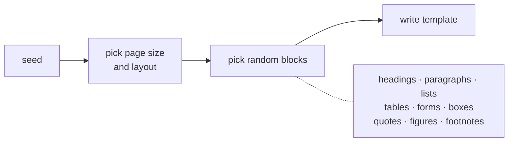

- Layouts: single column, 2–3 columns, or main text + sidebar.
- Optional header and footer with a page number.
- The same seed always gives the same template.

### 2. WebSight (`w_` · 123 templates)

These are real web pages (HTML) from the WebSight dataset by Hugging Face, with all text removed.

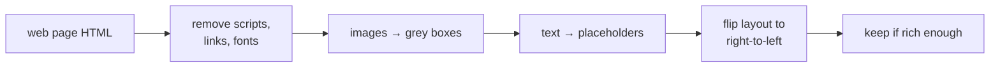

A page is kept only if it has at least 15 placeholders and a table, a list or multiple columns. Only 125
of the 3,000 pages scanned passed.

### 3. DocLayNet (`d_` · 100 templates)

These come from DocLayNet by IBM, a dataset of real document pages with every block on the page outlined
and labelled. Only the block positions are used, never the original text.

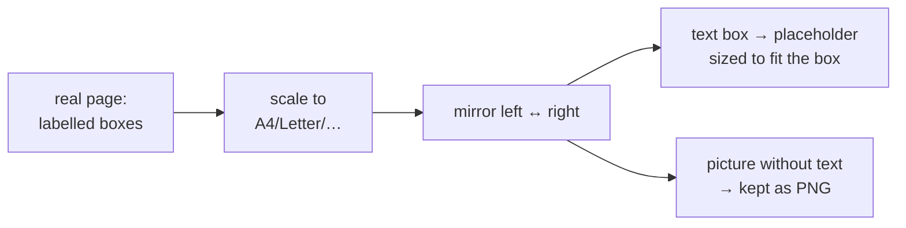

The pages are spread evenly over 6 document types: financial reports, scientific articles, laws, government
tenders, manuals and patents. Tables are rebuilt as empty tables. Of the 97 pictures in these 100 pages,
54 had PDF text inside and became grey boxes, as did all 26 formulas. Of the 43 without PDF text, 27 still
show text drawn into the image (logos, chemical formulas, screenshots, charts, labelled diagrams), found by
looking at each one; they are listed in `config/pictures_with_text.json` and became grey boxes too, because
that text would be on the page without being in the labels. The other 16 (photos, flags, icons) are kept as
images. When a page is generated, every grey box gets a photo from `img_pool/`.

---

## Checks every template passes

- It is a valid template whose placeholders match its `template.json`.
- It is a right-to-left Arabic page (`<html lang="ar" dir="rtl">`).
- It contains no links and no scripts. Any picture is a local PNG listed in its `template.json`.
- It can be filled with sample text without errors.
- It is not an exact copy of another template.

---

## How to create more templates

| You want | Do this |
|---|---|
| More grammar templates | Raise `--n-grammar`, e.g. `--n-grammar 2000` |
| A different random set | Change `--seed`; this replaces the current bank, it does not add to it |
| More WebSight templates | Raise `MAX_ROWS` in `src/from_websight.py`. About 1 page in 24 passes, so 500 templates need about 12,000 rows. New rows download automatically. |
| More DocLayNet templates | Raise `--n-doclaynet`. Pages that have pictures need their page image, which is read from the dataset once and cached in `data/raw/doclaynet_pages/` (about 0.9 GB was read for the current 24). The current download covers up to about 570 pages, but above about 120 the 6 document types are no longer even, because only 20 tender pages are cached. For more, raise `ROWS_PER_SHARD` in `src/from_doclaynet.py` and delete `data/raw/doclaynet_candidates.jsonl` so it downloads again. |
| New kinds of blocks | Add a block function in `src/grammar.py`, then register it in `BLOCKS` and `BLOCK_WEIGHTS` |
| A brand-new source | Write `src/from_xxx.py` that saves `template.html.j2` and `template.json` using the helpers in `src/bank.py`, add a new id prefix and source name in `schema/template.schema.json`, and call it from `src/build.py` |

After any change, rerun the build command. Dedup and validation run automatically, so bad or repeated
templates never reach the bank.

Each source can also run on its own: `python -m src.grammar --seed 0 --n 300`,
`python -m src.from_websight`, `python -m src.from_doclaynet`.

---

## Setup

```bash
python -m venv .venv
.venv/Scripts/python -m pip install -r requirements.txt
npm install
```

This installs jinja2, lxml, beautifulsoup4, datasets, jsonschema and Pillow (Pillow crops the kept
pictures). You need Python 3.12 (the spec asked for 3.11, but only 3.12 is installed on this machine and works) and
Node.js. Node runs `rtlcss`, the tool that flips web page layouts to right-to-left. Downloaded data is
cached in `data/raw/`, so later runs work without downloading again.

---

## Project layout

```
config/roles.json             default word range per slot type
schema/template.schema.json   rules every template.json must follow
src/build.py                  runs the whole pipeline
src/grammar.py                source 1: random layouts
src/from_websight.py          source 2: web pages
src/from_doclaynet.py         source 3: real document layouts
src/dedup.py                  removes exact copies
src/validate.py               checks + statistics
src/gallery.py                builds the preview pages
src/markdown.py               converts a filled page to Markdown (for the gallery's Markdown button)
assets/fonts/                 Noto Naskh Arabic + Amiri, used by the sample-text previews
docs/make_examples.py         remakes the before/after images in this README
demo/render_demo.py           demo of the next stage: varied fonts, papers and scan effects
demo/index.html               gallery of the demo images (demo/out/)
renders/                      per template: rendered image (.jpg) + filled page (.html), shown in the gallery
demo/fill_style.py            sample Arabic text + random style, shared by the demo and the SynthDoc adapter
synthdoc_adapter/             export bank templates to SynthDoc and render them with labels
synthdoc_out/                 SynthDoc's output: images, PDFs, HTML, slot boxes, word boxes
synthdoc_attacked/            SynthDoc pages after Augraphy + scan-simulator, with moved boxes
synthdoc_ocrsmith/            SynthDoc pages after OCRSmith's paper and capture effects, with moved boxes
requirements-attacks.txt      packages for the attack step (.venv-attacks)
pipeline/doc_pipeline.py      DocPipeline: template -> text -> SynthDoc -> effects -> Markdown with boxes
pipeline/server.py, static/   the sample generator page (Generate 16 samples + preview)
pipeline/llm_templates.py     optional: templates written by an LLM (Groq or local Ollama)
pipeline/img_pool.py          downloads img_pool/ and picks its photos
pipeline/text_pool.py         builds text_pool/ (Wikipedia, ar + en) and cuts text to fit each slot
text_pool/                    Wikipedia text for the slots (ar.json, en.json; built, not in git)
img_pool/                     500 photos for the templates' picture boxes (+ sources.json)
pipeline_out/                 generated samples, one folder per run
requirements-pipeline.txt     packages for .venv-pipeline (everything in one environment)
templates/                    the bank (one folder per template)
bank_index.jsonl              one line per template
reports/                      statistics
previews/, gallery/           for viewing only
```

---

## Sources and licences

| Prefix | Source | Licence |
|---|---|---|
| `g_` | Our grammar generator | own-generated (placeholder; choose the project licence) |
| `w_` | [WebSight](https://huggingface.co/datasets/HuggingFaceM4/WebSight) v0.1, by Hugging Face (HuggingFaceM4) | CC-BY-4.0 |
| `d_` | [DocLayNet v1.1](https://huggingface.co/datasets/docling-project/DocLayNet-v1.1), by IBM Research (layout positions, plus crops of pictures with no text) | CDLA-Permissive-1.0 |

---

## Known limitations

- **WebSight pages look like websites** (menus, banners, cards), not printed documents. They add variety
  but are less realistic.
- **DocLayNet word ranges are estimates.** They will only be accurate once the filling stage measures
  real Arabic text in each box.
- **Text inside photo pixels is not detected.** A kept DocLayNet picture could still show text that is part
  of the image itself (for example a photo of a sign); only PDF text is checked.
- **The placeholder previews hide the typography.** Each placeholder is a small fixed-size tag such as
  `paragraph · 25–60`, so titles, headings and paragraphs look alike. The rendered page next to it shows
  the template filled.
- **Templates name their fonts but do not include them.** The render pipeline loads OCRSmith's 13 font
  families, and the plain sample-text previews load Noto Naskh Arabic and Amiri from `assets/fonts/` (free
  OFL fonts). Any filling stage must do the same: install the fonts, or add them through `{{ style }}` with
  `@font-face`.
- **Font size only changes for grammar templates.** WebSight pages keep their original pixel sizes and
  DocLayNet boxes their measured sizes, so a random size in the render pipeline only changes their font family.
