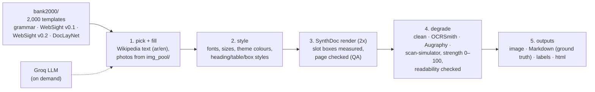
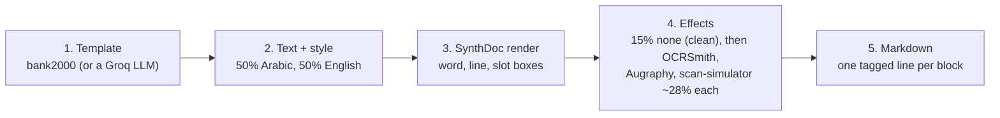

# OCRSynthGen: Arabic Document Template Bank and Synthetic OCR Generator

This project turns a bank of **empty document templates** (Arabic and English) into a **labelled synthetic
OCR dataset**: page images with word, line and block boxes, text and Markdown.

A template is a page layout with no text. Every place where text should go is a placeholder such as
`{{ slot_3 }}`, and each placeholder has a type (title, paragraph, table cell…) and a word range. The
generator fills the placeholders with Wikipedia text, styles and renders the page, degrades it like a scan
or photo, and writes the ground truth.

**Result:** a bank of **2,000 diverse, checked templates** (`bank2000/`, half Arabic, half English) that the
generator uses by default, a pipeline that fills, styles, renders, labels and degrades them, and checks at
every step that no text is hidden, cut, covered or mislabelled. (bank2000 was chosen from an earlier bank of
113,077 templates; that bank and the scripts that built it are no longer in the repository, only in its git
history, up to commit 2f6c254.)

For a detailed, step-by-step explanation of how a page is made (template storage, text injection, the exact
SynthDoc and OCRSmith arguments, the Wikipedia text format, the label formats), see
[OCRREADME.md](OCRREADME.md); [section 0](OCRREADME.md#0-the-final-version-in-short) covers the final version.

## The final pipeline in one picture



1. **Templates** ([src/bank2000.py](src/bank2000.py)): 2,000 templates chosen for diversity (farthest-first on
   layout features; no two share 75% of their features, no two have the same structure) from four sources:
   500 from the grammar (random combinations of headings, paragraphs, lists, tables, forms, card grids,
   key/value lists, stat boxes, timelines, picture rows, callouts, in single/columns/grid/sidebar/letter/report
   layouts), 450 WebSight v0.1, 450 WebSight v0.2 (Tailwind pages, the CSS they use inlined) and 600 DocLayNet
   layouts. Every one was rendered once and kept only if the page passed every check. If fewer than 2,000
   passed, the bank is topped up with more candidates, then with Groq LLM templates. Picture places are real
   `` tags (``) with a hint of what they show.
2. **Text** ([pipeline/text_pool.py](pipeline/text_pool.py)): Wikipedia (Arabic or English, as the template
   says), one article per page, so a page reads as one document: its title in the title slot, its sentences
   in paragraphs, short sentences in list items, words and numbers in cells and fields.
3. **Pictures** ([pipeline/img_pool.py](pipeline/img_pool.py)): `img_pool/` holds 3,193 photos (Picsum and
   Wikimedia Commons quality images: animals, landscapes, nature, architecture, people, food, sports,
   transport, patterns); a picture slot gets one that matches its hint (a "team" slot gets people).
4. **Style** ([demo/fill_style.py](demo/fill_style.py), [pipeline/themes.py](pipeline/themes.py)): font family,
   size, weights, line height, alignment, margins, ink, digits, plus a theme: accent colour, heading style
   (plain, accent, underline, side bar, band, rule above), table style (grid, striped, tinted header, rules,
   boxed), box style and page tint. WebSight pages keep their own design with its colours turned around the
   colour wheel. Hundreds of different-looking pages come from one template.
5. **Render + checks** ([pipeline/doc_pipeline.py](pipeline/doc_pipeline.py), [pipeline/qa.py](pipeline/qa.py)):
   SynthDoc renders at 2x. Before layout, text that doesn't fit its box is fitted (tighter lines, smaller
   font down to 80%, then whole words dropped) and low-contrast text is darkened. After layout every word is checked: hidden, cut, outside the page, overlapping
   another slot's text, covered by a picture or anything opaque, low contrast, CSS-generated text, and
   whether it has ink in the rendered image at all. A page with any of these is
   made again (another style, then another template).
6. **Degradation** ([pipeline/degrade.py](pipeline/degrade.py)): clean 15%, else OCRSmith, Augraphy or
   scan-simulator (about 28% each), at a strength from 0 to 100 (50 = each tool's own settings), set per tool
   on the generator page or on the command line. After the effect every word is checked again (still there
   and inside the picture, not under a streak or blot,
   not faded, sharp enough, standing out from the noise); if not, the effect is retried lighter.
7. **Ground truth = the Markdown** ([pipeline/groundtruth.py](pipeline/groundtruth.py)): `<name>.md` holds only
   this, one line per slot (text block), in reading order, text first and box last, in image pixels:

   ```
   <text>المملكة العربية السعودية <bbox>50, 20, 450, 65</bbox></text>
   <text>KINGDOM OF SAUDI ARABIA <bbox>50, 20, 450, 65</bbox></text>
   ```

   The box hugs the letters (from the font's glyph measurements, not the line height), and moves with the
   page through every effect.

## Quick start: make a training set

```bash
cd D:\code\OCR\arabic-template-bank
.venv-pipeline\Scripts\python -m pipeline.dataset --n 10000 --out datasets\ocr_v1 --workers 6
```

| In `--out` | What |
|---|---|
| `images/<id>.jpg` | the page |
| `labels/<id>.json` | words, lines and slots (blocks), each with its box in image pixels and its text; how the page was made (template, style, theme, effect, strength, readability); the Wikipedia articles used |
| `markdown/<id>.md` | the ground truth: `<text>… <bbox>x1, y1, x2, y2</bbox></text>`, one line per text block, nothing else |
| `html/<id>.html` | the filled page |
| `manifest.jsonl` | one line per sample: id, `split` (train/val, 5% val), files, language, template, effects… |
| `dataset.json` | counts and the options, sources and licences of the set |

Options: `--language ar|en`, `--source grammar|websight|websight2|doclaynet`, `--tashkeel none|partial|full`
(Arabic diacritics; default 40% none, 30% partial, 30% full),
`--effect clean|ocrsmith|augraphy|scan-simulator|augraphy+scan-simulator`,
`--strength-ocrsmith 0.5`, `--strength-augraphy 0.5`, `--strength-scan-simulator 0.5` (0 lightest, 1
strongest), `--val 0.05`, `--seed 0` (the same seed makes the same set). An interrupted run continues where
it stopped when run again. Speed: about 3–6 s per sample per worker; each worker needs about 1.5 GB of memory.

To look at samples one by one: `.venv-pipeline\Scripts\python pipeline\server.py`, then open
http://localhost:8765. Menus pick the language, template source (or **Template maker: LLM** for a new Groq
template), effect and text; three sliders set the strength of OCRSmith, Augraphy and scan-simulator. Each card
opens a preview that shows the page and its Markdown side by side (pointing at a Markdown line marks its box on
the page), plus tabs for the slot and word boxes, the clean render, HTML, labels and details (theme, strength,
readability, rejected renders).

To check finished samples independently (ground truth = labels = page text, boxes on the image, ink in every
box, no overlapping text), and to draw the ground-truth boxes on every page with contact sheets:

```bash
.venv-pipeline\Scripts\python -m pipeline.qa --n 40                 :: make 40 samples, report what the checks caught
.venv-pipeline\Scripts\python -m pipeline.audit pipeline_out\qa     :: audit them, draw the boxes
```

`bank2000/` is built once and kept in git. Building it again needs the earlier bank from the git history
(commit 2f6c254: `templates/`, `data/raw/` and `python -m src.bank2000 --workers 6`).

**Licences of a generated set:** the text is Wikipedia (CC BY-SA 4.0), so a set you share must keep
CC BY-SA and the attribution (each label lists its articles); photos are from Picsum (Unsplash License) and
Wikimedia Commons (each photo's licence and author in `img_pool/sources.json`); templates come from WebSight
(CC BY 4.0), DocLayNet (CDLA-Permissive-1.0) and our own grammar.


---

## The sample generator: the whole pipeline in one class

`pipeline/doc_pipeline.py` holds `DocPipeline`, which makes one labelled, scan-like page from start to finish.
`pipeline/server.py` puts it behind a page with a **Generate 16 samples** button.



1. **Template:** a random bank2000 template (grammar, WebSight v0.1, WebSight v0.2 and DocLayNet equally often). If a page ends up
   with no readable text (a template that is all pictures), another template is picked.
2. **Text:** Arabic or English (the template's language, 50/50), taken from Wikipedia (see below). English pages are switched to
   left-to-right and use installed Latin fonts (Georgia, Calibri, Cambria…: Windows fonts, see
   [Running on a server](#running-on-a-server)); Arabic pages use OCRSmith's 13 Arabic fonts.
3. **Render:** SynthDoc renders the page and measures every word, line and slot (page 1 only).
4. **Effects:** none at all (15%: a clean, sharp page exactly as SynthDoc rendered it, like a born-digital
   document), else OCRSmith, Augraphy or scan-simulator, equally often (about 28% each; Augraphy followed
   by scan-simulator is still available with `--effect augraphy+scan-simulator`). Every box moves
   with the page; faint pages are retried with a new seed.
5. **Markdown:** the ground truth only, one `<text>… <bbox>x1, y1, x2, y2</bbox></text>` line per text block
   in reading order. Word and line boxes are in the sample's `.json`.

**Text, from Wikipedia:** the words come from Arabic and English Wikipedia (the `wikimedia/wikipedia` dataset,
dump of 2023-11-01, through Hugging Face's dataset server): edited and cited text, openly licensed
(CC BY-SA 4.0), on every topic. `text_pool/` holds a few thousand random articles per language (Arabic:
4,122 articles, about 130,000 different words; English: 4,533 articles, about 198,000), split into the kinds
of text a document has, and each kind fills the matching slots:

| From the article | Fills |
|---|---|
| article titles | titles |
| section headings (short lines) | headings, table headers, labels (+ ":") |
| list lines | list items |
| paragraphs, cut at whole sentences near the wanted length | paragraphs, quotes, captions, footnotes, sidebars |
| a few words from a sentence | table cells and form values (when they aren't a random number, date or phone) |

Reference sections are skipped, and lines with much text in the other script are dropped, so a page stays in
one language. Each sample's `.json` lists the articles its text came from, with their source and licence; CC BY-SA asks for that attribution, and a shared dataset made from it should keep the same
licence. The old demo sentences are still there (`text="demo"`, or **Text: demo sentences** on the page). To
build the pool again, or bigger:

```bash
.venv-pipeline\Scripts\python -m pipeline.text_pool --articles 5000
```

Real words are longer than the demo ones, and English words longer still, so in narrow table cells some words
are cut at the cell edge. Those are left out of the labels: the pipeline extends SynthDoc's word measuring (in
memory, nothing in the SynthDoc folder changes) to report a word cut on its left or right side.

**Pictures:** every picture slot of a bank2000 template (``) gets a
photo from `img_pool/` that matches the slot's hint (people for "team", food for "menu"…), scaled to cover
its frame, so the layout and the text boxes don't change. The Markdown names the photo and the labels list
the photos used. `img_pool/` holds 3,193 photos: 993 from [Lorem Picsum](https://picsum.photos) (Unsplash
licence) and 2,200 "quality images" from Wikimedia Commons in nine categories (animals, landscapes, nature,
architecture, people, food, sports, transport, patterns); each one's author, licence and page are in
`img_pool/sources.json`. They are photos rather than document figures, and titles that suggest text (signs,
posters, maps, logos, packaging, shop fronts) are skipped, because a picture with text in it would put words
on the page that the labels don't know about. To download again (about 500 MB):

```bash
.venv-pipeline\Scripts\python -m pipeline.img_pool
```

Each sample writes `<name>.jpg` (final), `<name>_clean.jpg`, `<name>.html`, `<name>.md`, `<name>.json`
(labels) and `<name>_words.jpg` / `<name>_slots.jpg` (boxes drawn).

```python
from pipeline.doc_pipeline import DocPipeline
pipe = DocPipeline("pipeline_out/mine")                 # weights can be changed:
pipe = DocPipeline("pipeline_out/mine", languages={"ar": 1}, effects={"ocrsmith": 3, "augraphy": 1})
pipe.sample(seed=7)                                     # one sample
pipe.run(n=16)                                          # sixteen
```

```bash
.venv-pipeline\Scripts\python -m pipeline --n 16          # from the command line
.venv-pipeline\Scripts\python pipeline\server.py          # the generator page: http://localhost:8765
```

The page has menus to force the language, the effect or the template source, and a preview window with
tabs: final page, word boxes, slot boxes, clean render, HTML code, Markdown, labels and details (timings,
seed). With 4 worker processes, 16 samples take about 10–15 seconds; one sample takes 2–7 seconds, most of it
SynthDoc's render. Every run is kept in `pipeline_out/run_<time>_<port>/`.

**One environment for everything:** `.venv-pipeline` holds the packages of the SynthDoc, OCRSmith and
attacks environments (same versions, `requirements-pipeline.txt`). SynthDoc, its Arabic extension, OCRSmith
and scan-simulator are used from their folders through a path file in the venv, without installing or
changing them:

```bash
py -3.12 -m venv .venv-pipeline
.venv-pipeline\Scripts\pip install -r requirements-pipeline.txt
```
then put these four lines in `.venv-pipeline\Lib\site-packages\ocr_sources.pth`:
```
D:\code\OCR\synthdoc-arabic-test\synthdoc\src
D:\code\OCR\synthdoc-arabic-test\arabic_ext
D:\code\OCR\ocrsmith\src
D:\code\OCR\scan-simulator
```

**Templates from an LLM (optional):** `pipeline/llm_templates.py` asks a model to write a document page
(invoice, report, letter, form…). The page then goes through the same steps as a WebSight page: text to
slots, pictures to grey boxes, CSS flipped to right-to-left. Two ways to run the model:

- **Groq (fast, hosted):** copy `.env.example` to `.env` and set `GROQ_API_KEY`. `GROQ_MODEL` picks the
  model; the default is `openai/gpt-oss-20b`. `.env` is git-ignored.
- **Ollama (local):** with no Groq key, a local Ollama with `qwen2.5-coder:1.5b` is used.

Pick **Template maker: LLM** on the page; the menu shows which model is set up. Every template the model
writes is kept in `pipeline_out/llm_templates/`. Groq's free limit is 8,000 tokens a minute, about three
templates, so when Groq says "too many requests" the pipeline waits as told (up to three times), then reuses
a saved LLM template ("reused LLM template" on the card). Only with no saved template at all does a sample
fall back to the bank ("fallback"). To build up the saved set beforehand, within the limit:

```bash
.venv-pipeline\Scripts\python -m pipeline.llm_templates --n 30
```


---

## Running on a server

What a machine needs to make data:

| What | Where it comes from |
|---|---|
| this repository (main) | `git clone --depth 1 https://github.com/Yousef10p/OCRSynthGen.git arabic-template-bank` |
| SynthDoc + its Arabic extension | the `synthdoc-arabic-test/` folder (`synthdoc/src`, `arabic_ext`), copied next to this repository |
| OCRSmith (and its 13 Arabic fonts) | `git clone https://github.com/atlasia-ma/OCRSmith ocrsmith`, next to this repository |
| scan-simulator | `git clone https://github.com/s1mb1o/scan-simulator`, next to this repository |
| `img_pool/` (3,193 photos, 500 MB) and `text_pool/` (Wikipedia text, 26 MB) | copied from a machine that has them, or made again: `python -m pipeline.img_pool`, `python -m pipeline.text_pool --articles 5000` |
| Python 3.12, `requirements-pipeline.txt`, Chromium for Playwright | `python -m playwright install chromium` (on Linux: `--with-deps`) |
| the Latin fonts English pages use | on Windows they are there; on Linux install them (Georgia, Times New Roman, Arial, Verdana, Trebuchet MS come with `ttf-mscorefonts-installer`); a missing font is replaced by Chromium's default, which still renders and labels correctly but makes English pages look more alike |

The four folders sit side by side; a path file in the venv points at the other three (see Setup). Then:

```bash
python -m pipeline.dataset --n 100000 --out datasets/batch_01 --workers 16 --seed 1
```

A different `--seed` per batch gives different pages; an interrupted batch continues where it stopped.
Each worker needs about 1.5 GB of memory and makes a sample every 3–6 s.

---

## Setup

```bash
py -3.12 -m venv .venv-pipeline
.venv-pipeline\Scripts\pip install -r requirements-pipeline.txt
.venv-pipeline\Scripts\python -m playwright install chromium
```

then put these four lines (the folders next to this repository) in
`.venv-pipeline\Lib\site-packages\ocr_sources.pth` (on Linux
`.venv-pipeline/lib/python3.12/site-packages/ocr_sources.pth`):

```
D:\code\OCR\synthdoc-arabic-test\synthdoc\src
D:\code\OCR\synthdoc-arabic-test\arabic_ext
D:\code\OCR\ocrsmith\src
D:\code\OCR\scan-simulator
```

Optional: Node.js and `npm install` (rtlcss) only for LLM-written templates, and `.env` with `GROQ_API_KEY`.

---

## Project layout

```
pipeline/doc_pipeline.py      DocPipeline: template -> text -> SynthDoc -> effects -> ground truth
pipeline/dataset.py           the dataset command (many samples, manifest, train/val split)
pipeline/server.py, static/   the sample generator page (Generate 16 samples + preview)
pipeline/degrade.py           OCRSmith, Augraphy, scan-simulator, with strength and readability checks
pipeline/groundtruth.py       the Markdown ground truth
pipeline/qa.py, audit.py      checks of rendered pages and of finished samples
pipeline/themes.py            theme colours, heading / table / box styles
pipeline/tashkeel.py          Arabic diacritics (none / partial / full)
pipeline/text_pool.py         builds text_pool/ (Wikipedia, ar + en) and cuts text to fit each slot
pipeline/img_pool.py          downloads img_pool/ and picks its photos
pipeline/llm_templates.py     optional: templates written by an LLM (Groq or local Ollama)
demo/fill_style.py            the random style (fonts, sizes, digits) and the slot texts
synthdoc_adapter/             SynthDoc page export, labels, Augraphy and OCRSmith helpers
src/                          template helpers (bank.py, dedup.py), bank2000.py (how the bank was chosen;
                              adapt() also prepares LLM templates), grammar.py, near_dedup.py, from_websight.py
config/roles.json             default word range per slot type
bank2000/                     the 2,000-template bank (templates/, index.jsonl, report.json)
text_pool/, img_pool/         Wikipedia text and photos (made locally, not in git)
pipeline_out/                 generated samples, one folder per run (not in git)
```

---

## Sources and licences

| Prefix | Source | Licence |
|---|---|---|
| `g_` | Our grammar generator | own-generated (placeholder; choose the project licence) |
| `w_` | [WebSight](https://huggingface.co/datasets/HuggingFaceM4/WebSight) v0.1 and v0.2, by Hugging Face (HuggingFaceM4) | CC-BY-4.0 |
| `d_` | [DocLayNet v1.1](https://huggingface.co/datasets/docling-project/DocLayNet-v1.1), by IBM Research (layout positions, plus crops of pictures with no text) | CDLA-Permissive-1.0 |

Text: Wikipedia (CC BY-SA 4.0). Photos: Lorem Picsum (Unsplash licence) and Wikimedia Commons (per photo in
`img_pool/sources.json`).

---

## Known limitations

- **WebSight pages look like websites** (menus, banners, cards), not printed documents. They add variety
  but are less realistic.
- **Text inside photo pixels is not detected.** Photos whose titles suggest text are skipped, but a photo can
  still show some writing that the labels don't know about.
- **Font size only changes for grammar templates.** WebSight pages keep their original pixel sizes and
  DocLayNet boxes their measured sizes, so a random size only changes their font family.
