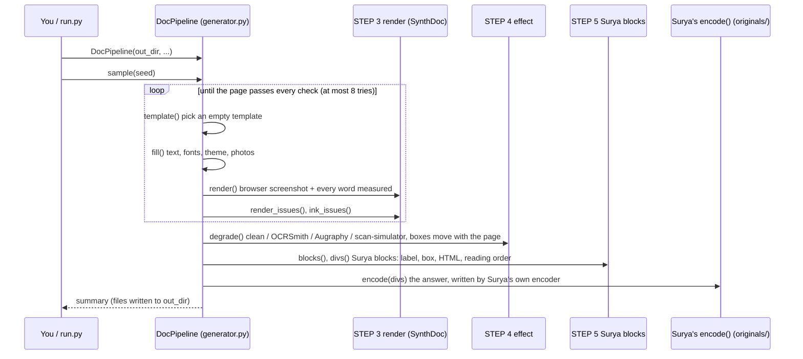
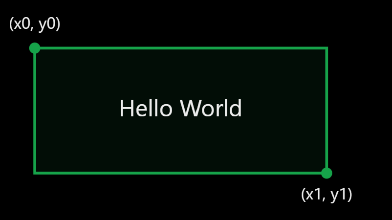
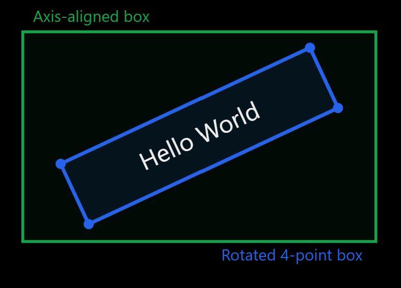
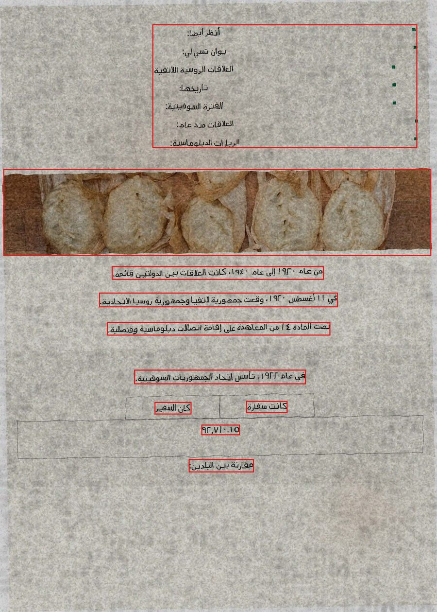
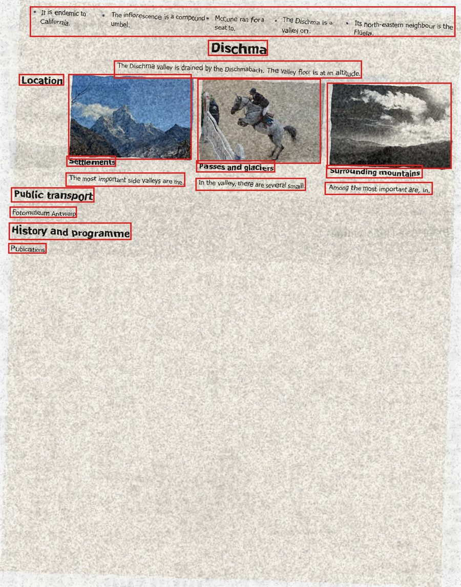
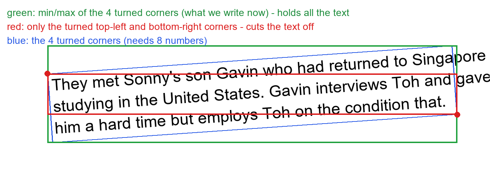

# OCRSynthGen: synthetic Arabic and English pages for training Surya OCR 2.5

This project makes **training pages for Surya OCR 2.5** (`datalab-to/surya-ocr-2.5`). Each page is a real-looking
document (Arabic or English) with a label written **exactly the way Surya answers**, so fine-tuning makes Surya
read better without changing the shape of its answers.

```
empty template  ->  fill with text  ->  render in a browser  ->  scan/photo effect  ->  Surya label
 (bank2000/)        (Wikipedia, fonts)     (SynthDoc, 2x)          (OCRSmith, ...)       (Surya's own encoder)
```

**Contents**

1. [Where everything is](#1-where-everything-is)
2. [Setup (once)](#2-setup-once)
3. [Run it: three ways](#3-run-it-three-ways)
4. [What one sample is](#4-what-one-sample-is)
5. [How the pipeline runs, step by step](#5-how-the-pipeline-runs-step-by-step)
6. [Calling the steps yourself](#6-calling-the-steps-yourself)
7. [Surya's label format](#7-suryas-label-format)
8. [How our labels match Surya](#8-how-our-labels-match-surya)
9. [Boxes through the effects](#9-boxes-through-the-effects)
10. [Fine-tuning Surya](#10-fine-tuning-surya)
11. [Files](#11-files)
12. [Sources, licences, limits](#12-sources-licences-limits)

---

## 1. Where everything is

Everything is in **`D:\code\OCR\arabic-template-bank`**, branch `main`
(GitHub: `Yousef10p/OCRSynthGen`). Nothing else is needed: the projects it uses are copied into it.

Our code is 5 files in `pipeline/`:

| File | What it is |
|---|---|
| [generator.py](pipeline/generator.py) | the steps: the class **`DocPipeline`**, marked `STEP 1` ... `STEP 6` |
| [checking.py](pipeline/checking.py) | the checks and fixes around the steps: page checks, readability after the effect, box fixes, faster rendering |
| [run.py](pipeline/run.py) | the two commands: `dataset` (make a training set) and `website` |
| [pools.py](pipeline/pools.py) | downloads the Wikipedia text and the photos (once) |
| [llm_templates.py](pipeline/llm_templates.py) | optional: templates written by an LLM |

The other projects are in [originals/](originals/README.md), copied unchanged with their licences: SynthDoc
and its Arabic extension (render the page), OCRSmith (fonts, paper, scan/photo effects), scan-simulator,
Augraphy, and Surya's `compact.py` (`encode()` / `decode()`) and `prompts.py` (the prompts, allowed tags and
labels). Fixes we need are applied in memory by `checking.py`; the files in `originals/` stay as written.

If something fails, the error says in which step: `sample s07 failed in STEP 4 effect: ...`.
Search `generator.py` for that `STEP`.

---

## 2. Setup (once)

```bash
py -3.12 -m venv .venv-pipeline
```
```bash
.venv-pipeline\Scripts\pip install -r requirements-pipeline.txt
```
```bash
.venv-pipeline\Scripts\python -m playwright install chromium
```

The text, picture, font and graphics pools are made once (not in git):

```bash
.venv-pipeline\Scripts\python -m pipeline.pools text --articles 5000
```
```bash
.venv-pipeline\Scripts\python -m pipeline.pools images --polaris-shards 30 --pd12m 20000
```
```bash
.venv-pipeline\Scripts\python -m pipeline.pools fonts
```
```bash
.venv-pipeline\Scripts\python -m pipeline.pools graphics
```

**Fonts** (`font_pool/`, 100 families from Google Fonts, SIL OFL or Apache, chosen by Google Fonts' own
popularity rank): the 10 most used families with Arabic letters (Google Sans, Rubik, Cairo, Tajawal, IBM Plex Sans
Arabic, Almarai, Amiri, Readex Pro, Vazirmatn, Changa), the 10 most used for English (Roboto, Open Sans, Inter,
Montserrat, Lato, Arimo, Roboto Condensed, Oswald, DM Sans, Playfair Display), and 80 more: every other family
with Arabic letters (all of them have Latin letters too), then English families of every kind (serif, sans,
display, handwriting, monospace). Each family's regular and bold TrueType files are kept only if they have every
character its pages need (fontTools reads the file's character map): Arabic letters, tashkeel marks and
Arabic-Indic digits for an Arabic family, A-Z, a-z, 0-9 and punctuation for a Latin one. Arabic pages pick from
these and OCRSmith's Arabic fonts, English pages from these (the Arabic families too: they have Latin letters)
and the installed Windows fonts; code blocks use the monospace ones. Index: `font_pool/fonts.json`.

**Graphics** (`img_pool/graphics/`, 6,000 pictures drawn once, each with its exact label): 2,000 charts
(Figure), 1,000 flowcharts (Diagram), 1,500 molecules (Chemical-Block: ZINC-250k molecules, laid out by RDKit,
drawn with matplotlib) and 1,500 equations (Equation-Block, matplotlib's mathtext). Charts and flowcharts carry
Arabic words on Arabic pages and English on English ones. Index: `img_pool/graphics/graphics.jsonl`.

The picture pool is captioned photos, each with the captions that become its label
(`<p class="img-desc">...</p>`, `generator.picture_html()`). The index is
`img_pool/captions.jsonl` (one line per picture: file, source, licence, captions, category). Three sources:

| Source | Pictures | Captions |
|---|---|---|
| `img_pool/output_dataset/k*/` (uploaded Flickr8k: `Images/` + `captions.txt`) | 7,612 of 8,000 | 5 by people |
| Polaris (`yuwd/Polaris`, 30 train shards; only the human `refs`, not the rated `cand`) | 7,272 | 5-10 by people |
| PD12M (`Spawning/PD12M`, 20,000 drawn from 12 metadata shards) | 20,000 | 1 long, generated |

A picture whose captions mention text in it (signs, posters, maps, coins, letters...) is left out, because the
labels can't know that text. People's captions are kept as written; "The image shows X" (PD12M) becomes "A
photograph showing X", Surya's most common start; a painting or drawing gets `Artwork:` / `Illustration:` as
Surya writes them. The download keeps the files it has, so a stopped run can be started again.

Optional: `npm install` (Node.js) and a `.env` with `GROQ_API_KEY`, only for templates written by an LLM.

All commands below run from `D:\code\OCR\arabic-template-bank`.

---

## 3. Run it: three ways

**a) The website** (look at samples one by one):

```bash
.venv-pipeline\Scripts\python -m pipeline.run website
```

Open http://localhost:8765 and press **Generate 16 samples**. Menus choose the language, effect, Surya task,
template source and tashkeel; sliders set each effect's strength and the % of pages in colour. Click a card to see the page, its Surya
answer, the boxes, the HTML and the labels. Every run is saved in `pipeline_out/run_<time>_<port>/`.

**b) A training set** (many samples in parallel):

```bash
.venv-pipeline\Scripts\python -m pipeline.run dataset --n 1000 --out datasets\v1 --workers 4 --seed 1
```

| Option | Meaning |
|---|---|
| `--task full_ocr+block_ocr` | which Surya prompt (default: 40% `full_ocr`, 25% `layout`, 35% `block_ocr`); also `layout`, `table` |
| `--language ar` / `en` | one language only (default 50/50) |
| `--effect clean` / `ocrsmith` / `augraphy` / `scan-simulator` | one effect only (default: 15% clean, the rest even) |
| `--tashkeel none` / `partial` / `full` | Arabic diacritics (default 40/30/30) |
| `--colour-share 0.5` | share of pages in colour, 0 to 1 (the rest light: white, off-white or a light tint) |
| `--strength-ocrsmith 0.5` (and `-augraphy`, `-scan-simulator`) | 0 lightest, 0.5 the tool's own settings, 1 strongest |
| `--seed 1` | the same seed makes the same pages; use a new seed for each batch |
| `--val 0.05` | share of pages in the validation split |

An interrupted run continues where it stopped. Speed: about 4 s per sample per worker; each worker needs
about 1.5 GB of memory.

**c) From Python:**

```python
from pipeline.generator import DocPipeline

pipe = DocPipeline("pipeline_out/mine")       # files go here
summary = pipe.sample(seed=7)                 # one sample
print(summary["task"], summary["target_file"], summary["seconds"])

pipe.run(n=16)                                # sixteen samples
```

Choose what you get:

```python
pipe = DocPipeline("pipeline_out/arabic_scans",
                   languages={"ar": 1},                          # only Arabic
                   effects={"scan-simulator": 3, "ocrsmith": 1}, # weights
                   tasks={"full_ocr": 1},                        # only full-page OCR
                   tashkeel={"none": 1},
                   strengths={"scan-simulator": 0.8})
pipe.sample(seed=1, name="page1")
pipe.sample(seed=2, task="block_ocr", effect="clean")           # force one sample's choices
```

---

## 4. What one sample is

`pipe.sample(seed=7, name="s7")` writes these files (the dataset command puts each kind in its own folder:
`images/`, `prompts/`, `targets/`, `pages/`, `labels/`, `markdown/`, `html/`, plus `manifest.jsonl`):

| File | What it is |
|---|---|
| `s7.jpg` | what Surya is shown: the page, or (for `block_ocr`) one block cut out of it |
| `s7.prompt.txt` | Surya's prompt, word for word |
| `s7.target.txt` / `s7.target.json` | **the training answer**: what Surya should reply |
| `s7_page.jpg` | the whole page, when `s7.jpg` is a cut-out |
| `s7.json` | labels: every word, line and slot with its box, the Surya blocks, how the page was made |
| `s7.md` | one line per text block: `<text>... <bbox>x1, y1, x2, y2</bbox></text>` (pixels) |
| `s7.html` | the filled page |
| `s7_clean.jpg`, `_words.jpg`, `_slots.jpg`, `_blocks.jpg` | the page before effects, and the boxes drawn (only with `extras=True`, the default) |

Example pair, `s7.prompt.txt` and `s7.target.txt` (`full_ocr`, one long line, shortened here):

```text
OCR this image to HTML. Each block is a div with data-label and data-bbox (x0 y0 x1 y1, normalized 0-1000).
```
```text
<|Section-Header|><|877|><|162|><|981|><|190|><h2>تاريخها</h2><|Text|><|22|><|202|><|980|><|265|><p>تأسست الجامعة في ...</p><|Image|><|22|><|14|><|981|><|149|><p class="img-desc">A close-up photograph of a dish of food.</p>
```

---

## 5. How the pipeline runs, step by step

### 5.1 The order of calls



### 5.2 The same, as code

This is `DocPipeline.sample()` with only its calls kept (the real one is in
[pipeline/generator.py](pipeline/generator.py)):

```python
def sample(self, seed, name=None, language=None, effect=None, task=None):
    rng = random.Random(seed)                         # one seed decides everything
    lang = language or pick(rng, self.languages)      # "ar" / "en"
    effect = effect or pick(rng, self.effects)        # "clean" / "ocrsmith" / "augraphy" / "scan-simulator"
    task = task or pick(rng, self.tasks)              # "full_ocr" / "layout" / "block_ocr" / "table"

    for attempts in range(1, ATTEMPTS + 1):           # 1. template + 2. fill + 3. render, until clean
        if attempts % 2 == 1:                         #    a new template every second try
            meta, text, folder, note = self.template(rng, name, lang, need_table=task == "table")
        page, values, style = self.fill(meta, text, folder, rng, lang)
        clean, ocr, slots, pages, qa = self.render(page, values, name)
        issues = {**render_issues(ocr, qa), **ink_issues(clean, ocr["words"])}
        if not issues:
            break

    words, cut = split_words(ocr)                     # the measured words
    plan = carry(qa["struct"])                        # tables, rows, columns, lists, pictures
    plan = to_ink(plan, clean)                        # lists and tables: only what is drawn in them
    image, boxes, attacks, strength, check, moved = self.degrade(     # 4. effect
        clean, words, rng, effect, corners(plan))
    regions = slot_regions(meta["slots"], words, boxes, lang, positioning, qa["slots"])  # one per slot

    width, height = image.size                        # 5. Surya labels
    rects = rebuild(plan, moved, width, height)
    blks = blocks(regions, roles, qa["struct"], rects, lang, positioning, self.categories, width, height)
    if task == "full_ocr":
        target = encode(divs(blks, width, height))    # Surya's encode() on the page's div HTML
    elif task == "layout":
        target = layout(blks, width, height)          # JSON, one line
    elif task == "block_ocr":
        block, crop = rng.choice(cuts)                # a block whose cut-out takes in no neighbour
        target = encode(block["html"])                # Surya's encode() on that block's content
    # 6. write <name>.jpg, .prompt.txt, .target.txt, .json, .md, .html
```

### 5.3 Each step, its file, and what it does

| Step | Call | Where in `generator.py` | What happens |
|---|---|---|---|
| 1 template | `DocPipeline.template()` | STEP 1 | a random template from `bank2000/` (2,000, half Arabic, half English; 4 sources: grammar, WebSight v0.1, WebSight v0.2, DocLayNet), or one written by an LLM (`llm_templates.py`) |
| 2 fill | `DocPipeline.fill()` | STEP 2 (text and photos from `pools.py`) | Wikipedia text (one article per page), random fonts and sizes, a colour theme (half the pages light: white, off-white or a light tint with near-black text; half in colour: any hue, dark or bright, with text at least 7:1 against it and accents at least 4.5:1), photos for picture slots, Arabic diacritics |
| 3 render | `DocPipeline.render()` | STEP 3 | SynthDoc lays the page out in Chromium at 2x (about 192 dpi), takes the screenshot and measures every word, table, list and picture |
| 3 checks | `render_issues()`, `ink_issues()` | STEP 3 | hidden, cut, overlapping, covered, off-page, low-contrast or invisible text: the page is made again |
| 4 effect | `DocPipeline.degrade()` -> `degrade()` | STEP 4 | clean (15%), OCRSmith, Augraphy or scan-simulator; boxes move with the page; every word checked still readable, else retried lighter |
| 5 regions | `slot_regions()` | STEP 6 | the words of each slot joined: its text and its box |
| 5 blocks | `blocks()`, `divs()` | STEP 5 | Surya's blocks: label, HTML, box, reading order (section 8), as `<div data-bbox data-label>` HTML |
| 5 answer | `encode()` | `originals/surya/inference/compact.py` | Surya's own encoder writes the answer (`layout` is JSON: `layout()`) |
| 6 labels | `build_label()` | STEP 6 | the labels JSON (words, lines, slots) |

---

## 6. Calling the steps yourself

Any step can be used on its own. Run these from the project folder with `.venv-pipeline\Scripts\python`.
On Windows, run `set PYTHONIOENCODING=utf-8` first, or printing Arabic text fails.

**Render a page and look at what was measured:**

```python
import random
from pipeline.generator import DocPipeline

pipe = DocPipeline("pipeline_out/try")
rng = random.Random(3)
meta, text, folder, note = pipe.template(rng, "t1", "ar")
page, values, style = pipe.fill(meta, text, folder, rng, "ar")
clean, ocr, slots, pages, qa = pipe.render(page, values, "t1")

clean.save("pipeline_out/try/clean.png")
print(len(ocr["words"]), "words;", ocr["words"][0]["text"], ocr["words"][0]["x"], ocr["words"][0]["y"])
print(style["font"], style["size_pt"], style["theme"])
```

**Put an effect on the page** (continuing from above; the word boxes come back moved with the page):

```python
from pipeline import checking, generator as G

words = ocr["words"]                           # each has x, y, width, height, line_id, text
out, boxes, attacks = G.degrade(clean, words, seed=5, effect="ocrsmith", strength=0.5)
print(attacks)                                 # e.g. ['ocrsmith-paper:solid', 'ocrsmith:fax', 'Downscale', ...]
print(boxes[0])                                # the first word's box after the effect: [x, y, w, h]
print(checking.readable(checking.legibility(clean, out, words, boxes)))   # is every word still readable?
out.save("pipeline_out/try/scanned.jpg")
```

The effect can be `"clean"`, `"ocrsmith"`, `"augraphy"`, `"scan-simulator"` or `"augraphy+scan-simulator"`.

**Write a Surya answer from your own HTML, and read one back** (Surya's own encoder):

```python
import pipeline  # puts originals/ on the path
from surya.inference.compact import encode, decode

html = ('<div data-bbox="71 33 143 45" data-label="Page-Header">Northwind</div>'
        '<div data-bbox="120 87 881 255" data-label="Text"><p>The agent is not trading.</p></div>')
answer = encode(html)
print(answer)        # <|Page-Header|><|71|><|33|><|143|><|45|>Northwind<|Text|><|120|><|87|><|881|><|255|><p>...</p>
print(decode(answer))                          # back to the div HTML, one div per line
```

**Check that a target is in Surya's format:**

```python
from pipeline import checking
print(checking.problems("full_ocr", open("pipeline_out/mine/s01.target.txt", encoding="utf-8").read()))  # [] = fine
```

**Check a whole training set** (pairing, prompts, format, Surya's encoder, length):

```bash
.venv-pipeline\Scripts\python surya_probe\check_dataset.py datasets\v1
```


---

## 7. Surya's label format

Surya OCR 2.5 answers four fixed prompts. Its code calls them "the model's training-time contract", so we use
them word for word (`PROMPTS` in `generator.py`):

| Task | Share | Surya is shown | It answers |
|---|---|---|---|
| `full_ocr` | 40% | the page | every block: label, box, content |
| `layout` | 25% | the page | a JSON list: label, box, `count` for each block |
| `block_ocr` | 35% | one block cut out | that block's content only |
| `table` | only when asked | a table cut out | rows, then columns (Surya 2's format; 2.5 reads tables through `block_ocr`) |

The `table` task is off by default: Surya 2.5 answers it with an error (`surya_table --mode simple` needs a Surya 2
checkpoint), so 2.5 learns tables as HTML in `full_ocr` and `block_ocr`. When asked for, a table is cut out only if
the whole table, every row and column, is on the image and in the cut-out (`whole_table()`); a page without one
becomes `full_ocr`. A cell merged down from the row above (rowspan) keeps the next cells in their own column.

**Boxes** are `x0 y0 x1 y1` (left, top, right, bottom) as whole numbers from 0 to 1000 of the image's width and
height. A box from pixel (687, 764) to (901, 794) on a 1590 x 2248 page is `432 340 567 353`.

**A page's label is HTML, one `div` per block**, in reading order. We use all 19 labels Surya's model writes.
The templates' own slots give `Text`, `Section-Header`, `List-Group`, `Table`, `Image`, `Caption`, `Footnote`,
`Page-Header`, `Page-Footer`; the rest are added to the pages, each in the form Surya's own answers give it
(its answers on real pages: `surya_inference/debug_docling_outputs/`):

| Label | Where it comes from | Its content in the answer |
|---|---|---|
| `Figure` | a chart in a picture box (35% of picture boxes get a drawn picture) | ``, legend `<p class="img-text">`, `<p class="chart-axes">`, the data drawn as `<table class="chart-data">`, `<p class="img-desc">` |
| `Diagram` | a flowchart in a picture box | ``, its words, its Mermaid source `<pre class="mermaid">graph TD ...</pre>`, a description |
| `Chemical-Block` | a molecule in a picture box | `` |
| `Equation-Block` | an equation in place of a paragraph (half the pages get one or two such blocks) | `<math display="block">LaTeX</math>` |
| `Code-Block` | Python code (from Python's own library), line breaks kept | `<pre>code</pre>` |
| `Bibliography` | numbered references | `<ul style="list-style-type: none; padding-left: 0;"><li>[1] ...</li></ul>` |
| `Table-Of-Contents` | entries and page numbers | `<table><tr><td>1<td>Title<td>5 ...` |
| `Form` | fields with blank lines, check boxes, a signature and date row | `<table><tr><td><b>1</b> Name: ____ ...`, `<input type="checkbox"/>` |
| `Complex-Block` | an infographic panel: a photo, a big figure, a sentence | `<p><b>42%</b></p><p>...</p>` |
| `Blank-Page` | 1% of the samples: paper and the effect, nothing else | one block over the whole page (`0 0 1000 1000`), no content |

A special block is drawn from the same HTML its label is written from, so what the label says is what the image
shows; a block that doesn't show whole (cut by a fixed-size box, split by a page break) makes the page fail its
checks and it is made again. Surya never used `Code-Block` or `Complex-Block` in a whole-page answer on those real
pages (code came back as `Text` with `<pre>`; `Code-Block` with `<pre>` in its layout answer), so their content
follows that layout answer and Surya's picture form. `Picture` is not generated: Surya's model has no such label
(its code renames the model's `Image` to `Picture`), and two labels for one thing would teach a coin toss.

**Tashkeel is drawn but never labelled.** Arabic pages get no marks (40%), some (30%) or all (30%); the words are
measured with their marks, so their boxes hold them, and then every mark is taken out of every text the labels
are made from (`no_marks` in `generator.py`). The model learns to read the letters whether a page is marked or
not.

```html
<div data-bbox="71 33 143 45" data-label="Page-Header">Northwind Logistics</div>
<div data-bbox="120 87 881 255" data-label="Text"><p>The agent is not trading.</p></div>
<div data-bbox="120 270 881 400" data-label="List-Group"><ul><li>• first point</li><li>• second point</li></ul></div>
```

**Surya's `encode()` shortens it** into what the model really writes
([originals/surya/inference/compact.py](originals/surya/inference/compact.py) is Surya's `compact.py`, copied unchanged, Apache-2.0):

| Rule | Before | After |
|---|---|---|
| a block's `div` becomes 5 tokens | `<div data-bbox="71 33 143 45" data-label="Page-Header">` | `<\|Page-Header\|><\|71\|><\|33\|><\|143\|><\|45\|>` |
| no `</div>`, nothing between blocks | `...</p></div>\n<div ...>` | `...</p><\|Text\|>...` |
| `</td>`, `</th>`, `</tr>` left out | `<tr><td>a</td><td>b</td></tr>` | `<tr><td>a<td>b` |
| one spelling per tag | `<br>`, `<TD data-kind='parent' data-cs=2>` | `<br/>`, `<td data-cs="2" data-kind="parent">` |

A merged table cell is one `data-kind="parent"` cell with `data-cs` / `data-rs`, then a `data-kind="ghost"` cell
for each other place it covers. A picture is `<p class="img-desc">...</p>`. The answer
ends with the end token `<|im_end|>` (token 2), which training adds.

The other answers:

```json
[{"label": "Section-Header", "bbox": "451 90 872 176", "count": 30}, {"label": "Text", "bbox": "744 237 887 286", "count": 50}]
```
```html
<p>الحروب العثمانية الصفوية</p>
```

The first is `layout` (`count` = the block's answer length in Surya's tokens, rounded up to tens); the second
is `block_ocr` (content only: never a label or a box).

---

## 8. How our labels match Surya

We sent 100 of our pages per prompt to a Surya 2.5 server and kept every answer (`surya_probe/batch100/`,
`clean100/`; each answer next to the image it was shown, our label and the prompt). Where Surya does one thing
most of the time, our labels now do the same (STEP 5 in `generator.py`):

| Rule | Example |
|---|---|
| a short plain label line alone is `Text` (74 of 83); a bold one is a `Section-Header`, `<h3>` | `<p>History:</p>`, `<h3>Career:</h3>` |
| "label: value" with only the label bold | `<p><b>Charts:</b> 650542</p>` |
| a list right under another list is one list (45 of 67) | one `List-Group` with both items |
| texts on one line that almost touch are one block (20 of 23) | `<p>Population: 12,000</p>` |
| short lines stacked with almost no gap are one block, split by `<br/>` (30 of 35) | `<p><b>Born:</b> 1950<br/><b>Died:</b> 2010</p>` |
| reading order (`reading_order()`, see below): one rule for every page | the page's groups (columns, cards, regions), then inside each; rows first, then columns; Arabic right to left |
| the text is what the image shows, word for word | `historica lly` -> `historically` |

How close we are, on the same images: block labels 91% the same, box overlap 0.90 (median), answer format
100 of 100 correct, Surya's own encoder gives back our targets unchanged (100 of 100). The rest is where Surya
is not consistent itself: heading levels (`h2` or `h3` for the same kind of heading), bold inside headings,
joining paragraphs. There we keep one simple choice.

**Reading order.** Surya 2.5 has no fixed reading-order rule: its order is a habit it learned, so it reads some
pages by columns and others by rows. The labels use **one rule for every page** (`reading_order()` and
`xy_cut()` in `pipeline/generator.py`):

1. The page's groups first, then what is inside each group. The groups are the template's containers (a
   column, a card, a sidebar, a DocLayNet region), recorded by the page script for every block (`paths`), so a
   card or a column is read whole before the next.
2. Groups, and the blocks in a group, are cut along empty strips: rows first (a strip across: the part above
   is read before the part below), then columns, right to left on Arabic pages, left to right on English ones.
3. The strips are measured on the containers' own boxes and the elements' boxes on the clean page (`boxes`,
   `frames`), not on the ink: the ink of a short text ends higher, and the effects move it, so strips found
   on ink come and go with the text. A DocLayNet region has a fixed size; a card is measured as the whole card.
4. Text flowing through newspaper columns (`column-count`) is read in its flow: down one column, then the next.

How the templates were checked: every one of the 2,000 templates rendered twice (other text, fonts and colours),
the blocks' order recorded each time (`python surya_probe/check_templates.py OUT.jsonl`).
A template is ambiguous when its two renders put the same elements in different orders, or (flow pages) when
the order goes against the template's own document order on more than 15% of block pairs:

| | Before | After |
|---|---|---|
| ambiguous templates | 680 of 2,000 (34%) | 96 of 2,000 (4.8%) |
| templates that never render (fail every attempt) | 16 (+7 that fail half the time) | 0 |
| Surya's 100 full pages in Surya's exact order | 55 (91.8% of block pairs) | 61 (93.2%) |

What changed in the templates (still exactly 2,000, all different):

- 92 templates with newspaper columns got one CSS rule: a block stays in one column and a heading stays with
  what follows it (`break-inside` / `break-after: avoid`); before, a section broke across two columns and its
  box covered both.
- 23 templates that never rendered or failed half the time (hidden text, text cut at the page edge, a page of
  12 pictures over its 4 captions) were replaced by new WebSight pages converted the way the others were
  (`llm_templates.to_template` and `adapt`, WebSight v0.2 with the Tailwind rules it uses inlined), each kept
  only if it rendered on two seeds, its order was not ambiguous and its structure was new. Two of them were
  DocLayNet templates: DocLayNet is now 598 templates, WebSight v0.2 452.
- A list laid out in a row (a menu) gets its markers inside its items (`list-style-position: inside`): the
  theme gives every list a marker, and outside a row's items it was drawn into the previous item's words.

Table cells keep the page's order (on
Arabic tables Surya writes 31 of 47 rows that way, 16 reversed).

One page, ours and Surya's (page `full_ocr/0000004`):

```text
ours:   <|Text|><|425|><|337|><|569|><|352|><p>MAD, MAD/I, and:</p>...
Surya:  <|Text|><|425|><|334|><|571|><|354|><p>MAD, MAD/I, and:</p>...
```

Same blocks, order, labels and tags. Boxes are drawn the way Surya draws them: its boxes start a little further
left and higher than the text (0.69% of the width, 0.30% of the height; pictures 0.41% and 0.17%), so the answers
move each block box by Surya's measured edge shift (`SURYA_SHIFT` and `as_surya()` in `pipeline/generator.py`,
measured on 1,219 blocks of `surya_probe/batch100`). Text blocks then get a little room on every side
(`TEXT_MARGIN`, 0.3% of the page: about 5 px across and 6 px down), so a box never sits right on the letters.
Only the boxes written in the answers move; the crops and the reading order use the box on the text.

---

## 9. Boxes through the effects

Every effect that moves the page moves the boxes with it:

- **OCRSmith** moves each word's four corners through the same rotation, perspective, curl or wrinkles as
  the pixels.
- **scan-simulator** moves a word-id mask with the image; words that overlap go in separate mask layers.
- **Augraphy** only changes colours, so nothing moves.

A page is never turned more than 2° (`MAX_ANGLE` in `pipeline/generator.py` caps OCRSmith's and
scan-simulator's rotation at every strength).

Tables, rows, columns, lists and pictures ride along as corner points.

Checked by painting every word as a solid block in its own colour and running each moving step alone:
rotation (5°), perspective, page binding, wrinkles and curls all stay within 2-6 px of the words. (Two bugs
found this way are fixed: OCRSmith's page curl slid boxes up to 42 px off their words, and touching lines cut
each other's boxes in scan-simulator.)

### Known problem: a turned page gets upright boxes

**Surya's box is 2 points, not 4.** `x0 y0 x1 y1` is the top-left corner and the bottom-right corner. Two
points can only draw an upright box:



When the page is turned (OCRSmith or scan-simulator rotation, perspective), the text is turned too. A box that
turns with the text needs 4 points (8 numbers, blue below). With 2 points, the best possible box is the
smallest upright box that holds the turned text (green): it touches the text's highest, lowest, leftmost and
rightmost points, and has empty corners.



**Why we keep upright boxes.** Surya's own `encode()` and parser read exactly 4 numbers per box. Training on
4-point (8-number) boxes would change Surya's answer format, and everything that reads Surya's output would
break. So on a turned page every label box is the tightest upright box around the turned text: correct for
Surya's format, but it shows empty corners, and boxes of neighbouring blocks can overlap a little.

On one of our turned pages (rotation, OCRSmith "archive"), the boxes of our label:



Surya itself does the same: its own answer on one of our turned pages (`surya_probe/batch100`, page 0000037)
has upright boxes too, of the same size as ours (on all our turned pages: 1.03 times our box height).



**Why not keep only two of the turned corners?** Turn the box's 4 corners with the page (blue), then keep only
its turned top-left and bottom-right corners as `x0 y0 x1 y1` (red). The box looks tighter, but on a block of
three lines turned 4° it is 119 px tall while the text is about 200 px: the right end of the first line and the
left end of the last line fall outside it. Any 2 points make an upright box, and the blue box's other two
corners still stick out of it. So the only upright box that holds all the turned text is the min / max of the
4 turned corners (green), which is what the labels use.



This is why rotation is capped at 2° (`MAX_ANGLE`): the text stays nearly straight, so the upright boxes stay
close to it. Lower `MAX_ANGLE` for tighter boxes on turned pages.

---

## 10. Fine-tuning Surya

**The simple way: `notebooks/Surya_finetune_swift_Colab.ipynb`** (ms-swift). Upload it to Colab, choose a T4
GPU, *Run all*. It:

1. makes the pages in Colab itself: `PAGES` pages per epoch, a new seed per epoch (`full_ocr` + `block_ocr`);
2. trains Surya on them for `EPOCHS` epochs, saving to `MyDrive/surya/run_swift/` (it continues after a
   disconnect, and skips training when the model is already there);
3. checks a few KITAB-Bench images after every epoch, and at the end compares the original and the trained
   Surya on KITAB-Bench (CER / WER per dataset).

It needs a read-only GitHub token in Colab's *Secrets* as `GITHUB_TOKEN` (to clone this repository).

**Other notebooks:** `Generate_batches_Colab.ipynb` makes batch folders into Drive;
`Surya_finetune_Colab.ipynb` trains on those folders with plain transformers.

**Three traps both notebooks avoid** (each found by testing):

| Trap | What goes wrong | Fix |
|---|---|---|
| the tokenizer | transformers' default Qwen tokenizer breaks Arabic letters into bytes (`<p>مرحبا</p>`: 12 tokens instead of 7) | load Surya's own tokenizer (`TokenizersBackend`) |
| the end token | `.<` and `><` are tokens, so `</p><|im_end|>` tokenized as one text loses the end token; Surya would learn to *type* "im_end" | add the end token by its number (2) |
| image tokens | ms-swift has Qwen's image token ids (248056, 248057) | Surya's are 11 and 12 |

To make pages locally for training instead:

```bash
.venv-pipeline\Scripts\python -m pipeline.run dataset --n 1000 --out batches\epoch_001 --task full_ocr+block_ocr --tashkeel none --seed 1
```

---

## 11. Files

```
pipeline/                     our code: generator.py, checking.py, run.py, pools.py, llm_templates.py
originals/                    SynthDoc, OCRSmith, scan-simulator, Augraphy, Surya's encoder and prompts, unchanged
pipeline/static/              the website's page
bank2000/                     the 2,000 templates (templates/<id>/template.html.j2 + template.json)
surya_probe/                  Surya's own answers to our pages, and the scripts that asked and compared them
notebooks/                    Colab: fine-tune Surya (ms-swift), make batches, KITAB-Bench before/after
docs/                         the pictures in this README
```

Not in git (made locally): `text_pool/`, `img_pool/`, `pipeline_out/`, `datasets/`, `batches/`,
`surya_probe/batch100/` and `clean100/` (Surya's answers), `surya_inference/` (the Surya API client and its key),
`runnigs/` (training runs from Colab).

**A template** is a page with `{{ slot_N }}` where text goes; `template.json` gives each slot a role (title,
paragraph, cell, list item...) and a word range, and each picture slot a hint (food, people...).

---

## 12. Sources, licences, limits

| Part | Source | Licence |
|---|---|---|
| templates `g_` | our own grammar generator | own |
| templates `w_` | WebSight v0.1 and v0.2 (Hugging Face) | CC BY 4.0 |
| templates `d_` | DocLayNet v1.1 layouts (IBM) | CDLA-Permissive-1.0 |
| text | Arabic and English Wikipedia (dump 2023-11-01); each label lists its articles | CC BY-SA 4.0: a shared set must keep it and the attribution |
| pictures | Flickr8k (uploaded, research use), Polaris (BSD-3-Clause; images from COCO / nocaps), PD12M (public domain / CC0); each picture's source and licence in `img_pool/captions.jsonl` | per picture |
| fonts | Google Fonts (`font_pool/fonts.json`) and OCRSmith's Arabic fonts | SIL OFL 1.1 or Apache 2.0 |
| molecules | ZINC-250k (`aspuru-guzik-group/chemical_vae`) | molecule structures |
| code | Python's own library (`Lib/*.py`) | PSF licence |
| Surya's encoder | `datalab-to/surya` `compact.py`, commit 9d5aadf | Apache-2.0 |

The scripts that built `bank2000/` are in the git history up to commit d88ba8665c.

**Limits:**
- On a turned page boxes are upright, so they have empty corners and can overlap a little
  ([why](#known-problem-a-turned-page-gets-upright-boxes)).
- WebSight pages look like websites (menus, cards), not printed documents.
- Text inside photos is not in the labels (pictures whose captions mention text are skipped; a caption can
  miss some, so a few pictures may still show a word).
- Flickr8k and COCO images are for research use; for a dataset shared or used commercially, use PD12M only.
- Augraphy's noise is random even for the same seed, so Augraphy pages can't be remade exactly.
- English pages can also pick 14 installed Windows fonts by name; on Linux, install `ttf-mscorefonts-installer`
  or those pages fall back to a default font (the font pool's 100 families come as files and work anywhere).
- RDKit's drawing library is blocked on some Windows machines, so molecules are drawn with matplotlib from RDKit's
  2D layout: no wedges or charges are drawn, so molecules with charges are left out and the SMILES has no stereo
  marks.
