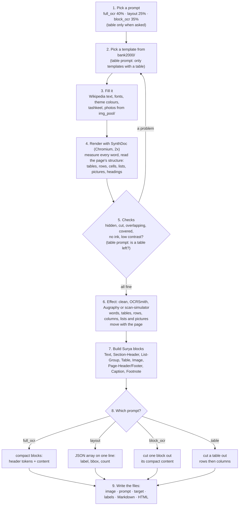
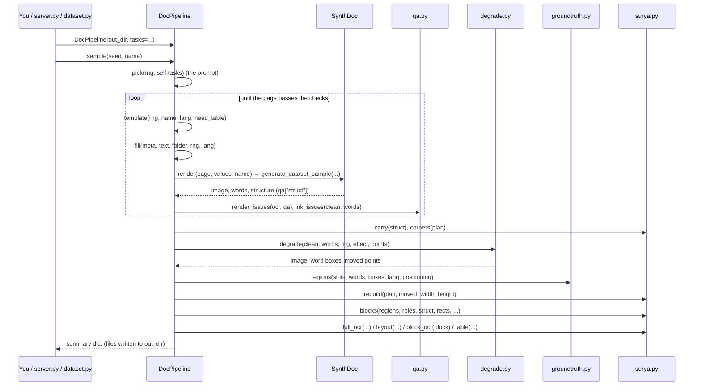
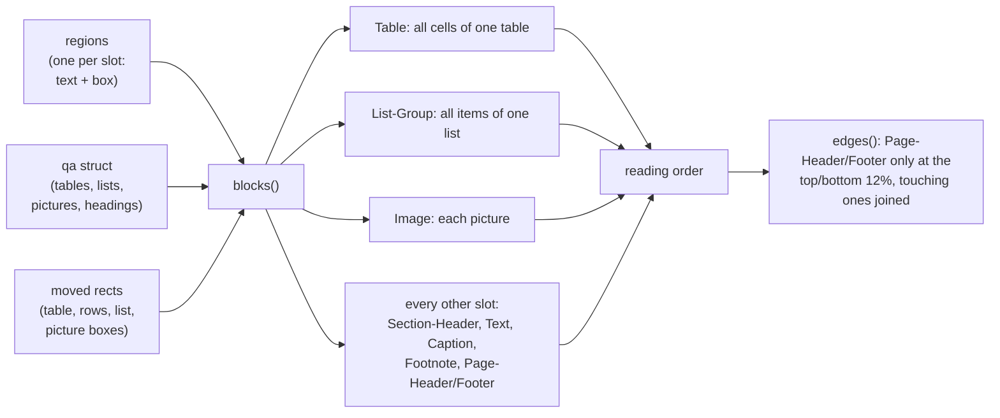
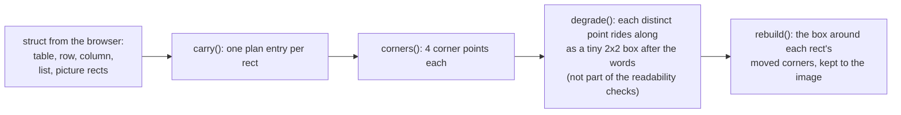
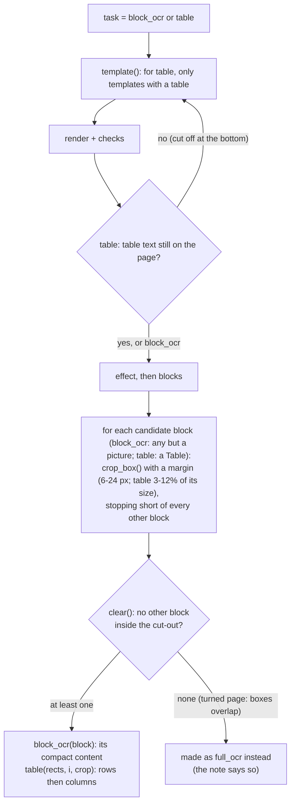

# surya-format: training pages in Surya OCR 2.5's own output format

Labelling for Surya changes one thing about the generator:
**every page is made for one of Surya OCR 2.5's prompts, and its label is the answer Surya 2.5 gives to that
prompt, written exactly the way the model writes it.** Everything else (templates, Wikipedia text, styling,
SynthDoc rendering, effects, checks) is the same pipeline as on `main`.

The formats come from asking the model itself, image by image, and from Surya's own source code; how they
were found is in [surya_inference_findings.md](surya_inference_findings.md).

This file explains, in simple English, what happens to one page, which function calls which, and how to run
it. The code is in [pipeline/surya.py](pipeline/surya.py) (the Surya part) and
[pipeline/doc_pipeline.py](pipeline/doc_pipeline.py) (the pipeline class, `DocPipeline`).

**Contents**

1. [The four prompts and their answers](#1-the-four-prompts-and-their-answers)
2. [The whole path of one page](#2-the-whole-path-of-one-page)
3. [Function calls, in order](#3-function-calls-in-order)
4. [How the blocks are made](#4-how-the-blocks-are-made)
5. [How boxes survive the effects](#5-how-boxes-survive-the-effects)
6. [The cut-out tasks (block_ocr, table)](#6-the-cut-out-tasks-block_ocr-table)
7. [The files of one sample](#7-the-files-of-one-sample)
8. [How to run it: commands and Python](#8-how-to-run-it-commands-and-python)
9. [Where the formats come from](#9-where-the-formats-come-from)

---

## 1. The four prompts and their answers

Surya OCR 2.5 is asked one of four questions (prompts). Each sample draws one, with these shares
(`surya.TASKS`):

| Task | Share | Prompt (exact text, `surya.PROMPTS`) | The model sees | The label (target) |
|---|---|---|---|---|
| `full_ocr` | 40% | `OCR this image to HTML. Each block is a div with data-label and data-bbox (x0 y0 x1 y1, normalized 0-1000).` | the page | compact blocks: `<\|Label\|><\|x0\|><\|y0\|><\|x1\|><\|y1\|>content`, one after another |
| `layout` | 25% | `Output the layout of this image as JSON. Each entry is a dict with "label", "bbox", and "count" fields. Bbox is x0 y0 x1 y1, normalized 0-1000.` | the page | a JSON array on one line, one entry per block |
| `block_ocr` | 35% | `OCR this block image to HTML.` | one block cut out of the page | that block's content only, compact (no label, no box) |
| `table` | 0% (only when asked) | `Output the table rows then columns as JSON. Each entry is a dict with "label" ("Row" or "Col") and "bbox" (x0 y0 x1 y1, normalized 0-1000).` | a table cut out of the page | rows then columns as a JSON array on one line |

The prompts are Surya's own wording, word for word (its code calls them "the model's training-time
contract"). `table` is Surya 2's format: Surya 2.5 never answers it (its model card: row and column geometry
needs a Surya 2 checkpoint; 2.5 reads tables through `block_ocr`), so it is not in the default mix.

**Boxes** are four whole numbers `x0 y0 x1 y1`: the top-left and bottom-right corners, each on a 0-1000 scale
of the image's width and height (0 = left/top edge, 1000 = right/bottom edge). In `full_ocr` they are tokens,
`<|85|>`; in the JSON they are a string, `"85 26 401 42"`.

**Compact** means Surya 2.5's own spelling: a block header is one label token and four coordinate tokens; a
block has no `</div>`; nothing (no newline) between blocks; `</td>`, `</th>` and `</tr>` are left out (but
`</table>`, `</p>`, `</li>`, `</ul>`, `</h1>` are written); a merged table cell is a `data-kind="parent"` cell
with `data-cs` (columns) or `data-rs` (rows), followed by `data-kind="ghost"` cells for the places it covers.

Real examples from the generator:

`full_ocr` (an Arabic grammar page; the real file is one long line):

```text
<|Image|><|22|><|14|><|981|><|149|><p class="img-desc">A close-up photograph of a dish of food.</p><|Section-Header|><|877|><|162|><|981|><|190|><h2>تاريخها</h2><|List-Group|><|22|><|202|><|980|><|265|><ul><li>◦ جامعة تشمران الأهوازية</li>...</ul>...
```

A table inside `full_ocr` (and the same in `block_ocr`):

```text
<|Table|><|0|><|0|><|100|><|100|><table><tr><th data-cs="2" data-kind="parent">A<th data-kind="ghost"><th>B<tr><td data-rs="2" data-kind="parent">C<td>D<td>E<tr><td data-kind="ghost"><td>F<td>G</table>
```

`layout`:

```json
[{"label": "Section-Header", "bbox": "451 90 872 176", "count": 30}, {"label": "Text", "bbox": "744 237 887 286", "count": 50}]
```

`block_ocr` (a cut-out page header):

```html
<p>الحروب العثمانية الصفوية</p>
```

`table` (on a table cut out of the page):

```json
[{"label": "Row", "bbox": "36 14 964 175"}, {"label": "Row", "bbox": "36 175 964 231"}, {"label": "Col", "bbox": "36 14 420 897"}]
```

**count** is the model's estimate of how many tokens it needs to OCR the block. Fitted on Surya's own answers:
about 0.345 per Latin character + 1.05 per Arabic character of the block's HTML + 3, rounded to tens
(`surya.count()`).

The model ends every answer with its end token (`<|im_end|>`; this server shows it as `<|im_end!>`). Targets
leave it out: the tokenizer adds it when training.

---

## 2. The whole path of one page



In words:

1. **Pick a prompt.** A random draw decides which of the four questions this page is for.
2. **Pick a template.** A random empty page layout from the 2,000-template bank. For the table prompt, only
   templates that contain a table.
3. **Fill it.** Every text place gets real Wikipedia text (Arabic or English), the page gets a random font,
   size and colour theme, Arabic pages may get diacritics (tashkeel), picture places get photos.
4. **Render.** SynthDoc opens the page in a real browser and takes a picture of it at double resolution. It
   also measures where every word is. A small script in the page also reports the structure: which texts are
   in which table row and cell, which are list items, where the pictures are, which texts are headings.
5. **Check.** If any word is hidden, cut, overlapping, covered, has no ink, or is too pale, the page is made
   again (another style, and every second time another template). For the table prompt, a page whose table
   was cut off is also made again.
6. **Effect.** The page stays clean (15%) or gets OCRSmith, Augraphy or scan-simulator. The word boxes move
   with the page, and so do the boxes of tables, rows, columns, lists and pictures.
7. **Blocks.** The page is turned into Surya's blocks: a whole table is one Table block, a whole list is one
   List-Group block, each paragraph is a Text block, and so on (section 4).
8. **The answer.** The blocks are written as the chosen prompt's answer. For `block_ocr` one block (not a
   picture) is cut out of the page and the answer is its content; for `table` a table is cut out.
9. **Save.** The image the model sees, the exact prompt, the answer, and the usual labels.

---

## 3. Function calls, in order

### 3.1 Who calls what



### 3.2 The same, as code

This is `DocPipeline.sample()` reduced to its calls (the real code is in
[pipeline/doc_pipeline.py](pipeline/doc_pipeline.py); timing, notes and some details are left out):

```python
def sample(self, seed, name, language=None, effect=None, task=None):
    rng = random.Random(seed)                                  # one seed decides everything
    lang = language or pick(rng, self.languages)                # "ar" or "en"
    effect = effect or pick(rng, self.effects)                  # "clean", "ocrsmith", "augraphy", "scan-simulator"
    task = task or pick(rng, self.tasks)                        # "full_ocr", "layout", "block_ocr", "table"

    for attempts in range(1, ATTEMPTS + 1):                     # up to 8 tries
        if attempts % 2 == 1:                                   # a new template every second try
            meta, text, folder, note = self.template(rng, name, lang, need_table=task == "table")
        page, values, s = self.fill(meta, text, folder, rng, lang)          # text, style, theme, photos
        clean, ocr, slots, pages, qa = self.render(page, values, name)     # SynthDoc
        issues = {**render_issues(ocr, qa), **ink_issues(clean, ocr["words"])}
        if task == "table" and no_table_left(ocr, qa):
            issues["no table"] = 1
        if not issues:
            break

    words, cut = split_words(ocr)                               # the measured words
    plan = SURYA.carry(qa["struct"])                            # [(("table", 0), rect), (("row", 0, 0), rect), ...]
    image, boxes, attacks, strength, check, moved = self.degrade(
        clean, words, rng, effect, SURYA.corners(plan))         # the effect; corners ride along
    regions = GT.regions(meta["slots"], words, boxes, lang, positioning)   # one region per slot

    width, height = image.size
    rects = SURYA.rebuild(plan, moved, width, height)           # {("table", 0): [x0, y0, x1, y1], ...}
    blks = SURYA.blocks(regions, roles, qa["struct"], rects, lang, positioning,
                        self.categories, width, height)         # [{"label", "box", "html"}, ...]

    if task == "full_ocr":
        target = SURYA.full_ocr(blks, width, height)            # compact blocks
    elif task == "layout":
        target = SURYA.layout(blks, width, height)              # JSON array on one line
    elif task == "block_ocr":
        b, crop = rng.choice(clean_cutouts(blks))               # one block, not a picture: crop_box(...) + clear(...)
        target = SURYA.block_ocr(b)                             # its compact content
    else:  # table
        b, crop = rng.choice(clean_table_cutouts(blks))
        target = SURYA.table(rects, b["table"], crop)           # rows then columns on the cut-out

    # write <name>.jpg (or the cut-out), <name>.prompt.txt, <name>.target.txt/.json, <name>.json, ...
    return summary
```

### 3.3 What each function takes and gives back

| Function | Takes | Gives back |
|---|---|---|
| `DocPipeline.template(rng, name, lang, need_table)` | the random generator, the language, whether a table is needed | `(meta, text, folder, note)`: the template's description and its folder |
| `DocPipeline.fill(meta, text, folder, rng, lang)` | the template | `(page, values, style)`: the page for SynthDoc, the text for each slot, what was picked |
| `DocPipeline.render(page, values, name)` | the filled page | `(clean_image, ocr, slots, pages, qa)`: the picture, every measured word, and `qa["struct"]` (tables, lists, pictures, headings) |
| `qa.render_issues(ocr, qa)`, `qa.ink_issues(image, words)` | the measurements | `{issue: count}`; empty means fine |
| `surya.carry(struct)` | the page structure | `plan`: a list of `(key, rect)` for every table, row, column, list and picture |
| `surya.corners(plan)` | the plan | the 4 corners of every rect, as `(x, y)` points |
| `DocPipeline.degrade(clean, words, rng, effect, points)` | the clean picture, the words, the corner points | `(image, word_boxes, attacks, strength, check, moved_points)` |
| `groundtruth.regions(slots, words, boxes, lang, positioning)` | the words after the effect | one region per slot: `{id, role, text, box, bbox}` |
| `surya.rebuild(plan, moved, width, height)` | the moved corners | `{key: [x0, y0, x1, y1]}` for every table, row, column, list, picture still on the image |
| `surya.blocks(regions, roles, struct, rects, lang, positioning, categories, width, height)` | regions, structure, moved rects | Surya blocks in reading order: `[{"label", "box", "html", ...}]` |
| `surya.full_ocr(blks, width, height)` | the blocks | the `full_ocr` answer (compact blocks, one line) |
| `surya.layout(blks, width, height)` | the blocks | the `layout` answer (JSON array on one line) |
| `surya.block_ocr(block)` | one block | the `block_ocr` answer (its compact content) |
| `surya.compact(html)` | a block's HTML | the same in Surya 2.5's spelling (`</td>`, `</th>`, `</tr>` left out) |
| `surya.divs(blks, width, height)` | the blocks | the readable `<div data-bbox data-label>` form (kept in the labels JSON) |
| `surya.crop_box(box, width, height, rng, others, share)` | a block's or table's box, the other blocks | the cut-out `[x0, y0, x1, y1]`, its margin stopping short of other blocks |
| `surya.clear(crop, others)` | a cut-out | `True` if no other block reaches into it |
| `surya.table(rects, i, crop)` | the moved rows and columns, the cut-out | the `table` answer (JSON array on one line) |
| `surya.table_structure(rects, i, crop)` | the same | rows then columns as a list (kept in the labels JSON) |
| `surya.problems(task, target)` | any answer | a list of format problems; empty means it matches Surya's format |

---

## 4. How the blocks are made

`surya.blocks()` turns the page's labelled texts (one per template slot) into Surya's blocks:



| On our page | Surya label | What goes inside the div |
|---|---|---|
| all cells of one `<table>` | `Table` | `<table><tr><th><b>…</b><th>…<tr><td>…<td>…</table>` (`<b>` for bold cells; empty cells kept; merged cells as parent + ghost cells) |
| all items of one `<ul>`/`<ol>` | `List-Group` | `<ul><li>• item</li>…</ul>` (the bullet as drawn: • ◦ ▪, or 1. / ١.) |
| a picture | `Image` | `<p class="img-desc">…</p>` |
| title / heading / subtitle | `Section-Header` | `<h1>` / `<h2>` / `<h3>` |
| page header | `Page-Header` | the text bare, no `<p>` (in block_ocr `<p>…</p>`); only near the top; items that touch are one block |
| footer, page number | `Page-Footer` | `<p>…</p>`; only near the bottom; items that touch are one block |
| caption, footnote | `Caption`, `Footnote` | `<p>…</p>` |
| a label with its value beside it | `Text` | `<p>Label: value</p>` |
| a label with no value beside it | `Section-Header` | `<b>Label:</b>` when bold, otherwise `<h4>Label:</h4>` |
| paragraph, quote, side box, other | `Text` | `<p>…</p>` (`<b>`/`<i>` if the whole block is bold/italic) |

**Reading order:** the order of the page's code for normal pages; for DocLayNet pages (boxes placed at
fixed positions) top to bottom in bands, right to left for Arabic and left to right for English.

---

## 5. How boxes survive the effects

Effects can turn, warp or crop the page. Word boxes always moved with the page; now table, row,
column, list and picture boxes move too:



Each point is carried once, even when two rects share a corner (a row's bottom corners are the next row's top
corners): with scan-simulator the boxes travel in a mask, where a second dot on the same pixel would erase the
first.

---

## 6. The cut-out tasks (block_ocr, table)



The model sees only the cut-out (`<name>.jpg`); the whole page is saved as `<name>_page.jpg`. Pictures are
never cut out for `block_ocr`: Surya does not OCR picture blocks one by one.

---

## 7. The files of one sample

| File | What it is |
|---|---|
| `<name>.jpg` | what the model is shown: the page, or (table) the table cut out of it |
| `<name>.prompt.txt` | the exact prompt |
| `<name>.target.txt` | the answer for `full_ocr` and `block_ocr` |
| `<name>.target.json` | the answer for `layout` and `table` |
| `<name>_page.jpg` | the whole page, only when `<name>.jpg` is a cut-out (`block_ocr`, `table`) |
| `<name>.json` | all labels: words, lines, slots, and under `surya`: `task`, `prompt`, `target`, `crop`, `table_structure`, `page_size`, `divs`, `blocks` |
| `<name>.md` | the page-level ground truth of `main` (`<text>… <bbox>…</bbox></text>` per slot) |
| `<name>.html` | the filled page |
| `<name>_blocks.jpg`, `_slots.jpg`, `_words.jpg`, `_clean.jpg` | drawings for checking (the generator page) |

In a dataset (`pipeline.dataset`): `images/`, `prompts/`, `targets/`, `pages/`, `labels/`, `markdown/`,
`html/`.

---

## 8. How to run it: commands and Python

All commands run from the repository folder:

```bash
cd D:\code\OCR\arabic-template-bank-surya
```

**The generator page** (16 samples at a time, with an **Image + Target** view):

```bash
D:\code\OCR\arabic-template-bank\.venv-pipeline\Scripts\python pipeline\server.py --port 8767
```

Then open http://localhost:8767. The **Task** menu picks the prompt (or a mix).

**A training set:**

```bash
D:\code\OCR\arabic-template-bank\.venv-pipeline\Scripts\python -m pipeline.dataset --n 1000 --out datasets\surya_v1 --workers 6
```

Add `--task full_ocr` (or `layout`, `block_ocr`, `table`) for one prompt only (`table` only this way); the other options are those of
`main` (`--language`, `--source`, `--effect`, `--tashkeel`, `--strength-…`).

**From Python, one sample:**

```python
from pipeline.doc_pipeline import DocPipeline

pipe = DocPipeline("pipeline_out/mine")                    # all four prompts, mixed
summary = pipe.sample(seed=7, name="p7")                   # one page, files in pipeline_out/mine/
print(summary["task"], summary["target_file"])             # e.g. "layout", "p7.target.json"

pipe.sample(seed=8, name="t8", task="table")               # force one prompt for one sample
pipe = DocPipeline("pipeline_out/tables", tasks={"table": 1}, languages={"ar": 1})   # only Arabic tables
pipe.run(n=16)
```

**Reading a sample's answer and checking its format:**

```python
import json
from pipeline import surya

label = json.load(open("pipeline_out/mine/p7.json", encoding="utf-8"))
task, target = label["surya"]["task"], label["surya"]["target"]
print(label["surya"]["prompt"])
print(target)
print(surya.problems(task, target))                        # [] means it matches Surya's format
```

**Using the Surya functions on their own** (for example, to write the answers again from the blocks a
sample kept):

```python
import json
from pipeline import surya

label = json.load(open("pipeline_out/mine/p7.json", encoding="utf-8"))
width, height = label["surya"]["page_size"]
blks = label["surya"]["blocks"]                            # [{"label", "box", "html"}, ...]

print(surya.full_ocr(blks, width, height))                 # the full_ocr answer
print(surya.block_ocr(blks[0]))                            # the block_ocr answer for the first block
print(surya.layout(blks, width, height))                   # the layout answer
print(surya.count('<p>Hello world</p>'))                   # Surya's count for one block: 10
print(surya.norm([159, 92, 1012, 140], width, height))     # pixels -> "x0 y0 x1 y1" on 0-1000
```

---

## 9. Where the formats come from

Three sources, all detailed in [surya_inference_findings.md](surya_inference_findings.md):

1. **The model itself.** Hundreds of requests to the Surya 2.5 server, one at a time: our pages, single blocks
   and tables cut out of them, and the four reference pages, each with every prompt (`surya_probe/`).
2. **Surya's own code** (datalab-to/surya, `surya/inference/`): `prompts.py` (the exact prompts),
   `compact.py` (the output format: how HTML becomes the compact form), `parsers.py` (how each answer is read
   back), `merged_cells.py` (parent / ghost cells).
3. **The model card** (datalab-to/surya-ocr-2.5): `count` is the token estimate; row and column geometry needs
   Surya 2; tables in 2.5 come back as HTML.

What changed from the first version of this branch: the `<div>` files in `suryan_outputs/` were made by a
converter from the model's compact answer, not by the model; `block_ocr` is meant for one block cut out of a
page (on a whole page the model just does full OCR); the layout JSON is written on one line; the table prompt's
only "valid" answer earlier (one `Table` entry with token coordinates) was the schema forcing the model's own
tokens into JSON, not a real answer; and the full-page prompt had a stray quote before `(x0`.
