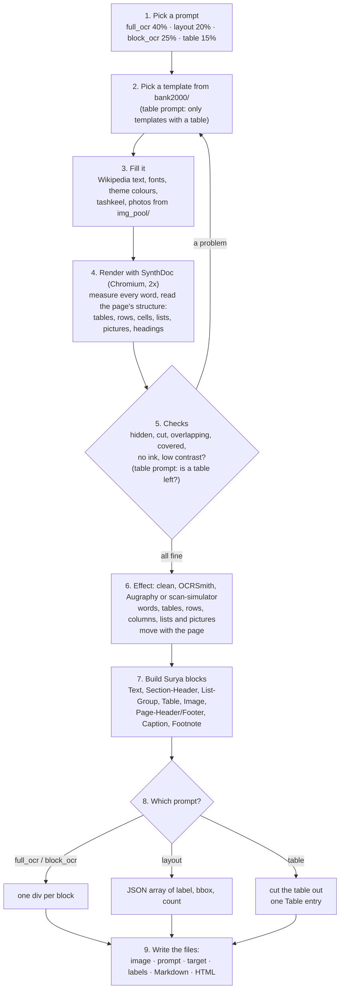
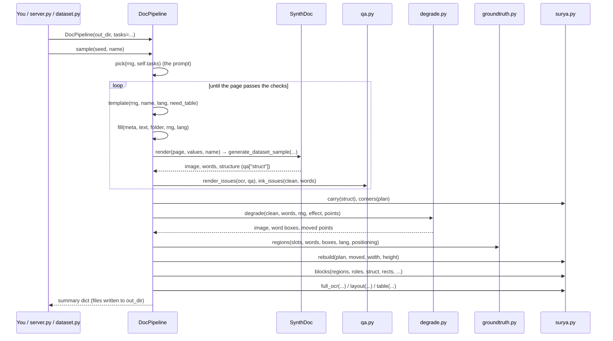
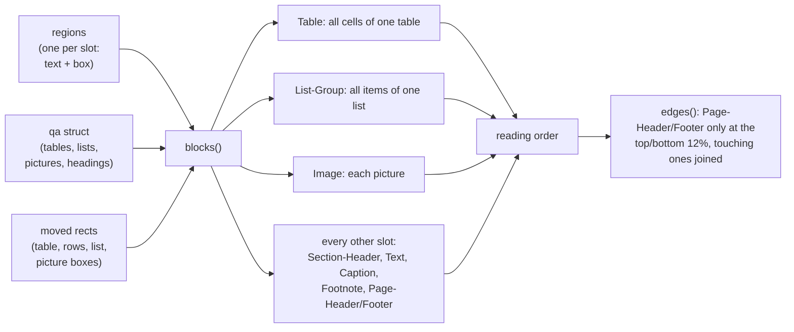
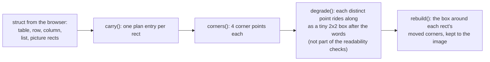
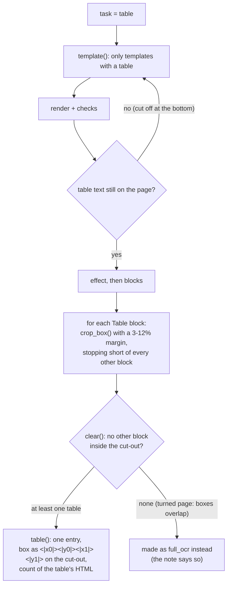

# surya-format: training pages in the shape of Surya OCR 2.5's answers

This branch (`surya-format`) changes one thing about the generator: **every page is made for one of Surya
OCR 2.5's four prompts, and its label is the answer Surya gives to that prompt.** Everything else (templates,
Wikipedia text, styling, SynthDoc rendering, effects, checks) is the same pipeline as on `main`.

This file explains, in simple English, what happens to one page, which function calls which, and how to run
it. The code is in [pipeline/surya.py](pipeline/surya.py) (the Surya part) and
[pipeline/doc_pipeline.py](pipeline/doc_pipeline.py) (the pipeline class, `DocPipeline`).

**Contents**

1. [The four prompts and their answers](#1-the-four-prompts-and-their-answers)
2. [The whole path of one page](#2-the-whole-path-of-one-page)
3. [Function calls, in order](#3-function-calls-in-order)
4. [How the blocks are made](#4-how-the-blocks-are-made)
5. [How boxes survive the effects](#5-how-boxes-survive-the-effects)
6. [The table task](#6-the-table-task)
7. [The files of one sample](#7-the-files-of-one-sample)
8. [How to run it: commands and Python](#8-how-to-run-it-commands-and-python)
9. [Where the formats come from](#9-where-the-formats-come-from)

---

## 1. The four prompts and their answers

Surya OCR 2.5 is asked one of four questions (prompts). Each sample of this branch draws one, with these
shares (`surya.TASKS`):

| Task | Share | Prompt (exact text, `surya.PROMPTS`) | The model sees | The label (target) |
|---|---|---|---|---|
| `full_ocr` | 40% | `OCR this image to HTML. Each block is a div with data-label and data-bbox "(x0 y0 x1 y1, normalized 0-1000).` | the page | one `<div>` per block |
| `layout` | 20% | `Output the layout of this image as JSON. Each entry is a dict with "label", "bbox", and "count" fields. Bbox is x0 y0 x1 y1, normalized 0-1000.` | the page | a JSON array, one entry per block |
| `block_ocr` | 25% | `OCR this block image to HTML.` | the page | one `<div>` per block (same as `full_ocr`) |
| `table` | 15% | `Output the table rows then columns as JSON. Each entry is a dict with "label" ("Row" or "Col") and "bbox" (x0 y0 x1 y1, normalized 0-1000).` | a table cut out of the page | a JSON array with one `Table` entry |

**Boxes** are four whole numbers `x0 y0 x1 y1`: the top-left and bottom-right corners, each on a 0-1000 scale
of the image's width and height (0 = left/top edge, 1000 = right/bottom edge).

Real examples from this branch:

`full_ocr` and `block_ocr` (an English DocLayNet page and an Arabic grammar page):

```html
<div data-bbox="62 43 159 74" data-label="Page-Header"><p>Career and works</p></div>
<div data-bbox="48 131 319 183" data-label="Text"><p>Grayson Earle (born 1987) is an American contemporary artist and activist.</p></div>
...
<div data-bbox="367 133 898 190" data-label="Section-Header"><h1>الحلف الهابسبورغي الصفوي</h1></div>
<div data-bbox="517 257 898 328" data-label="List-Group"><ul><li>▪ أرسل ملك إسبانيا كارلوس الأول مبعوثا لاقتراح.</li>...</ul></div>
```

`layout`:

```json
[
  {
    "label": "Section-Header",
    "bbox": "451 90 872 176",
    "count": 30
  },
  {
    "label": "Text",
    "bbox": "744 237 887 286",
    "count": 50
  }
]
```

`table` (on a table cut out of the page; the box is written as tokens, as Surya wrote it):

```json
[
  {
    "label": "Table",
    "bbox": "<|36|><|14|><|964|><|897|>",
    "count": 460
  }
]
```

**count** is Surya's estimate of how long a block's text answer is. Fitted on Surya's own answers:
about 0.345 per Latin character + 1.05 per Arabic character of the block's HTML + 3, rounded to tens
(`surya.count()`).

---

## 2. The whole path of one page



In words:

1. **Pick a prompt.** A random draw decides which of the four questions this page is for.
2. **Pick a template.** A random empty page layout from the 2,000-template bank. For the table prompt, only
   templates that contain a table.
3. **Fill it.** Every text place gets real Wikipedia text (Arabic or English), the page gets a random font,
   size and colour theme, Arabic pages may get diacritics (tashkeel), picture places get photos.
4. **Render.** SynthDoc opens the page in a real browser and takes a picture of it at double resolution. It
   also measures where every word is. A small script in the page also reports the structure: which texts are
   in which table row and cell, which are list items, where the pictures are, which texts are headings.
5. **Check.** If any word is hidden, cut, overlapping, covered, has no ink, or is too pale, the page is made
   again (another style, and every second time another template). For the table prompt, a page whose table
   was cut off is also made again.
6. **Effect.** The page stays clean (15%) or gets OCRSmith, Augraphy or scan-simulator. The word boxes move
   with the page, and so do the boxes of tables, rows, columns, lists and pictures.
7. **Blocks.** The page is turned into Surya's blocks: a whole table is one Table block, a whole list is one
   List-Group block, each paragraph is a Text block, and so on (section 4).
8. **The answer.** The blocks are written as the chosen prompt's answer.
9. **Save.** The image the model sees, the exact prompt, the answer, and the usual labels.

---

## 3. Function calls, in order

### 3.1 Who calls what



### 3.2 The same, as code

This is `DocPipeline.sample()` reduced to its calls (the real code is in
[pipeline/doc_pipeline.py](pipeline/doc_pipeline.py); timing, notes and some details are left out):

```python
def sample(self, seed, name, language=None, effect=None, task=None):
    rng = random.Random(seed)                                  # one seed decides everything
    lang = language or pick(rng, self.languages)                # "ar" or "en"
    effect = effect or pick(rng, self.effects)                  # "clean", "ocrsmith", "augraphy", "scan-simulator"
    task = task or pick(rng, self.tasks)                        # "full_ocr", "layout", "block_ocr", "table"

    for attempts in range(1, ATTEMPTS + 1):                     # up to 8 tries
        if attempts % 2 == 1:                                   # a new template every second try
            meta, text, folder, note = self.template(rng, name, lang, need_table=task == "table")
        page, values, s = self.fill(meta, text, folder, rng, lang)          # text, style, theme, photos
        clean, ocr, slots, pages, qa = self.render(page, values, name)     # SynthDoc
        issues = {**render_issues(ocr, qa), **ink_issues(clean, ocr["words"])}
        if task == "table" and no_table_left(ocr, qa):
            issues["no table"] = 1
        if not issues:
            break

    words, cut = split_words(ocr)                               # the measured words
    plan = SURYA.carry(qa["struct"])                            # [(("table", 0), rect), (("row", 0, 0), rect), ...]
    image, boxes, attacks, strength, check, moved = self.degrade(
        clean, words, rng, effect, SURYA.corners(plan))         # the effect; corners ride along
    regions = GT.regions(meta["slots"], words, boxes, lang, positioning)   # one region per slot

    width, height = image.size
    rects = SURYA.rebuild(plan, moved, width, height)           # {("table", 0): [x0, y0, x1, y1], ...}
    blks = SURYA.blocks(regions, roles, qa["struct"], rects, lang, positioning,
                        self.categories, width, height)         # [{"label", "box", "html"}, ...]

    if task in ("full_ocr", "block_ocr"):
        target = SURYA.full_ocr(blks, width, height)
    elif task == "layout":
        target = SURYA.layout(blks, width, height)
    else:  # table
        b, crop = rng.choice(clean_table_cutouts(blks))        # crop_box(...) + clear(...)
        target = SURYA.table(b, crop)
        structure = SURYA.table_structure(rects, b["table"], crop)

    # write <name>.jpg (or the cut-out), <name>.prompt.txt, <name>.target.html/.json, <name>.json, ...
    return summary
```

### 3.3 What each function takes and gives back

| Function | Takes | Gives back |
|---|---|---|
| `DocPipeline.template(rng, name, lang, need_table)` | the random generator, the language, whether a table is needed | `(meta, text, folder, note)`: the template's description and its folder |
| `DocPipeline.fill(meta, text, folder, rng, lang)` | the template | `(page, values, style)`: the page for SynthDoc, the text for each slot, what was picked |
| `DocPipeline.render(page, values, name)` | the filled page | `(clean_image, ocr, slots, pages, qa)`: the picture, every measured word, and `qa["struct"]` (tables, lists, pictures, headings) |
| `qa.render_issues(ocr, qa)`, `qa.ink_issues(image, words)` | the measurements | `{issue: count}`; empty means fine |
| `surya.carry(struct)` | the page structure | `plan`: a list of `(key, rect)` for every table, row, column, list and picture |
| `surya.corners(plan)` | the plan | the 4 corners of every rect, as `(x, y)` points |
| `DocPipeline.degrade(clean, words, rng, effect, points)` | the clean picture, the words, the corner points | `(image, word_boxes, attacks, strength, check, moved_points)` |
| `groundtruth.regions(slots, words, boxes, lang, positioning)` | the words after the effect | one region per slot: `{id, role, text, box, bbox}` |
| `surya.rebuild(plan, moved, width, height)` | the moved corners | `{key: [x0, y0, x1, y1]}` for every table, row, column, list, picture still on the image |
| `surya.blocks(regions, roles, struct, rects, lang, positioning, categories, width, height)` | regions, structure, moved rects | Surya blocks in reading order: `[{"label", "box", "html", ...}]` |
| `surya.full_ocr(blks, width, height)` | the blocks | the `full_ocr` / `block_ocr` answer (one div per line) |
| `surya.layout(blks, width, height)` | the blocks | the `layout` answer (JSON text) |
| `surya.crop_box(box, width, height, rng, others, share)` | a table's box, the other blocks | the cut-out `[x0, y0, x1, y1]`, its margin stopping short of other blocks |
| `surya.clear(crop, others)` | a cut-out | `True` if no other block reaches into it |
| `surya.table(block, crop)` | the table block and its cut-out | the `table` answer (JSON text, one entry) |
| `surya.table_structure(rects, i, crop)` | the moved rows and columns | rows then columns on the cut-out (kept in the labels JSON) |
| `surya.raw(blks, width, height)` | the blocks | Surya's token sequence for the page (kept in the labels JSON) |
| `surya.problems(task, target)` | any answer | a list of format problems; empty means it matches Surya's format |

---

## 4. How the blocks are made

`surya.blocks()` turns the page's labelled texts (one per template slot) into Surya's blocks:



| On our page | Surya label | What goes inside the div |
|---|---|---|
| all cells of one `<table>` | `Table` | `<table><tr><th><b>…</b></th>…</tr><tr><td>…</td>…</tr></table>` (`<b>` for bold cells; empty cells kept) |
| all items of one `<ul>`/`<ol>` | `List-Group` | `<ul><li>• item</li>…</ul>` (the bullet as drawn: • ◦ ▪, or 1. / ١.) |
| a picture | `Image` | `<p class="img-desc">…</p>` |
| title / heading / subtitle | `Section-Header` | `<h1>` / `<h2>` / `<h3>` |
| page header, footer, page number | `Page-Header`, `Page-Footer` | `<p>…</p>`; only near the top or bottom; items that touch are one block |
| caption, footnote | `Caption`, `Footnote` | `<p>…</p>` |
| a label with its value beside it | `Text` | `<p>Label: value</p>` |
| paragraph, quote, side box, other | `Text` | `<p>…</p>` (`<b>`/`<i>` if the whole block is bold/italic) |

**Reading order:** the order of the page's code for normal pages; for DocLayNet pages (boxes placed at
fixed positions) top to bottom in bands, right to left for Arabic and left to right for English.

---

## 5. How boxes survive the effects

Effects can turn, warp or crop the page. Word boxes always moved with the page; on this branch, table, row,
column, list and picture boxes move too:



Each point is carried once, even when two rects share a corner (a row's bottom corners are the next row's top
corners): with scan-simulator the boxes travel in a mask, where a second dot on the same pixel would erase the
first.

---

## 6. The table task



The model sees only the cut-out (`<name>.jpg`); the whole page is saved as `<name>_page.jpg`. The rows and
columns the prompt names are also computed (`table_structure()`) and kept in the labels JSON under
`surya.table_structure`, in case they are wanted later.

---

## 7. The files of one sample

| File | What it is |
|---|---|
| `<name>.jpg` | what the model is shown: the page, or (table) the table cut out of it |
| `<name>.prompt.txt` | the exact prompt |
| `<name>.target.html` | the answer for `full_ocr` and `block_ocr` |
| `<name>.target.json` | the answer for `layout` and `table` |
| `<name>_page.jpg` | the whole page, only when `<name>.jpg` is a cut-out |
| `<name>.json` | all labels: words, lines, slots, and under `surya`: `task`, `prompt`, `target`, `crop`, `table_structure`, `page_size`, `raw`, `blocks` |
| `<name>.md` | the page-level ground truth of `main` (`<text>… <bbox>…</bbox></text>` per slot) |
| `<name>.html` | the filled page |
| `<name>_blocks.jpg`, `_slots.jpg`, `_words.jpg`, `_clean.jpg` | drawings for checking (the generator page) |

In a dataset (`pipeline.dataset`): `images/`, `prompts/`, `targets/`, `pages/`, `labels/`, `markdown/`,
`html/`.

---

## 8. How to run it: commands and Python

All commands run from this branch's folder:

```bash
cd D:\code\OCR\arabic-template-bank-surya
```

**The generator page** (16 samples at a time, with an **Image + Target** view):

```bash
D:\code\OCR\arabic-template-bank\.venv-pipeline\Scripts\python pipeline\server.py --port 8767
```

Then open http://localhost:8767. The **Task** menu picks the prompt (or a mix).

**A training set:**

```bash
D:\code\OCR\arabic-template-bank\.venv-pipeline\Scripts\python -m pipeline.dataset --n 1000 --out datasets\surya_v1 --workers 6
```

Add `--task full_ocr` (or `layout`, `block_ocr`, `table`) for one prompt only; the other options are those of
`main` (`--language`, `--source`, `--effect`, `--tashkeel`, `--strength-…`).

**From Python, one sample:**

```python
from pipeline.doc_pipeline import DocPipeline

pipe = DocPipeline("pipeline_out/mine")                    # all four prompts, mixed
summary = pipe.sample(seed=7, name="p7")                   # one page, files in pipeline_out/mine/
print(summary["task"], summary["target_file"])             # e.g. "layout", "p7.target.json"

pipe.sample(seed=8, name="t8", task="table")               # force one prompt for one sample
pipe = DocPipeline("pipeline_out/tables", tasks={"table": 1}, languages={"ar": 1})   # only Arabic tables
pipe.run(n=16)
```

**Reading a sample's answer and checking its format:**

```python
import json
from pipeline import surya

label = json.load(open("pipeline_out/mine/p7.json", encoding="utf-8"))
task, target = label["surya"]["task"], label["surya"]["target"]
print(label["surya"]["prompt"])
print(target)
print(surya.problems(task, target))                        # [] means it matches Surya's format
```

**Using the Surya functions on their own** (for example, to write the answers again from the blocks a
sample kept):

```python
import json
from pipeline import surya

label = json.load(open("pipeline_out/mine/p7.json", encoding="utf-8"))
width, height = label["surya"]["page_size"]
blks = label["surya"]["blocks"]                            # [{"label", "box", "html"}, ...]

print(surya.full_ocr(blks, width, height))                 # the full_ocr / block_ocr answer
print(surya.layout(blks, width, height))                   # the layout answer
print(surya.count('<p>Hello world</p>'))                   # Surya's count for one block: 10
print(surya.norm([159, 92, 1012, 140], width, height))     # pixels -> "x0 y0 x1 y1" on 0-1000
```

---

## 9. Where the formats come from

From Surya's own answers in `suryan_outputs/` (in the main folder): four reference pages (a report, an
invoice table, a text block, an Arabic page) and twelve of our generated pages, each with the four prompts'
answers. Only the answers Surya got right are copied:

- **full_ocr:** the div form, labels, tags and reading order of the reference pages. Header and footer items
  are one block only when they touch (a row of links), separate when far apart (titles spread over the top).
- **block_ocr:** on whole pages Surya answered with the same blocks, labels and order as `full_ocr` (header
  and footer text always in `<p>`, as ours always is), so a `block_ocr` sample is the whole page.
- **layout:** the JSON array, 2-space indent, keys `label`, `bbox`, `count`, as in `layout.json`.
- **table:** Surya's only valid answer, on the table-only image:
  `[{"label": "Table", "bbox": "<|32|><|71|><|959|><|884|>", "count": 220}]`. Its answers on whole pages were
  never valid JSON, so they are not copied.

Surya's mistakes are not copied either (calling mid-page headings Page-Header, misread words on degraded
pages). More detail: [OCRREADME.md, section 0.10](OCRREADME.md#010-surya-ocr-25-targets-branch-surya-format-experimental).
