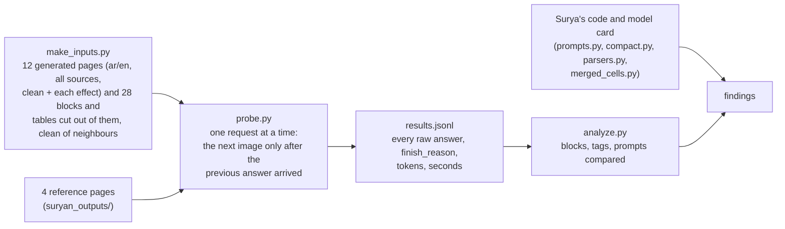

# Surya OCR 2.5: what it really answers to each prompt

Branch `surya-inference` (on top of `surya-format`). Goal: find the exact output format of Surya OCR 2.5 for
each of its prompts, so our training labels are written the way the model writes, and apply it to the
pipeline.

**In short:** the model writes everything in one compact format, `<|Label|><|x0|><|y0|><|x1|><|y1|>content`.
The `<div>` and JSON files in `suryan_outputs/` were made from that by a converter, not by the model. Each
prompt has its own job: `full_ocr` is the whole page as compact blocks, `block_ocr` is one block cut out of a
page and answered with its content only, `layout` is a one-line JSON array (made with schema-guided decoding),
and the table prompt (rows and columns) is a Surya 2 feature that 2.5 does not do.

**Contents**

1. [How the tests were run](#1-how-the-tests-were-run)
2. [The model's native format](#2-the-models-native-format)
3. [Prompt by prompt](#3-prompt-by-prompt)
4. [What Surya's own code says](#4-what-suryas-own-code-says)
5. [Surprises and pitfalls](#5-surprises-and-pitfalls)
6. [What changed in the pipeline](#6-what-changed-in-the-pipeline)
7. [Numbers](#7-numbers)
8. [How to repeat the tests](#8-how-to-repeat-the-tests)

---

## 1. How the tests were run



- **Server:** the endpoint and model in `surya_inference/suraya.py` (`datalab-to/surya-ocr-2.5`, an
  OpenAI-style chat API), temperature 0. The key is read from that file at run time; it is not in this
  repository.
- **Every image got every prompt.** `layout` and `table` were also asked with the guided-decoding JSON schema,
  as `suraya.py` does.
- **Token limit:** first 2,048 (as `suraya.py`), then 4,096, because long Arabic pages ran out at 2,048
  (`finish_reason: length`) and an answer cut short says nothing about its format.

---

## 2. The model's native format

Whatever the prompt, the model answers in **one format**, which Surya's code calls "compact":

```text
<|Page-Header|><|85|><|26|><|401|><|42|>Northwind Logistics | Quarterly Report Q3 2026<|Section-Header|><|85|><|73|><|458|><|101|><h1>1. Operational Summary</h1><|Text|><|85|><|113|><|879|><|214|><p>Optical character recognition systems ...</p>...<|im_end!>
```

| Part | Rule |
|---|---|
| block header | one label token and four coordinate tokens, `<\|Text\|><\|85\|><\|113\|><\|879\|><\|214\|>` (0-1000 of the image) |
| block end | no `</div>`: the next header, or the end of the answer, closes a block |
| between blocks | nothing, not even a newline |
| tables | `</td>`, `</th>`, `</tr>` left out; `</table>` written |
| other tags | written and closed: `<p>…</p>`, `<h1>…</h1>`, `<ul><li>…</li></ul>`, `<b>`, `<i>`, `<sup>`, `<br/>`, `<math>` |
| merged cells | a `data-kind="parent"` cell with `data-cs="2"` (2 columns) or `data-rs="2"` (2 rows), then `data-kind="ghost"` cells for the places it covers |
| boxes inside a block | `<\|box\|>` and four coordinate tokens just before a tag (seen once: cell boxes in a table) |
| lists | the bullet as drawn is part of the item text: `<li>• …</li>`, `<li>■ …</li>` |
| pictures | `<p class="img-desc">…</p>`, sometimes `<p class="img-text">…</p>` for text inside the picture; `alt` may start `Illustration:` or `Artwork:` |
| end | `<\|im_end!>`: the end-of-answer token (`<\|im_end\|>`) as this server prints it |

Surya's `compact.py` says the same: "Instead of `<div data-bbox=… data-label=…>`, a top-level block header is
one label token plus four coordinate tokens (0-1000) … A block has no `</div>` … `</td>`, `</th>` and `</tr>`
are left out … A `data-bbox` on any other tag becomes `<|box|>` plus four coordinate tokens."

---

## 3. Prompt by prompt

### `full_ocr`: `OCR this image to HTML. Each block is a div with data-label and data-bbox (x0 y0 x1 y1, normalized 0-1000).`

- **On a page:** every block, compact, in reading order. This is what the `full_ocr.html` reference files were
  converted from (header and footer text in `<p>` or bare; the converter kept what the model wrote).
- **On a cut-out block:** the block with its own header, the box usually the whole image (`0 0 1000 1000`) or
  close to it.
- **Prompt text:** Surya's `prompts.py` has no quote before `(x0`; `suraya.py` (and our first version) had one,
  `data-bbox "(x0 …`. The wording is "the model's training-time contract", so the pipeline now uses Surya's
  exact text.

### `block_ocr`: `OCR this block image to HTML.`

- **On a cut-out block** (what it is for, per Surya's code: block mode runs on each layout block): **only the
  content**, no label, no box: `<p>He has a diplomatic rank …</p>`, `<h2>Career</h2>`, `<table><tr><th><b>List
  of head coach</b><th>…</table>`, `<p class="img-desc">…</p>`.
  - single headings come back as `<h2>` more often than `<h1>` (full_ocr on the same cut-out says `<h1>`);
  - a few answers still start with a header token (pictures, a list, one table): the model is not fully
    consistent; the content-only answer is the norm.
- **On a whole page:** the same as `full_ocr` (all blocks, with headers). That is why the reference
  `block_ocr.html` files looked like `full_ocr`, and why the text-only reference image (`03_text_block`) gave an
  empty file: the model answered `<p>…</p>` without a header and the converter found no block.

### `layout`: `Output the layout of this image as JSON. …`

- **Without guided decoding:** almost always the full-page OCR answer (compact, with the text), the same as
  `full_ocr`. On a few cut-outs it wrote the intended format:
  `[{"label": "Image", "bbox": "40 70 938 960", "count": 210}]` - a JSON array **on one line**, `bbox` a string
  of four numbers, `count` an integer.
- **With guided decoding** (the schema from `suraya.py`, which is Surya's own `LAYOUT_JSON_SCHEMA`): this server
  answers HTTP 500, "The model produced output that does not match the expected peg-native format". Surya runs
  layout with guided decoding on by default (`SURYA_GUIDED_LAYOUT=true`); this server's guided decoding does
  not work with the model.
- **`count`:** the model card: "model's token estimate for OCR'ing this block". Surya's parser comment says
  multiples of 50; every count we saw (here and in the references) was a multiple of 10. Ours: the fit on the
  reference answers, rounded to 10.

### `table`: `Output the table rows then columns as JSON. …`

- **Never answered as asked.** On table cut-outs and on pages it gave the compact OCR answer (a `<table>`);
  on a few non-table cut-outs it invented empty tables. With the schema: HTTP 500, or (once) the schema's
  opening bracket followed by the model's own tokens until the token limit.
- **Why:** the model card says row and column geometry "requires a Surya 2 checkpoint"; Surya 2.5 recognizes
  tables as HTML through the block prompt. The earlier "valid" table answer in `suryan_outputs/02` (one
  `Table` entry with `<|32|>` tokens as its bbox) was the schema forcing the model's own header tokens into
  JSON, not a format the model was trained on.
- Surya's `parse_table_rec` reads `[{"label": "Row"|"Col", "bbox": "x0 y0 x1 y1"}, …]` (Surya 2).

---

## 4. What Surya's own code says

From [datalab-to/surya](https://github.com/datalab-to/surya), `surya/inference/` (read, not run):

| File | What it shows |
|---|---|
| `prompts.py` | the four prompts, "the exact wording is the model's training-time contract"; `LAYOUT_JSON_SCHEMA` and `TABLE_REC_JSON_SCHEMA` (as in `suraya.py`); `SKIP_OCR_LABELS = {Figure, Image, Diagram, Blank-Page}` (no block OCR for pictures) |
| `compact.py` | the output format (above): `encode()` turns `<div>` HTML into the compact form, `decode()` back |
| `parsers.py` | `parse_layout` pulls the JSON array out of the answer; `parse_table_rec` reads Row/Col; `clean_block_html` decodes a block's compact HTML; `parse_full_page_html` decodes compact blocks to divs |
| `merged_cells.py` | turns parent/ghost cells into `colspan`/`rowspan` |

And the [model card](https://huggingface.co/datalab-to/surya-ocr-2.5): layout JSON with `count` ("token
estimate"), block OCR per layout block, tables as `<table>…</table>`, row/column geometry only with Surya 2.

---

## 5. Surprises and pitfalls

- **The reference files are converted, not raw.** `full_ocr.html` and `block_ocr.html` in `suryan_outputs/`
  were rebuilt from the compact answers. Training labels should be the compact form the model writes.
- **Guided JSON does not work on this server** (HTTP 500 "peg-native format"), so `layout` and `table` answers
  from this server are not JSON. This is a server limit, not the model's training format.
- **2,048 tokens is too few for long Arabic pages** (Arabic text costs about one token per character, as the
  `count` fit shows): the answer stops mid-page (`finish_reason: length`). With 4,096 none was cut short.
- **The end token shows as `<|im_end!>`**. It is not part of a label: the tokenizer adds the end token.
- **Different prompts, slightly different readings.** On the same image the four answers usually have the
  same blocks, but a word, a diacritic or a box coordinate can differ between them: each prompt is a different
  input to the model.
- **Bold inside headings is not consistent.** About a third of the model's headings carry `<b>` inside; ours
  don't (almost all our headings are bold, so following the page would put `<b>` in nearly every heading).
  Left as it is; easy to change in `surya.blocks()` if wanted.

---

## 6. What changed in the pipeline

| | Before (`surya-format`) | Now (`surya-inference`) |
|---|---|---|
| `full_ocr` target | `<div data-bbox data-label>` lines | compact blocks, one line: `<\|Label\|><\|x0\|>…content…` |
| `full_ocr` prompt | with the stray quote | Surya's exact text |
| `layout` target | JSON array, 2-space indent | JSON array on one line |
| `block_ocr` | the whole page, every block | one block cut out of the page (not a picture), its compact content only |
| `table` | one `Table` entry with token bbox, 15% of samples | rows then columns, one-line JSON (Surya 2), 0% unless asked |
| default mix | 40 / 20 / 25 / 15 | full_ocr 40%, layout 25%, block_ocr 35% |
| merged table cells | `colspan="2"` | `data-cs="2" data-kind="parent"` + ghost cells (also `data-rs` for rows) |
| target file | `.target.html` / `.target.json` | `.target.txt` / `.target.json` |
| labels JSON `surya` | `raw` | `divs` (the readable div form; the target itself is now the compact form) |

Code: [pipeline/surya.py](pipeline/surya.py) (`compact`, `full_ocr`, `layout`, `block_ocr`, `table`,
`merged_grid`, `problems`), [pipeline/doc_pipeline.py](pipeline/doc_pipeline.py) (`sample`: the cut-outs;
`QA_JS`: row spans), the generator page (the **Image + Target** view reads the compact form and one-line
JSON). Docs: [surya-format.md](surya-format.md), [OCRREADME.md](OCRREADME.md) section 0.10.

---

## 7. Numbers

216 requests on 44 images (12 generated pages, 28 cut-outs, 4 reference pages), each sent only after the
previous answer had arrived. Median 4 seconds per request, up to 2 minutes for long Arabic pages.

| | Result |
|---|---|
| answers without the schema | 204 HTTP 200, all compact; with 4,096 tokens all 176 ended normally (`<\|im_end!>`), none cut short |
| answers with the schema | 12 HTTP 500 ("peg-native format"), 6 HTTP 200 that are the model's tokens inside a JSON wrapper, running to the token limit |

What each prompt gave (the longest answer per image and prompt, no schema):

| Image | Prompt | Compact blocks (with headers) | Content only | JSON |
|---|---|---|---|---|
| cut-out block | `full_ocr` | 27 | 1 | 0 |
| cut-out block | `block_ocr` | 6 | **22** | 0 |
| cut-out block | `layout` | 25 | 0 | **3** |
| cut-out block | `table` | 27 | 1 | 0 (Row/Col never) |
| page | `full_ocr` | 16 | 0 | 0 |
| page | `block_ocr` | 15 | 1 | 0 |
| page | `layout` | 16 | 0 | 0 |
| page | `table` | 16 | 0 | 0 |

Tags in all answers: `<td>` opened 2,133 times and closed 0; `<th>` 168 / 0; `<tr>` 415 / 0; `<table>` 50 / 49
(one answer stopped inside a table); `<p>` 503 / 503; `<li>` 69 / 69; `<ul>` 17 / 17; `<h1>` 56 / 56;
`<h2>` 79 / 79; `<h3>` 35 / 35. No newline anywhere. Merged cells: 9 parents, 9 ghosts. `<|box|>`: 8 (cell
boxes in one table). Pictures: 46 `img-desc`, 7 `img-text`.

Block labels the model used: Text 360, Section-Header 217, Page-Header 200, Page-Footer 118, Table 85, Image
47, Caption 36, List-Group 17, Form 8, Code-Block 8, Equation-Block 4, Footnote 4. Headings: `<h2>` 146,
`<h1>` 104, `<h3>` 70, `<h4>` 24; about a third of headings have `<b>` inside (`<h2><b>Charts</b></h2>`). On
cut-out headings, `block_ocr` wrote `<h2>` 6 times and `<h1>` once.

---

## 8. How to repeat the tests

```bash
cd D:\code\OCR\arabic-template-bank-surya-inference
D:\code\OCR\arabic-template-bank\.venv-pipeline\Scripts\python surya_probe\make_inputs.py
D:\code\OCR\arabic-template-bank-surya\surya_inference\venv\Scripts\python surya_probe\probe.py surya_probe\inputs\g00_page.jpg --out surya_probe\my_results.jsonl --tasks full_ocr block_ocr layout table --schema off --max-tokens 4096
D:\code\OCR\arabic-template-bank\.venv-pipeline\Scripts\python surya_probe\analyze.py surya_probe\my_results.jsonl
```

`probe.py` sends one request at a time and continues an interrupted run. All raw answers of these tests are in
`surya_probe/results.jsonl` (the input images are not in git; `make_inputs.py` makes them again).

To look through them: start the generator (`pipeline\server.py`) and open **Surya answers →** in its header
(`/probe.html`): every probe image with Surya's answer per prompt, the boxes drawn on the image (hover a line to
see its box), the status, time, finish reason and tokens.
